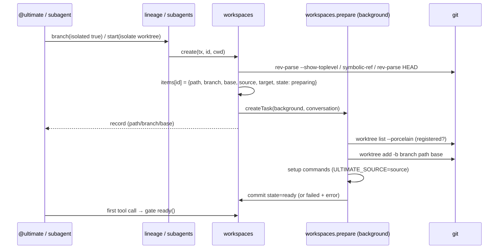
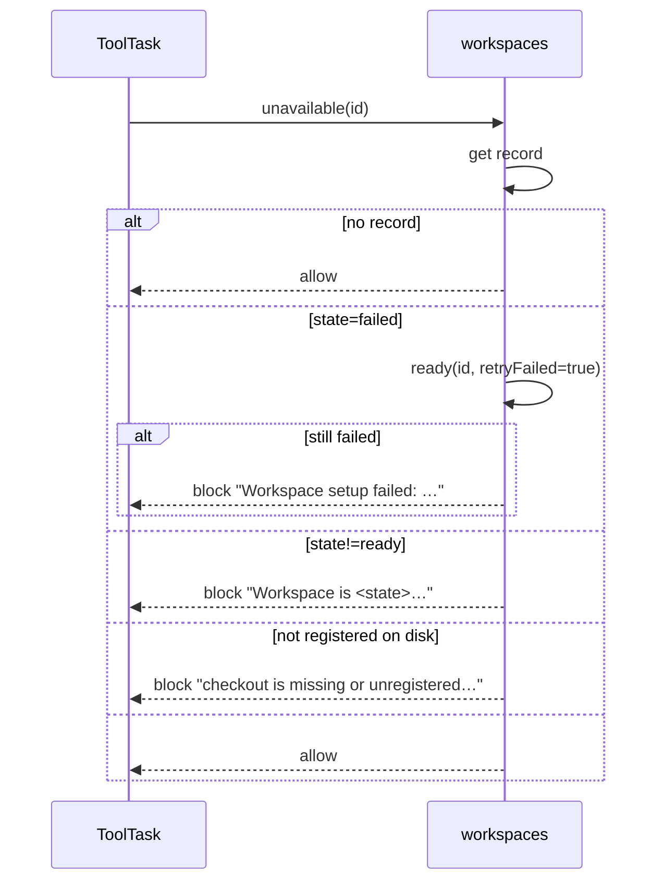
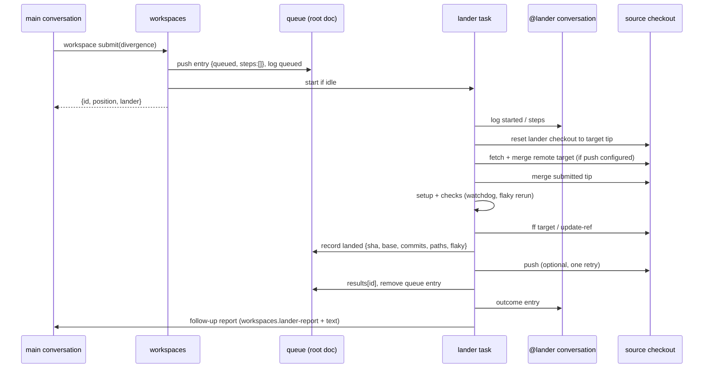

# 50 · Ultimate Worktree 管理机制与复刻 Spec

| 字段     | 值                                                                                                                                                                                                                                            |
| -------- | --------------------------------------------------------------------------------------------------------------------------------------------------------------------------------------------------------------------------------------------- |
| 文档 ID  | AD-50                                                                                                                                                                                                                                         |
| 状态     | final                                                                                                                                                                                                                                         |
| 版本     | 1.0                                                                                                                                                                                                                                           |
| 证据基线 | `3f7b7bec2d4713c036d371870b0bea65a9acb8a2`（2026-10-27，`dev/lxy`）                                                                                                                                                                           |
| 前置依赖 | [`20-subagent-orchestration-spec.md`](../subagent-orchestration/20-subagent-orchestration-spec.md) §3.6（隔离区）、[`docs/worktrees.md`](../../docs/worktrees.md)、[`extensions/workspaces/README.md`](../../extensions/workspaces/README.md) |
| 目标读者 | 要复刻 Ultimate worktree 机制、或实现兼容 lander 协议的 AI agent / 工程师                                                                                                                                                                     |
| 语言     | 中文叙述 + 英文契约标识符；类型/字段/错误码保持源码原名                                                                                                                                                                                       |

> **复刻者 10 分钟摘要**
>
> 1. 一个 conversation 最多一条 workspace 记录；路径 `<home>/worktrees/<conversationId>`，分支 `ultimate/<home-hash6>-<conversationId>`，base 是创建时源检出的 `HEAD`。
> 2. 创建是同步写记录、异步跑持久任务：`workspaces.prepare` 先 `git worktree add`，再跑项目 setup 命令，成功才把 `state` 置为 `ready`。
> 3. 每个工具调用前都有门禁：记录不是 `ready`、checkout 不在盘上、或未被 `git worktree list` 登记，工具被 block 并返回原因；下一次工具调用自动重试失败的 setup。
> 4. 两条落地路径：同步 `workspace land` 只做 `git merge --ff-only`，不 rebase、不 push；异步 `workspace submit` 进每源一条的队列，由该源的 `@lander` 常驻会话处理。
> 5. 每个源检出只有一个 live lander task；它 reset 自己的 detached checkout、fetch/merge 远端、merge 提交、跑 setup、跑检查、校验集成树未变、ff 目标分支、记录 landed、push、回报。
> 6. 检查按顺序执行，数组是一组并发；每条检查有 2 分钟无输出 / 10 分钟总时限，失败重跑一次，第二次仍失败才交给人/模型；超时按 failed 记录，`workspaces.check` 事件标 `timeout`。
> 7. 失败只给模型一次机会：`onFailure: diagnose` 只解释不改；`fix` 必须留下干净、已完成 merge、基于失败提交的新 commit，随后所有检查重跑。
> 8. 所有写操作按 source 串行；land、lander、release 共用同一把进程内队列；跨进程没有锁（边界）。
> 9. `landed` 在 push 之前就持久化到 queue entry：崩溃后新的 lander task 不再 merge/check，只 push 并报告原 landing。
> 10. 回收只删除干净、已落地、空闲的 checkout；有未提交/未落地工作、子代未回收、正在运行或排队输入，一律保留并报告原因。
> 11. 移除的 checkout 不会丢分支：下次模型请求按同路径重建，未落地分支原样 checkout，新 base 取其 tip；已合并或缺失分支从 target tip 重新开始。
> 12. 可观测面固定为：`ultimate.workspaces` 文档、`workspaces.*` actions、`workspaces.landed` / `workspaces.check` 事件、`ultimate.lander` / `ultimate.lander-ask` / `workspaces.lander-report` entries、`workspace` 工具输出。

## 0. 元数据与阅读顺序

- 本文 §2 给不可变量，§3 给架构，§4 给数据契约，§5 给状态机，§6 给接口，§7 给算法，§8 给文件清单，§9 给实施顺序，§10 给测试，§11 给验收，§12 给失败矩阵，§13 给证据索引，§14 给外部采纳与未决问题。
- 只关心"怎么用"的读者读 §1.2、§2.1、§6.1、§7.5–§7.7；要复刻的读者按 §8 → §9 执行。
- 本文只描述**当前基线**的行为。`推断:` 标记的段落不是源码事实，实施前应验证。

**路径缩写约定**（正文为可读性使用短名，证据索引可按此展开为仓库相对路径）：

| 短名                                                                                                      | 完整路径                             |
| --------------------------------------------------------------------------------------------------------- | ------------------------------------ |
| `workspaces.ts` / `lander.ts` / `server.ts` / `setup.ts` / `paths.ts` / `types.ts` / `refs.ts` / `api.ts` | `extensions/workspaces/<name>`       |
| `subagents/server.ts` / `subagents/README.md`                                                             | `extensions/subagents/<name>`        |
| `conversations/server.ts`                                                                                 | `extensions/conversations/server.ts` |
| `sidebar/*`                                                                                               | `extensions/sidebar/*`               |
| `review/*`                                                                                                | `extensions/review/*`                |
| `info/web.tsx`                                                                                            | `extensions/info/web.tsx`            |
| `web.tsx` / `panel.tsx` / `log.tsx` / `landing.tsx` / `steps.tsx` / `data.tsx` / `ui.tsx`                 | `extensions/workspaces/<name>`       |
| `e2e/*`                                                                                                   | `test/e2e/*`                         |

## 1. 目标与非目标

### 1.1 目标

1. 让每个隔离 conversation 拥有独立、可预测、可重建的 Git checkout。
2. 让隔离 checkout 的使用对 agent 透明：工具直接在自己的 cwd 工作，不需要知道 worktree 命令。
3. 提供两条落地路径：同步快进（简单、可由 agent 直接调用）与异步 lander（合并、检查、推送、失败诊断/修复）。
4. 在多 conversation、多 worktree、崩溃/重载/并发提交下不丢工作、不重复落地、不误删。
5. 把状态、队列、进度、结果暴露成稳定契约，供侧栏、Info 面板、transcript 卡、review 使用。

### 1.2 非目标

- 不做容器/沙箱/远程执行；隔离只改变工作目录（`extensions/subagents/README.md:72`、`:90`）。
- 不做跨进程/跨机器锁；串行只在单进程内（`workspaces.ts:170-185`；`subagents/README.md:90`）。
- 不自动解决语义冲突；冲突交给 lander 模型或提交者。
- 不实现 Pi Durable 的任务/事务/文档引擎，只使用其公开契约。
- 不以 PR 为落地单位；Ultimate 的 lander 直接 ff 本地目标分支并按配置 push。

### 1.3 需求清单

| ID                 | 需求                                                                                | 验收      |
| ------------------ | ----------------------------------------------------------------------------------- | --------- |
| REQ-WM-001         | 只有具备 Git 仓库、已检出分支、至少一个 commit 的项目才能隔离                       | AC-WM-001 |
| REQ-WM-002         | 每个 conversation 最多一条 workspace 记录，重复创建必须拒绝                         | AC-WM-002 |
| REQ-WM-003         | 路径、分支名、base 必须由固定公式确定，可跨重启复现                                 | AC-WM-003 |
| REQ-WM-004         | 准备必须是持久后台任务，创建事务只写 `preparing` 记录                               | AC-WM-004 |
| REQ-WM-005         | setup 命令必须来自项目设置、在 checkout 内、经宿主 shell、带 `ULTIMATE_SOURCE` 执行 | AC-WM-005 |
| REQ-WM-006         | 每次工具调用前必须验证 ready + 磁盘存在 + Git 已登记，否则 block                    | AC-WM-006 |
| REQ-WM-007         | setup 失败必须保留输出尾并允许下一次工具调用重试                                    | AC-WM-007 |
| REQ-WM-008         | 已移除 checkout 必须能按原路径重建，并保留未落地分支                                | AC-WM-008 |
| REQ-WM-009         | 同步 land 必须校验 idle、ready、clean、分支未变、目标分支已检出                     | AC-WM-009 |
| REQ-WM-010         | 同步 land 只允许 fast-forward，不得 rebase/force/push                               | AC-WM-010 |
| REQ-WM-011         | land 结果必须包含 commits、paths、files 行数、needsRestart                          | AC-WM-011 |
| REQ-WM-012         | submit 只允许顶层 main，要求非空 divergence，clean 且分支未变                       | AC-WM-012 |
| REQ-WM-013         | submit 必须按 source 排队、同 tip 去重、立即返回位置与 lander 会话                  | AC-WM-013 |
| REQ-WM-014         | 每个 source 同时最多一个 live lander task，且运行在专属 `@lander` 常驻会话          | AC-WM-014 |
| REQ-WM-015         | lander 必须从 target tip 的干净 detached checkout 开始，并集成远端领先提交          | AC-WM-015 |
| REQ-WM-016         | 检查必须支持顺序、并发组、单检查 timeout、2 分钟无输出/10 分钟总 watchdog           | AC-WM-016 |
| REQ-WM-017         | 检查失败只重跑一次；第二次通过记 `flaky`，第二次失败才失败                          | AC-WM-017 |
| REQ-WM-018         | 落地前必须确认集成 checkout 的 HEAD 与状态在检查期间未变                            | AC-WM-018 |
| REQ-WM-019         | 目标分支只能 ff；目标被移动时最多重试 3 次                                          | AC-WM-019 |
| REQ-WM-020         | `landed` 必须在 push 前持久化；push 失败不得回滚本地 landing                        | AC-WM-020 |
| REQ-WM-021         | push 必须非强制，失败只重试一次；报告必须包含 push 状态与 restart 提示              | AC-WM-021 |
| REQ-WM-022         | 结果必须回报给提交会话，且保留最近 50 条                                            | AC-WM-022 |
| REQ-WM-023         | 冲突或两次检查失败时按 `onFailure` 诊断/修复，每次提交最多修一次                    | AC-WM-023 |
| REQ-WM-024         | deploy 必须按路径前缀触发，并经 `workspaces.handoff` 恰好一次发送                   | AC-WM-024 |
| REQ-WM-025         | release 只能删除干净、已落地、空闲的 checkout；子代保留必须连带保留祖先             | AC-WM-025 |
| REQ-WM-026         | discard 只删除 checkout，必须保留分支                                               | AC-WM-026 |
| REQ-WM-027         | 嵌套隔离必须先准备 source 祖先 checkout                                             | AC-WM-027 |
| REQ-WM-028         | 所有 Git 写操作必须按 source 串行，记录更新必须在事务内                             | AC-WM-028 |
| REQ-WM-029         | 必须暴露 `workspaces.landed`、`workspaces.check` 事件和固定 entries/actions         | AC-WM-029 |
| REQ-WM-030         | Windows 路径比较必须大小写不敏感并统一分隔符                                        | AC-WM-030 |
| REQ-WM-031         | stats/disk 必须只读、可缓存，disk 测量不得并发重复                                  | AC-WM-031 |
| REQ-WM-032         | 崩溃后必须能从 memo/记录恢复，不重复 merge/check/push                               | AC-WM-032 |
| REQ-WM-033         | lander 模型必须排除 `workspace` 工具；未显式允许时排除 `subagent`                   | AC-WM-033 |
| REQ-WM-034         | 结论已落地的 branch 在其报告 run 与子 agent 空闲后自动 conclude                     | AC-WM-034 |
| REQ-WM-035（增强） | 提供保守 GC：已合入 + 干净 + 超过 N 天 + 无未推送提交才回收，默认 dry-run           | AC-WM-035 |

## 2. 术语、不变量、边界

### 2.1 术语

| 术语                | 定义                                                                   | 唯一真相                                  |
| ------------------- | ---------------------------------------------------------------------- | ----------------------------------------- |
| workspace record    | 一条 conversation 的 worktree 记录                                     | `extensions/workspaces/types.ts:3-12`     |
| source              | 被隔离的项目主 checkout 的 realpath                                    | `lib/git.ts:27-40`                        |
| target              | source 当前检出的分支名                                                | `lib/git.ts:36`                           |
| workspace branch    | 隔离分支 `ultimate/<home-hash6>-<id>`                                  | `extensions/workspaces/workspaces.ts:939` |
| base                | 创建/重建时分支的起点 commit                                           | `types.ts:6`、`workspaces.ts:940`         |
| preparation task    | `workspaces.prepare`，创建/重建 checkout 的持久任务                    | `workspaces.ts:314-436`                   |
| lander task         | `workspaces.lander`，每源串行合并/检查/ff/push                         | `lander.ts:491-1246`                      |
| lander conversation | 每源一个 `@lander` 常驻会话，lander task 的宿主                        | `workspaces.ts:209-232`                   |
| lander checkout     | 每源一个 detached 集成 checkout，`<home>/lander/<sha256(source)[:12]>` | `lander.ts:46-86`                         |
| submit queue        | 根文档中的 `queue: QueueEntry[]`                                       | `types.ts:98-119`                         |
| kept work           | 回收判定用的 `{uncommitted, unlanded}`                                 | `workspaces.ts:92-148`                    |
| landing             | 目标分支从 `base` 移到 `sha` 的一次 ff                                 | `types.ts:33-40`                          |
| divergence          | submit 必填的"与原始请求的差异"                                        | `workspaces.ts:717-726`                   |
| release             | 释放已结束会话的干净 checkout                                          | `workspaces.ts:571-647`                   |
| recreate            | 下一次模型请求时重建 removed checkout                                  | `workspaces.ts:805-910`                   |

### 2.2 不变量

| ID         | 不变量                                                                                       | 执行点                                       | 违反症状                                  |
| ---------- | -------------------------------------------------------------------------------------------- | -------------------------------------------- | ----------------------------------------- |
| INV-WM-01  | 一个 conversation 最多一条 workspace 记录                                                    | `workspaces.ts:934`                          | 抛 `Conversation already has a workspace` |
| INV-WM-02  | 路径与分支只由 home hash + conversation id 决定                                              | `workspaces.ts:935-944`                      | 重启后路径漂移、旧记录失联                |
| INV-WM-03  | 记录只在 `ready` 时允许工具执行                                                              | `server.ts:249-257`、`workspaces.ts:784-800` | 在未准备好的目录里跑命令                  |
| INV-WM-04  | source 必须是 realpath；target 必须是符号引用分支                                            | `lib/git.ts:35-40`                           | 子目录/符号链接导致 worktree 位置错误     |
| INV-WM-05  | 每个 source 同时只有一个 live lander task                                                    | `workspaces.ts:69-73`、`:270-289`            | 两个 task 同时 merge，重复落地            |
| INV-WM-06  | queue 中同一 source 的条目按到达顺序处理                                                     | `lander.ts:496-507`、`workspaces.ts:717-783` | 后提交先落地                              |
| INV-WM-07  | landing 只 ff；绝不 rebase/force                                                             | `workspaces.ts:701`、`lander.ts:1050-1051`   | 改写历史、丢提交                          |
| INV-WM-08  | `landed` 先于 push 持久化                                                                    | `lander.ts:1066-1084`                        | push 失败后重跑重复 merge/check           |
| INV-WM-09  | 检查只跑在集成后的确切 commit 上；检查期间树不得变化                                         | `lander.ts:1020-1033`                        | 落地未经检查的 commit                     |
| INV-WM-10  | 回收绝不 force 删除已登记 checkout；有工作就保留                                             | `workspaces.ts:541`、`:614-624`              | 删除未提交修改                            |
| INV-WM-10a | 只有 Git 已移除、记录仍为 ready 的**未登记残留目录**才允许 `rm -rf`（其中只剩 ignored 文件） | `workspaces.ts:633-634`                      | 把别人的目录当残留删除                    |
| INV-WM-11  | 删除 checkout 不删除未落地分支                                                               | `workspaces.ts:973-986`、`:840-857`          | 丢提交                                    |
| INV-WM-12  | 所有 source 写操作串行                                                                       | `workspaces.ts:170-185`                      | `worktree add` 半写、ff 竞态              |
| INV-WM-13  | 记录更新与任务创建在同一事务                                                                 | `workspaces.ts:384-388`、`:858-882`          | 记录 ready 但 checkout 不存在             |
| INV-WM-14  | lander 的 cwd 永远是一个 detached checkout，不是用户分支                                     | `lander.ts:481-489`                          | 把集成中间态写进用户 checkout             |
| INV-WM-15  | 工具/模型永远看不到 `ultimate.lander` 日志正文                                               | `lander.ts:39-40`、`README.md:89-90`         | 模型被日志污染、token 浪费                |

### 2.3 边界与已知限制

1. **不是沙箱**：隔离只改 cwd；绝对路径仍可访问其它 checkout（`extensions/subagents/README.md:90`）。
2. **单进程串行**：`queues` 是 `host.resource` 的内存 Map；多进程/多实例写同一 source 没有互斥（`workspaces.ts:170`）。
3. **Git 本身是真相**：记录说 ready 不算数，必须 `worktree list` 登记且在盘上（`workspaces.ts:149-168`）。
4. **Windows 差异**：Git 输出正斜杠、记录存反斜杠，比较时统一并小写（`paths.ts:3-11`）；check 进程用 Job Object 而不是 POSIX 进程组（`lander.ts:24`、`README.md:131-136`）。
5. **不自动处理远端分叉**：lander 只 fetch+merge 领先提交；真正的分叉冲突交给模型/提交者。
6. **不保证 push 成功**：本地 landing 与 push 是两个阶段；push 失败是 `landed` + `reason`（`lander.ts:621-639`）。
7. **唯一原生入口**：创建 worktree 必须经 `lineage.branch(isolated)`、`subagents start(isolate:worktree)` 或 `workspaces.create` action；**不要**让 agent 直接 `git worktree add`，否则会绕过记录、门禁与回收，产生孤儿 checkout（调研结论：Claude Code 的 sweep 只清理自己 marker 的 worktree，`using-git-worktrees` 也要求优先原生工具）。

## 3. 架构与数据流

### 3.1 组件与职责

| 组件                         | 职责                                                               | 关键文件                                                                            |
| ---------------------------- | ------------------------------------------------------------------ | ----------------------------------------------------------------------------------- |
| `workspaces` extension       | 记录、准备、门禁、land/submit/discard/release、stats/disk、actions | `extensions/workspaces/{workspaces,server,setup,paths,refs,types}.ts`               |
| lander                       | 队列消费、merge、checks、ff、push、report、failure agent、deploy   | `extensions/workspaces/lander.ts`                                                   |
| conversations                | Release 扩展点、conclude 流程、subject/metadata                    | `extensions/conversations/{api,server}.ts`                                          |
| subagents                    | `isolate: "worktree"` 创建、`land`/`discard` 代理、child 所有权    | `extensions/subagents/server.ts`                                                    |
| messages/lineage             | `branch` 工具默认 `isolated: true`，创建 coordinator 分支          | `extensions/messages/branch.ts:69`、`extensions/lineage/server.ts:943`              |
| sidebar / info / status-line | worktree 状态可视化                                                | `extensions/sidebar/*`、`extensions/info/web.tsx`、`extensions/status-line/web.tsx` |
| review                       | 分支/未提交/范围 diff                                              | `extensions/review/*`                                                               |
| lineage                      | landing note、memory 蒸馏                                          | `extensions/lineage/server.ts`                                                      |

### 3.2 创建与准备



证据：`workspaces.ts:925-952`（create）、`:314-436`（prepare）、`server.ts:249-257`（gate）、`setup.ts:9-40`。

### 3.3 工具门禁与自愈



证据：`workspaces.ts:784-800`、`server.ts:249-257`、`workspaces.ts:805-910`。

### 3.4 submit → lander → report



证据：`workspaces.ts:717-783`、`lander.ts:491-1140`、`lander.ts:1140-1232`。

### 3.5 所有权与写权限

| 操作               | 谁可以                                                                                           | 守卫                                           |
| ------------------ | ------------------------------------------------------------------------------------------------ | ---------------------------------------------- |
| create workspace   | lineage branch（默认 isolated）、subagents start（isolate worktree）、`workspaces.create` action | 项目可隔离、id 无记录                          |
| 使用 checkout      | 该 conversation 的工具                                                                           | 门禁 ready + registered                        |
| 同步 land          | 顶层 main 的 `workspace land`；子 agent 通过 `subagent land` 由 owner 代做                       | ownerless、非 lander、idle、clean、target 未变 |
| submit             | 顶层 main 的 `workspace submit`                                                                  | ownerless、非 lander、divergence 非空、clean   |
| discard            | `workspace discard` action（用户/内部）、`subagent discard`                                      | idle、非 preparing                             |
| release            | conversations conclude 自动、workspaces service                                                  | idle、clean、landed、descendants 先释放        |
| lander 写 checkout | 只有 lander task                                                                                 | 单 live task per source                        |

证据：`server.ts:277-297`（submit/land 只允许顶层 main）、`subagents/server.ts:917-924`（land/discard）、`conversations/server.ts:183-187`（conclude → release）。

## 4. 数据契约

### 4.1 TypeScript

以下类型是跨进程/跨重启契约，复刻时必须逐字段一致（可增可选字段，不可改语义）。

```ts
type ConversationSubject = { title: string; summary?: string; feature?: string }

export type Workspace = {
  path: string
  branch: string
  base: string
  source: string
  target: string
  state: 'preparing' | 'ready' | 'failed' | 'removed'
  error?: string
  landed?: string
}

export type QueueEntry = {
  id: string // `${conversationId}-${tip.slice(0,7)}-${Date.now().toString(36)}`
  conversationId: number
  source: string
  target: string
  tip: string
  at: number // latest submitting conversation entry id (breadcrumb)
  divergence: string
  state: 'queued' | 'landing'
  subject?: ConversationSubject
  step?: string // current step text, mirrored to the card
  steps: LanderStep[]
  landed?: Landed // set before push; survives a lander crash
  agent?: 'fix' | 'diagnose' // model is working on a failure
}

export type Landed = {
  sha: string
  base: string
  commits: string[] // `git log --oneline`
  paths: string[]
  flaky: string[]
}

export type LanderCheck = {
  command: string
  result: 'passed' | 'failed' | 'flaky'
  summary?: string // last output line, ANSI stripped, ≤200 chars
}

export type LanderStep = {
  step: string
  at: number
  check?: LanderCheck
}

export type LanderOutcome = {
  outcome: 'landed' | 'failed'
  divergence?: string
  sha?: string
  base?: string
  commits?: string[]
  paths?: string[]
  flaky?: string[]
  pushed?: string // `<remote>/<target>`
  needsRestart?: boolean
  reason?: string
  output?: string // tail, ≤3000 chars
  hint?: string
  diagnosis?: string
  fixed?: string[]
}

/** `results[id]`：outcome 加上提交上下文；`workspaces.lander-report` 的 data.outcome 就是它。 */
export type LanderResult = LanderOutcome & {
  target: string
  tip: string
  lander: number
  steps: LanderStep[]
  conversationId?: number
  subject?: ConversationSubject
  at: number // 注意：EntryId，不是时间戳（见 §4.6）
  divergence: string
}

/** `workspaces.lander-report` entry 的 data。 */
export type LanderReport = {
  id: string
  outcome: LanderResult
}
```

`LanderCheck.result` 只有 `passed | failed | flaky`：**超时不是一种 check 结果**。超时的检查按 `failed` 记录，`output` 里带 `Timed out after … / Stalled: no output for …`；只有 `workspaces.check` 事件的 `result` 额外允许 `timeout`（由 `ran.timedOut` 映射）。复刻时不要给 `LanderCheck.result` 加 `timeout`，否则 UI 的 `check.result` 分支要重写。

证据：`types.ts:3-97`、`lander.ts:526-548`、`:945-1002`。

```ts
export type WorkspaceIndex = {
  items: Record<string, Workspace> // key: conversation id as string
  queue: QueueEntry[]
  landers: Record<string, number> // source -> live task id
  landerConversations: Record<string, number> // source -> conversation id
  results: Record<string, LanderResult>
}

export type WorkspaceInfo = Workspace & {
  ahead: number | null
  tip: string | null
  sourceTip: string | null
  currentBranch: string | null
  sourceBranch: string | null
}

export type WorkspaceStats = Record<Workspace['state'], number> & {
  total: number
  landed: number
  ahead: number
  fresh: number
  dirty: number
}

export type WorkspaceDisk = { bytes: number | null; real: number | null; at: number }

export type LandResult = {
  text: string
  landed?: string
  commits?: string[]
  paths?: string[]
  files?: { path: string; added: number; removed: number }[]
  needsRestart?: boolean
}

export type SubmitResult = { text: string; id: string; position: number; lander: number }
```

证据：`types.ts:98-145`。

### 4.2 文档定义

```ts
export const Workspaces = defineDoc<WorkspaceIndex>({
  kind: 'ultimate.workspaces',
  checkpointWhen: () => false,
  version: 4,
  scope: 'conversation', // root conversation holds the single index
  history: 'latest',
  fork: 'initial',
  initial: () => ({ items: {}, queue: [], landers: {}, landerConversations: {}, results: {} }),
})
```

- 记录挂在 `ROOT_CONVERSATION_ID` 上；`scope: 'conversation'` 但只在 root 使用。
- `checkpointWhen: () => false`：不做额外 checkpoint，历史只保留最新。
- `version: 4`；迁移规则见 `workspaces.ts:40-61`。
- `fork: 'initial'`：fork 出来的 branch 从空索引开始，不继承父的 worktree 记录。

### 4.3 JSON 示例

```json
{
  "items": {
    "42": {
      "path": "C:\\Users\\me\\.ultimate\\projects\\ultimate-1a2b3c4d\\worktrees\\42",
      "branch": "ultimate/1a2b3c-42",
      "base": "3f7b7bec2d4713c036d371870b0bea65a9acb8a2",
      "source": "D:\\learnspace\\git\\ultimate",
      "target": "dev/lxy",
      "state": "ready",
      "landed": "9f1c2ab3d4e5f60718293a4b5c6d7e8f90123456"
    }
  },
  "queue": [
    {
      "id": "42-9f1c2ab-ldq3k2",
      "conversationId": 42,
      "source": "D:\\learnspace\\git\\ultimate",
      "target": "dev/lxy",
      "tip": "9f1c2ab3d4e5f60718293a4b5c6d7e8f90123456",
      "at": 12877,
      "divergence": "None",
      "state": "landing",
      "step": "checking: pnpm check",
      "steps": [
        { "step": "queued", "at": 1761600000000 },
        { "step": "started", "at": 1761600001000 },
        { "step": "preparing", "at": 1761600001500 }
      ]
    }
  ],
  "landers": { "D:\\learnspace\\git\\ultimate": 991 },
  "landerConversations": { "D:\\learnspace\\git\\ultimate": 7 },
  "results": {}
}
```

```json
// workspaces.info {id:42}
{
  "path": "C:\\Users\\me\\.ultimate\\projects\\ultimate-1a2b3c4d\\worktrees\\42",
  "branch": "ultimate/1a2b3c-42",
  "base": "3f7b7bec2d4713c036d371870b0bea65a9acb8a2",
  "source": "D:\\learnspace\\git\\ultimate",
  "target": "dev/lxy",
  "state": "ready",
  "landed": "9f1c2ab3d4e5f60718293a4b5c6d7e8f90123456",
  "ahead": 3,
  "tip": "9f1c2ab3d4e5f60718293a4b5c6d7e8f90123456",
  "sourceTip": "3f7b7bec2d4713c036d371870b0bea65a9acb8a2",
  "currentBranch": "ultimate/1a2b3c-42",
  "sourceBranch": "dev/lxy"
}
```

```json
// workspaces.progress {ids:[42,43]} → KeptWork[]
[{ "id": 42, "uncommitted": 4, "unlanded": 3 }]
```

`pending`/`release` 额外可能带 `busy`/`reason`/`descendant`；`progress` 只返回 ready 且登记的 worktree，不会有 `busy`。

### 4.4 磁盘布局

| 路径                                                     | 内容                             | 依据                    |
| -------------------------------------------------------- | -------------------------------- | ----------------------- |
| `<home>/worktrees/<conversationId>`                      | 隔离 checkout                    | `workspaces.ts:935-944` |
| `<home>/lander/<sha256(source)[:12]>`                    | lander 的 detached 集成 checkout | `lander.ts:46-51`       |
| `<home>/lander-checks/<pid>-<uuid>.pid`                  | 检查进程容器记录，崩溃后 sweep   | `lander.ts:222-239`     |
| `<home>/lander-tmp/<pid>-*`                              | 检查临时目录，避免 `/tmp` 配额   | `lander.ts:240-260`     |
| `.ultimate/settings.json` 的 `isolates.worktree.setup`   | setup 命令                       | `setup.ts:15-18`        |
| `.ultimate/settings.json` 的 `lander.checks/push/deploy` | lander 配置                      | `lander.ts:336-382`     |

### 4.5 运行时契约（Pi Durable 最小面）

复刻不需要实现 Pi Durable 的全部能力，但必须提供下列语义等价物。类型名可换，行为不可省。

```ts
// 标识与上下文
type ConversationId = number
type TaskId = number
type EntryId = number
type Context = { abortSignal?: AbortSignal }
type JsonObject = Record<string, unknown>
type EventToken<T> = { kind: string }
type ApiToken<T> = { name: string }

// 文档：一个具名、可事务读写的持久 JSON 文档
type DocToken<T> = { kind: string }
function defineDoc<T>(spec: {
  kind: string
  version: number
  scope: 'conversation' | 'task'
  history: 'latest'
  fork: 'initial'
  checkpointWhen: () => boolean
  initial: () => T
  migrate?: (value: unknown, from: number) => T
}): DocToken<T>

// 事务
type Tx = {
  doc<T>(token: DocToken<T>, conversationId: ConversationId): Promise<T>
  conversation(id: ConversationId): Promise<{ id: ConversationId; owner?: { conversationId: ConversationId } } | undefined>
  createConversation(input: { ownership: Ownership }): Promise<{ id: ConversationId }>
  createTask<I, S>(definition: TaskDefinition<I, S>, input: I, options: {
    conversationId: ConversationId
    ownership: Ownership
    background?: boolean
  }): Promise<TaskId>
  task(id: TaskId): Promise<{ id: TaskId; state: { status: 'running'|'terminal'|'completing'; outcome?: { status: string; error?: { message: string } } } } | undefined>
  scanEntries(query: { conversationId: ConversationId; maxEntryId?: EntryId; minEntryId?: EntryId }, limit: number): Promise<{ items: { id: EntryId }[] }>
  scanTasks(query: { conversationId?: ConversationId; kind?: string; order?: 'ascending'|'descending' }, limit: number): Promise<{ items: { id: TaskId }[] }>
  appendEntry(kind: string, conversationId: ConversationId, input: { data: unknown }): Promise<EntryId>
}

type Ownership =
  | { kind: 'ownerless' }
  | { kind: 'conversation' }
  | { kind: 'task'; taskId: TaskId }

// 任务定义与运行时
type TaskDefinition<I, S> = {
  name: string
  version: number
  initial: () => S
  phases: Record<string, (task: { input: I; state: { checkpoint: S } }, runtime: TaskRuntime, ctx: Context) => Promise<TaskTransition>>}
  abort?: (task: { input: I }, runtime: TaskRuntime, ctx: Context) => Promise<TaskTransition>
}
type TaskRuntime = {
  conversationId: ConversationId
  signal: AbortSignal
  memo<T>(key: string, valueOrContext?: T | Context, context?: Context): Promise<T | undefined>
  commit<T>(fn: (tx: Tx) => Promise<TaskTransition>, ctx: Context): Promise<T>
  snapshot<T>(token: DocToken<T>, conversationId: ConversationId, ctx: Context): Promise<T | undefined>
  conversation(id: ConversationId, ctx: Context): Promise<ConversationHandle | undefined>
  entry(kind: string, id: EntryId, ctx: Context): Promise<{ model?: { content: { type: string; text?: string }[] }[] } | undefined>
}
type TaskTransition = { status: 'running'; checkpoint: unknown } | { status: 'terminal'; outcome: { status: 'completed'|'aborted'; result: unknown } }

// 本 spec 的两个任务输入/状态
type PreparationInput = { id: ConversationId; reset?: boolean; preserve?: boolean }
type PreparationState = { phase: 'prepare' }
type LanderInput = { source: string }
type LanderState =
  | { phase: 'next' }
  | { phase: 'land'; id: string; attempt: number; failure?: unknown }
  | { phase: 'agent'; id: string; attempt: number; failure: unknown }
  | { phase: 'report'; id: string; conversationId: ConversationId; text: string; outcome?: unknown }

type AgentChange = {
  model?: string | null
  thinkingLevel?: string
  tools?: string[]
  instructions?: string
}

// 宿主
type Host = {
  home: string
  harness(): {
    commit<T>(fn: (tx: Tx) => Promise<T>, ctx: Context): Promise<T>
    snapshot<T>(token: DocToken<T>, conversationId: ConversationId, ctx: Context): Promise<T | undefined>
    conversation(id: ConversationId, ctx: Context): Promise<ConversationHandle | undefined>
    subscribeCommits(fn: (publication: { changes: unknown[] }) => void): () => void
    resume(): void
    waitForTask(id: TaskId, ctx: Context): Promise<unknown>
  }
  resource<T>(name: string, init: () => T): T
  projectSettings(): Promise<JsonObject>
  emit<T>(tx: Tx, event: EventToken<T>, data: T): Promise<void>
  notice(message: string): void
  need<T>(api: ApiToken<T>): T
  want<T>(api: ApiToken<T>): T | undefined
}

type ConversationHandle = {
  submit(input: {
    type: 'input'
    content: string
    entry?: { kind: string; data: unknown }
    whenBusy?: 'followUp' | 'steer'
    requestId?: string
  }, ctx: Context): Promise<{ wait(ctx: Context): Promise<{ status: 'done'; type: 'input'; answer: EntryId } | { status: 'unanswered'; reason: string } | { status: string }> }>
}

// 工具 hook：返回 {block} 表示阻止本次工具调用，字符串即用户/模型可见原因
type BeforeTool = (call: unknown, api: { conversationId: ConversationId }, caller: Context) => Promise<{ block: string } | undefined>
```

**`home` 公式**（源码：`server/project.ts:121-123`、`bin/ultimate.ts:77`、`server/harness.ts:129`）：

```
home = ULTIMATE_HOME ?? <userHome>/.ultimate/projects/<basename(projectRoot)>-<sha256(projectRoot).hex.slice(0,8)>
```

- `projectRoot` 用 realpath；`home` 是项目级持久状态目录，`worktrees/`、`lander/`、`lander-checks/`、`lander-tmp/` 都在其下。
- `ROOT_CONVERSATION_ID` 是平台根会话 id（本仓库常量为 1）；所有 workspace 记录挂在它上面。
- `tx.doc` 的读取必须发生在同一事务第一次写之前（源码多处注释强调）；复刻时可用快照读 + 事务写模拟。

### 4.6 辅助函数签名

```ts
function changes(id: ConversationId, w: Workspace): Promise<KeptWork>
// uncommitted = `git status --porcelain` 的非空行数
// unlanded = `git rev-list --count target..branch target..HEAD`（含 detached HEAD）

function held(id: ConversationId, w: Workspace, registered: boolean): Promise<KeptWork>
// registered=true → changes(id,w)
// registered=false → 只数 source 里 branch 的 target..branch；目录不可读时返回 0

function registeredCheckout(w: Workspace): Promise<boolean>
// if !lstat(w.path) return false
// 在 w.path 内跑 `git worktree list --porcelain`，任一条目路径 samePath(w.path) 即 true；命令失败返回 false

function listedBySource(w: Workspace): Promise<boolean>
// 在 w.source 内跑 `git worktree list --porcelain`，找 samePath(w.path)；读取失败抛出，不返回 false

function recordedCheckout(
  id: ConversationId,
  ctx: Context,
): Promise<{ workspace: Workspace; registered: boolean } | undefined>
// presentCheckout(id) 必须 state ∈ {ready,failed,removed} 且目录存在
// registered = listedBySource(w)
// 未登记且 state != ready → undefined（可能是别人的目录）

function finishRemoval(
  id: ConversationId,
  w: Workspace,
  ctx: Context,
): Promise<KeptWork | undefined>
// 见 §7.10；成功返回 undefined，保留工作或失败返回 KeptWork（可带 reason）

function presentCheckout(id: ConversationId, ctx: Context): Promise<Workspace | undefined>
// get(id) 且 state ∈ {ready,failed,removed} 且 lstat(path) 成功
```

**`at` 语义**（必须严格区分）：

| 字段                        | 类型          | 含义                                                   |
| --------------------------- | ------------- | ------------------------------------------------------ |
| `QueueEntry.at`             | `EntryId`     | 提交时提交会话最新 entry 的 id，用作面包屑，不是时间戳 |
| `LanderStep.at`             | `number` (ms) | `Date.now()` 时间戳                                    |
| `LanderEntry.at`            | `number` (ms) | 日志写入时间；`sourceEntry` 才是提交会话的 entry id    |
| `LanderEntry.sourceEntry`   | `EntryId`     | 提交时的面包屑 entry；与 `QueueEntry.at` 相同          |
| `results[id].at`            | `EntryId`     | 从 `QueueEntry.at` 复制，仍是 entry id                 |
| `workspaces.landed` 的 `at` | `EntryId`     | 同上，用于 `#<from>/<at>` 深链                         |

复刻时不要把 `results[id].at` 当时间戳排序；排序/年龄用 `steps.at(-1)?.at` 或额外记录 `submittedAt`。**这是基线源码的已知不一致，§12 列为 `NOTE-WM-01`。**

## 5. 状态机

### 5.1 Workspace 记录

| 当前状态    | 事件           | 守卫                                | 下一状态    | 副作用                                                       |
| ----------- | -------------- | ----------------------------------- | ----------- | ------------------------------------------------------------ |
| （无）      | `create`       | 项目可隔离、id 无记录               | `preparing` | 写记录、配置 cwd、创建 prepare task                          |
| `preparing` | prepare 成功   | checkout 已登记 + setup 全部成功    | `ready`     | 清除 `error`、`landed`                                       |
| `preparing` | prepare 失败   | 任意命令失败                        | `failed`    | `error` = 输出尾 ≤4000 chars；回滚本次新建的 checkout/branch |
| `preparing` | task abort     | 用户/宿主取消                       | `failed`    | `error = "Workspace preparation aborted"`                    |
| `failed`    | 下一次工具调用 | `retryFailed` 且路径不存在          | `preparing` | 重新创建 prepare task                                        |
| `ready`     | `discard`      | idle、非 preparing                  | `removed`   | `git worktree remove`，保留 branch                           |
| `ready`     | release 成功   | clean、landed、无 descendants、idle | `removed`   | 删除 checkout + 已合并分支                                   |
| `ready`     | 文件夹消失     | 下一次 `ready()`/release            | `removed`   | 记录修正，等待重建                                           |
| `removed`   | 下一次模型请求 | source 祖先 ready                   | `preparing` | 按原路径重建；未落地分支保留 tip 作 base                     |
| `failed`    | release        | 不属于本记录                        | 不变        | 不动别人的文件夹                                             |

非法迁移示例：`removed → ready`（必须经过 preparing）；`failed → ready`（必须经 prepare）；`preparing → removed`（release 只报告 busy）。

证据：`workspaces.ts:314-436`、`:571-647`、`:805-910`、`:973-986`。

### 5.2 Preparation task

| 当前阶段  | 事件                                 | 守卫                   | 下一阶段                 | 副作用                            |
| --------- | ------------------------------------ | ---------------------- | ------------------------ | --------------------------------- |
| `prepare` | 开始                                 | 记录存在               | `prepare`                | 进入 per-source 串行              |
| `prepare` | 已登记同路径同分支                   | `resumed` memo 为 true | `prepare`                | 继续 setup                        |
| `prepare` | 已登记但不同分支/非 resumed          | —                      | 失败                     | `Workspace path already exists`   |
| `prepare` | 路径存在但未登记                     | —                      | 失败                     | `Workspace path already exists`   |
| `prepare` | 分支存在且 `reset`/`preserve` 不满足 | —                      | 失败                     | `Workspace branch already exists` |
| `prepare` | `worktree add` 成功                  | —                      | `prepare`                | `started=true`，继续 setup        |
| `prepare` | setup 成功                           | —                      | completed                | 提交 `state=ready`                |
| `prepare` | setup 失败                           | —                      | completed（记录 failed） | 回滚、提交 `state=failed`         |
| `prepare` | abort                                | —                      | aborted                  | 提交 `state=failed`               |

### 5.3 QueueEntry

| 当前状态  | 事件               | 守卫                                     | 下一状态   | 副作用                                 |
| --------- | ------------------ | ---------------------------------------- | ---------- | -------------------------------------- |
| （无）    | submit             | 顶层 main、ready、clean、divergence 非空 | `queued`   | 入队、日志 `queued`、必要时启动 lander |
| `queued`  | lander 取队首      | task live                                | `landing`  | `step=started`，日志 `started`         |
| `landing` | merge/check 成功   | 集成树未变                               | `landing`  | 记录 `landed`，push，report            |
| `landing` | 冲突/两次失败      | lander 定义 `onFailure` 存在             | `landing`  | `agent=fix                             | diagnose`，日志 `fixing | diagnosing` |
| `landing` | 结束               | —                                        | 移出 queue | 写 `results[id]`，日志 outcome，回报   |
| `queued`  | lander abort       | —                                        | `queued`   | 清 `step/agent`，等待 resume           |
| `queued`  | 重复 submit 同 tip | 已有 queued 同 conversation              | 不变       | 复用 entry，返回原 position            |

### 5.4 Lander task

| 阶段     | 事件               | 守卫        | 下一阶段     | 副作用                                    |
| -------- | ------------------ | ----------- | ------------ | ----------------------------------------- |
| `next`   | 队列非空           | —           | `land`       | 取队首，`state=landing`，日志 `started`   |
| `next`   | 队列空             | —           | terminal     | 删除 `landers[source]`                    |
| `land`   | 检查点带 `failure` | —           | `agent`/报告 | 处理模型结果                              |
| `land`   | 准备成功           | 集成树未变  | `land`       | 记录 `prepared` memo                      |
| `land`   | ff 成功            | —           | `report`     | 记录 `landed`，push                       |
| `land`   | 目标移动           | attempt < 3 | `land`       | attempt+1                                 |
| `land`   | 失败               | —           | `report`     | 写 outcome                                |
| `agent`  | 模型 run settle    | —           | `land`       | 记录 answer/unfinished                    |
| `report` | 回报提交者         | —           | `next`       | 发送 follow-up + entry                    |
| `abort`  | —                  | —           | terminal     | 队列恢复 `queued`，删除 `landers[source]` |

证据：`lander.ts:491-507`、`:1085-1139`、`:1140-1246`。

## 6. 接口契约

### 6.1 `workspace` 工具

```ts
parameters: {
  action: 'status' | 'submit' | 'land'
  divergence?: string   // submit 必填
}
```

- `status` → `{ conversationId, workspace: WorkspaceInfo | null }`。
- `submit` → `SubmitResult`；要求调用者是顶层 main（`row.owner` 为空），且不是 lander 会话。
- `land` → `LandResult`；同样只允许顶层 main。
- 工具描述明确要求"提交干净、已验证的 tip；submit 需要 divergence；land 只 ff，不 rebase/push"。

证据：`server.ts:259-299`。

### 6.2 `WorkspacesApi`（扩展点）

| 方法       | 签名                                  | 语义                                            |
| ---------- | ------------------------------------- | ----------------------------------------------- |
| `get`      | `(id, ctx) => Workspace \| undefined` | 读记录                                          |
| `create`   | `(tx, id, cwd) => Workspace`          | 在事务内创建记录 + prepare task；不可隔离时抛错 |
| `land`     | `(id, ctx) => LandResult`             | 同步 ff                                         |
| `discard`  | `(id, ctx) => {text}`                 | 删除 checkout，保留分支                         |
| `release`  | `(ids, ctx, signal?) => KeptWork[]`   | 批量释放，返回保留项                            |
| `git`      | `typeof git`                          | 复用 Git 执行器                                 |
| `doc`      | `typeof Workspaces`                   | 事务内读索引                                    |
| `setupGit` | `() => Promise<void>`                 | 空目录 `git init` + 空首提交                    |

证据：`api.ts:12-31`。

### 6.3 Actions

| Action                 | 输入                      | 输出                    | 说明                                                  |
| ---------------------- | ------------------------- | ----------------------- | ----------------------------------------------------- |
| `workspaces.info`      | `{id}`                    | `WorkspaceInfo \| null` | 记录 + ahead/tip/sourceTip/currentBranch/sourceBranch |
| `workspaces.progress`  | `{ids: number[]}`（≤100） | `KeptWork[]`            | 侧栏 in-flight 行；只 ready 且 registered             |
| `workspaces.pending`   | `{ids: number[]}`         | `KeptWork[]`            | 结论前警告；含传递子代                                |
| `workspaces.stats`     | `null`                    | `WorkspaceStats`        | 面板统计                                              |
| `workspaces.disk`      | `null`                    | `WorkspaceDisk`         | `du` + btrfs，缓存 60s                                |
| `workspaces.isolation` | `null`                    | `{reason?, empty?}`     | 能否隔离；能则确保 lander 已 stand                    |
| `workspaces.github`    | `null`                    | `string \| null`        | `github.com/<owner>/<repo>`                           |
| `workspaces.create`    | `{cwd?, title?}`          | `{id}`                  | 创建 ownerless conversation + workspace               |
| `workspaces.discard`   | `{id}`                    | `{text}`                | 显式丢弃                                              |
| `workspaces.setupGit`  | `null`                    | `{}`                    | 用户动作：空目录初始化                                |

证据：`refs.ts:14-35`、`server.ts:63-139`。

### 6.4 事件与 entries

| 名称                            | 类型  | 触发点                              | 字段                                                                                                                                              |
| ------------------------------- | ----- | ----------------------------------- | ------------------------------------------------------------------------------------------------------------------------------------------------- |
| `workspaces.landed`             | event | landing 记录提交时（push 失败也算） | `submission, conversationId, at, sha, base, target, lander, divergence, title, summary?, feature?, commits[≤10], commitCount, paths[≤8], pushed?` |
| `workspaces.check`              | event | 每次检查运行（含重跑）              | `submission, command, result: passed\|failed\|flaky\|timeout, ms`                                                                                 |
| `ultimate.lander`               | entry | lander 每个步骤/检查/结果           | `submission, conversationId, tip, target, at, sourceEntry?, step?, check?, subject?, outcome...`                                                  |
| `ultimate.lander-ask`           | entry | 失败交给模型时                      | `submission, conversationId, tip, target, at, mode, reason`                                                                                       |
| `workspaces.lander-report`      | entry | 回报提交者                          | `{id, outcome}`，渲染为 LandingCard                                                                                                               |
| `lineage.note`（source=lander） | entry | landing note 到树根                 | `from, at, divergence, sha, base, target, title, summary, feature, commits, paths, more, pushed, abstract?`                                       |

证据：`refs.ts:37-76`、`types.ts:76-97`、`lander.ts:550-607`、`web.tsx:10-122`。

事件消费者（不要写错）：`SubmissionLanded` 由 lineage 消费生成 landing note（`lineage/server.ts:1443,1455`）；`CheckRan` 由 activity/automations 消费，**lineage 不监听它**。`ultimate.lander` entry 不进入任何模型上下文（`lander.ts:39-40`）。

### 6.5 子 agent 集成

- 定义 frontmatter `isolate: none | worktree`；默认 `none`，内置 `worker`/`designer` 为 `worktree`（`subagents/README.md:17`、`:58`）。
- `subagent start { isolate: "worktree" }` 覆盖定义；创建 child 后在**同一事务**里 `workspaces.create(tx, child.id, parent.cwd ?? projectRoot)`，并追加 instructions：只在该 path/branch 工作、提交、不 push、不碰其它 checkout（`subagents/server.ts:956-1026`）。
- 父有未提交修改时，提示"not in the worktree"（`:958-962`）。
- `subagent land {id}` / `discard {id}` 直接代理 `workspaces.land/discard`，用 memo `workspace-operation` 防重放（`:917-924`）。
- 子 agent 的 `workspace` 工具仍可用，但 `workspace submit/land` 因 owner 非空被拒绝（`server.ts:283-293`）。
- **未来增强（ADAPT-WM-007）**：`workspace handoff` 不在本期；语义与前置条件见 §7.14。不要把它实现成"复制目录"，那会破坏"同一分支只能在一个 worktree"的 Git 约束。

### 6.6 设置

```json
{
  "isolates": { "worktree": { "setup": ["pnpm install --frozen-lockfile --prefer-offline"] } },
  "lander": {
    "checks": ["pnpm check", [{ "command": "pnpm test", "timeout": 180 }, "pnpm test:e2e"]],
    "push": "origin",
    "deploy": { "agent": "cloudflare", "paths": ["src/", "wrangler.json"] }
  }
}
```

- `setup` 必须是字符串数组；每条 120s 超时、1MiB 输出、`SIGKILL`（`setup.ts:15-40`）。
- **增强（ADAPT-WM-002）**：复刻版可在 `setup` 之外增加两个可选配置：`copy`（从 source 复制 `.env`、本地配置等，目标不存在才复制）与 `cache`（依赖目录的 CoW/硬链接缓存，Unix 优先，Windows 退回复制）。两者都必须可提交到仓库、跨平台，且默认不开启；Ultimate 基线只有 `setup` 命令。
- `checks` 必须是 check 或 check 组；check 是字符串或 `{command, timeout>0}`（`lander.ts:327-355`）。
- `checks: []`（缺省）表示**没有检查**，lander 直接进入 ff；空组 `[[]]` 是非法配置，必须抛错而不是静默跳过。
- `timeout` 单位是**秒**，只影响该条检查；组内每条命令各有自己的 timeout，组的并发不共享计时器。
- `push` 是远端名；`deploy.agent` 必须是常驻 agent，`paths` 是非空前缀（非 glob）（`lander.ts:356-382`）。

### 6.7 错误码

| 错误码                        | 触发                                     | 可重试               | 用户可见文案（建议）                                                                         |
| ----------------------------- | ---------------------------------------- | -------------------- | -------------------------------------------------------------------------------------------- |
| `E_WM_NO_REPO`                | `isolatable` 找不到 toplevel             | 否，需初始化         | `Isolation needs a Git repository`                                                           |
| `E_WM_NO_BRANCH`              | HEAD 非符号引用                          | 否，需检出分支       | `Isolation needs a checked-out branch`                                                       |
| `E_WM_NO_COMMIT`              | HEAD 不存在                              | 否，需首提交         | `Isolation needs a first commit`                                                             |
| `E_WM_DUPLICATE`              | 同 conversation 已有记录                 | 否                   | `Conversation already has a workspace`                                                       |
| `E_WM_PATH_EXISTS`            | 路径被占用/半创建                        | 人工清理后可         | `Workspace path already exists: <path>`                                                      |
| `E_WM_BRANCH_EXISTS`          | 分支存在但不可复用                       | 人工处理后           | `Workspace branch already exists: <branch>`                                                  |
| `E_WM_SETUP`                  | setup 命令非零退出/超时                  | 是（下一次工具调用） | `Workspace setup failed: <cmd>\n<tail>`                                                      |
| `E_WM_PREP_ABORTED`           | prepare task 被取消                      | 是                   | `Workspace preparation aborted`                                                              |
| `E_WM_NOT_READY`              | 状态非 ready                             | 视状态               | `Workspace is <state>: <error>`                                                              |
| `E_WM_NOT_REGISTERED`         | 路径不存在/未登记                        | 下一次请求重建       | `Workspace checkout is missing or unregistered: <path>`                                      |
| `E_WM_DIRTY`                  | land/submit 时 `status --porcelain` 非空 | 是，提交/清理后      | `Worktree is dirty:\n<status>`                                                               |
| `E_WM_TARGET_MOVED`           | target 非 base 且非 tip 祖先             | 是，先更新           | `Target moved or diverged; update the workspace onto <target> and verify again`              |
| `E_WM_BRANCH_CHANGED`         | checkout 不在记录分支                    | 是，切回             | `Workspace branch changed`                                                                   |
| `E_WM_TARGET_NOT_CHECKED_OUT` | source 不在 target 分支                  | 是，切回             | `Target branch changed; check out <target> first`                                            |
| `E_WM_NOT_MAIN`               | 子 agent/lander 调 submit/land           | 否                   | `Only a top-level main conversation can <action> its own workspace`                          |
| `E_WM_DIVERGENCE`             | submit 的 divergence 为空                | 是                   | `Submitting requires divergence: describe changes from the original request, or say 'None'.` |
| `E_WM_BUSY`                   | 会话 running/有 queued input             | 是                   | `Conversation is running; wait or stop it before landing or removal`                         |
| `E_WM_MERGE_CONFLICT`         | lander merge 冲突                        | 模型/人工            | `it conflicts with <target> in:\n<paths>`                                                    |
| `E_WM_CHECK_FAILED`           | 检查两次失败                             | 人工/模型            | `check failed twice: <cmd>`                                                                  |
| `E_WM_CHECK_TIMEOUT`          | watchdog 停止                            | 人工/模型            | `Timed out after <n> / Stalled: no output for <n>`                                           |
| `E_WM_INTEGRITY`              | 检查期间集成树变了                       | 是，重新提交         | `the integration checkout changed during checks`                                             |
| `E_WM_FF_REFUSED`             | 目标 checkout 拒绝 ff                    | 人工处理             | `the checkout of <target> refused the fast-forward to <sha>`                                 |
| `E_WM_TARGET_MOVING`          | 3 次仍移动                               | 是                   | `<target> kept moving during 3 attempts`                                                     |
| `E_WM_PUSH`                   | push 被拒/失败                           | 一次自动重试         | `Push failed: <reason>`                                                                      |
| `E_WM_RELEASE_BUSY`           | 运行/排队输入                            | 是                   | `Conversation is running; wait or stop it before removal`                                    |
| `E_WM_RELEASE_DESCENDANT`     | 子代仍有工作                             | 先释放子代           | `descendant: <id>`                                                                           |
| `E_WM_REMOVAL`                | 删除事务失败                             | 视原因               | `Workspace path is not a registered checkout: <path>`                                        |
| `E_WM_LANDER_OWNS`            | lander 正在处理该源                      | 是，等 idle          | `The lander is landing #<id>; ask again when it is idle`                                     |

## 7. 算法与伪代码

> 约定：`tx` 是 Pi Durable 事务；`commit(fn)` 里先读表再写表；`memo(key, value)` 是 first-writer-wins 的持久检查点；`serial(source, fn)` 是进程内 per-source 串行队列。

### 7.1 `create(tx, id, cwd)`

```
1. 若 workspaces 扩展未启用 → throw "Enable workspaces to create an isolated conversation"
2. checkout = isolatable(cwd)
3. 若 checkout 含 reason → throw reason
4. {source, target} = checkout
5. index = tx.doc(Workspaces, ROOT)
6. 若 index.items[id] 存在 → throw E_WM_DUPLICATE
7. mkdir(<home>/worktrees, recursive)
8. parent = realpath(<home>/worktrees)
9. record = {
     path: join(parent, String(id)),
     branch: `ultimate/${sha256(home).hex.slice(0,6)}-${id}`,
     base: git(source, rev-parse HEAD),
     source, target, state: 'preparing'
   }
10. index.items[id] = record
11. configure(tx, id, { cwd: record.path })
12. tx.createTask(Preparation, {id}, { conversationId: id, ownership: { kind: 'conversation' }, background: true })
13. return record
```

要点：`create` 不执行任何 Git 写操作，只读 `rev-parse`；`worktree add` 在后台任务里，避免阻塞创建事务。**`create` 只写信道记录，不创建 conversation**：`workspaces.create` action 先 `tx.createConversation({ownership:{kind:'ownerless'}})`，再在同一个 `tx` 里调用 `create`；`subagents` 则在 child conversation 创建后、同一事务里调用。复刻时不要把两件事混在一个函数里。

**可选增强（ADAPT-WM-010）**：创建参数可增加 `baseMode: 'head' | 'fresh'`，默认 `head`（基线行为：`rev-parse HEAD`）；`fresh` 表示先 `git fetch origin` 再取 `origin/HEAD`，用于"从干净远端开始"。解析后的 `baseSha` 必须写进记录，不能只存 `baseMode`；从任意分支起步仍直接传 `ref`，不要把它做成第三个枚举。

### 7.2 Preparation task

```
prepare(task, runtime):
  record = get(task.input.id)
  created = false
  try:
    serial(record.source):
      entries = git(source, worktree, list, --porcelain).split("\n\n")
      registered = entries.find(e => samePath(worktreePath(e), record.path))
      resumed = memo('started') == true
      if registered:
        if !resumed or !entry.includes(`branch refs/heads/${record.branch}`):
          throw E_WM_PATH_EXISTS
      else:
        if lstat(record.path) exists: throw E_WM_PATH_EXISTS
        if git(source, branch, --list, record.branch):
          if !task.input.reset and (!resumed or branchTip != record.base):
            throw E_WM_BRANCH_EXISTS
          if !task.input.reset: git(source, branch, -D, record.branch)
        memo('started', true)
        created = true
        if task.input.preserve:
          git(source, worktree, add, record.path, record.branch)
        else if task.input.reset:
          git(source, worktree, add, -B, record.branch, record.path, record.base)
        else:
          git(source, worktree, add, -b, record.branch, record.path, record.base)
    setup(record.source, record.path, projectSettings, signal)
    commit: items[id].state = 'ready'; clear error/landed; outcome completed
  catch error:
    if signal.aborted: throw
    serial(source):
      // 只回滚本任务创建且仍登记为同分支的 checkout
      if created:
        if registered: git(source, worktree, remove, record.path) (best effort)
        if !preserve and branchTip == record.base: git(source, branch, -D, branch) (best effort)
    commit: items[id].state = 'failed'; items[id].error = tail(error, 4000)
```

不变量：

- `resumed` 防止重放时把已存在的同分支 checkout 当成冲突。
- `preserve` 用于重建未落地分支：`worktree add path branch` 直接 checkout 原分支，`base` 已是分支 tip。
- 回滚只删"本次创建的、仍是同分支的" checkout；不碰别人的目录。

### 7.3 `ready(id)`：重建与父级递归

```
ready(id, retryFailed=false):
  record = get(id); if !record: return
  parentEntry = Object.entries(index.items).find(([, w]) => w.path == record.source)  // 嵌套：source 也是某 conversation 的 worktree
  parentId = parentEntry ? Number(parentEntry[0]) : undefined
  loop:
    if parentId:
      ready(parentId)
      parent = (await get(parentId, context))!       // 重新读，父级可能在本轮变化
      if parent.state == 'failed': throw "Source workspace #<parent> setup failed"
      retry = serial(record.source, recreate)
    else:
      retry = recreate()
    if retry !== true: break
  if retry is KeptWork: return retry
  if get(id).state != 'preparing': return
  resume()
  task = latest task(id, workspaces.prepare)
  waitForTask(task.id)

recreate():
  // 父级必须 ready 且目录仍在，否则重新排队
  if parent and (parent.state != 'ready' or !lstat(parent.path)): return true
  w = get(id)
  if w.state == 'ready' and !presentCheckout(id):
    commit: w.state = 'removed'
  else if w.state != 'removed' and !(retryFailed and w.state == 'failed' and !lstat(w.path)):
    return false
  remaining = finishRemoval(id, w)
  if remaining: return remaining
  exists = git(source, branch, --list, w.branch)
  preserve = exists and !isAncestor(w.branch, w.target)
  base = git(source, rev-parse, preserve ? w.branch : w.target)
  commit:
    if parent and (parent.state != 'ready' or !lstat(parent.path)): return true
    w.base = base; w.state = 'preparing'; delete w.error; delete w.landed
    createTask(Preparation, {id, reset: true, preserve}, background)
    return false
```

### 7.4 工具门禁 `unavailable(id)`

```
w = get(id)
if !w: return undefined                     // 没有 worktree 的 conversation 正常使用共享 checkout
if w.state == 'failed':
  kept = ready(id, retryFailed=true)
  if kept: return "Workspace setup failed and its checkout keeps changes: <reason>"
  w = get(id)
  if w.state == 'failed': return "Workspace setup failed: <error>; fix the cause, then call a tool again to retry the setup"
if w.state != 'ready':
  return "Workspace is <state>: <error ?? 'checkout is not ready; send a new input to retry'>"
if !registeredCheckout(w):
  return "Workspace checkout is missing or unregistered: <path>[; <error>]"
return undefined
```

`registeredCheckout` 必须在 **checkout 自己**里跑 `git worktree list --porcelain` 并找到同路径条目；Git 无法检查时返回 false，不能猜。checkout 目录不存在时直接返回 false（不执行 Git）。

### 7.5 同步 `land(id, own)`

```
record = get(id); if !record: throw "Conversation has no workspace"
serial(record.source):
  w = get(id)
  await idle(id, own)                       // 非 own 时检查 run/inbox
  if w.state != 'ready': throw E_WM_NOT_READY
  dirty = git(w.path, status, --porcelain)
  if dirty: throw E_WM_DIRTY
  if git(source, symbolic-ref --short HEAD) != w.target: throw E_WM_TARGET_NOT_CHECKED_OUT
  if git(w.path, symbolic-ref --short HEAD) != w.branch: throw E_WM_BRANCH_CHANGED
  tip = git(w.path, rev-parse HEAD)
  head = git(source, rev-parse HEAD)
  integrated = isAncestor(tip, head)
  if integrated: return {text:'Nothing to land.', landed:tip, commits:[], paths:[], files:[]}
  if !isAncestor(head, tip): throw E_WM_TARGET_MOVED
  commits = git(w.path, log, --oneline, head..tip)
  files = git(w.path, diff, --numstat, --no-renames, head, tip)
  needsRestart = realpath(source)==realpath(ultimateRoot) and files.some(p => /^(server|shared)\//)
  git(source, merge, --ff-only, tip)
  commit: items[id].landed = tip
  return {text, landed:tip, commits, paths, files, needsRestart?}
```

`--ff-only` 是唯一允许的合并方式；`git merge --ff-only` 在 source 有无关脏文件时仍可成功，只有真正重叠才拒绝。

`idle(id, own)` 的语义：

```
busy(id):
  if LiveDoc(id).run exists: return "Conversation is running; wait or stop it before landing or removal"
  if InboxDoc(id).items.length > 0: return "Conversation has queued input; wait or cancel it first"
  return undefined

idle(id, own=false):
  if !own and busy(id): throw busy(id)
```

- `own=true` 只用于 `workspace land` 由会话自己发起：它已经在自己的 run 里，不应因为自己 running 而拒绝；但仍要检查 clean/ready。
- `release` 永远用 `own=false`（外部回收），所以 running/queued 一律保留。

### 7.6 `submit(id, divergence)`

```
1. divergence = trim(divergence); 若为空 → throw E_WM_DIVERGENCE
2. w = get(id); if !w → throw "Conversation has no workspace"
3. if w.state != 'ready' → throw E_WM_NOT_READY
4. if git(w.path, status, --porcelain) → throw E_WM_DIRTY
5. if git(w.path, symbolic-ref --short HEAD) != w.branch → throw E_WM_BRANCH_CHANGED
6. tip = git(w.path, rev-parse HEAD)
7. landerPath = landerPath(home, w.source)
8. {change} = landerAgent(host)
9. subject = conversations.subject(id)
10. commit:
    a. row = tx.conversation(id); if !row or row.owner → throw E_WM_NOT_MAIN
    b. at = 最新 entry id; 若 undefined → throw "Submitting requires a conversation entry for its breadcrumb"
    c. index = tx.doc(Workspaces, ROOT)
    d. stopped = landerIdle(tx, index, w.source)
    e. lander = ensureLander(tx, index, w.source, w.target, landerPath)
    f. queued = index.queue.find(q => q.conversationId==id && q.tip==tip && q.state=='queued')
    g. entry = queued ?? { id:`${id}-${tip.slice(0,7)}-${Date.now().toString(36)}`, ... state:'queued', steps:[] }
    h. configure(tx, lander, change)
    i. if !queued: log(queued); index.queue.push(entry)
    j. if stopped: startLander(tx, index, source)
    k. position = index.queue.filter(q => q.source==source).findIndex(q => q.id==entry.id) + 1
    l. return {id, position, lander, text}
11. host.harness().resume()
12. return result
```

去重语义：同一 conversation、同一 tip、仍在 `queued` 的重复 submit 复用原 entry，不重复排队；`landing` 中的同 tip 不算重复，会再排一条（当前实现）。

### 7.7 Lander `land` 阶段

#### 7.7.0 Lander 会话与 agent

- **会话**：每个 `source` 一个 `@lander` conversation，`title='@lander'`、`label='lander'`、`standing=true`（永不 conclude）、`automaticSummaries=false`、cwd 是 §7.7 的 lander checkout。`ensureLander` 幂等：已有记录且会话存在则复用，否则创建 ownerless 会话并写回 `landerConversations[source]`（`workspaces.ts:209-232`）。
- **agent 配置**：读取有效 `lander` 定义（builtin `agents/lander.md`，可被 `~/.ultimate/agents/` 与项目 `.ultimate/agents/` 覆盖/叠加）。定义提供 `model`、`thinking`、`tools`、`instructions`、`onFailure: diagnose|fix`（默认 `diagnose`）。无定义时只继承主会话模型，`onFailure` 为空，失败不交给模型（`lander.ts:175-199`）。
  签名固定为 `landerAgent(host, ctx): Promise<{ onFailure?: 'fix'|'diagnose'; change: AgentChange }>`；`change` 直接传给 `configure(tx, landerConversationId, change)`。复刻时不要直接把定义文件塞进 prompt；先转成 `AgentChange`，否则模型路由/工具裁剪会丢。
- **工具排除**：始终排除 `workspace`；定义没有显式 `subagent` 时再排除 `subagent` 与 `subagents` 扩展（`lander.ts:191-197`）。这是为了不让 lander 提交自己的 workspace、也不让它在 landing 中再开子 agent。
- **prompt section**：`lander_state` 只出现在 lander 会话，列出该 source 的 queue（id、#N、tip、state、step）与最近 8 条 results（outcome、sha、pushed、reason、fixed）（`server.ts:300-327`）。
- **失败 prompt**：`failurePrompt({id, reason, output, integration, state, mode})`（`lander.ts:448-472`）；`fix` 模式要求"最小改动、Conventional Commits、保持 checkout 干净、绝不 push/碰其它 checkout、所有检查重跑"；`diagnose` 要求"只解释、不改动"。
- **配置时机**：每次 submit 前、每次失败交给模型前都 `configure(tx, lander, change)`；定义编辑后下一次失败即生效（`workspaces.ts:765`、`lander.ts:708-709`）。

复刻者最小实现：一个 standing 会话 + 一个 agent 定义 + 上述排除规则 + 一个 `lander_state` section。不要给 lander 加 `workspace`/`subagent` 工具，否则会绕过队列与检查门。

#### 7.7.1 算法

```
checkout(source, tip):
  path = landerCheckout(home, source, tip)   // 未登记则 rm + prune + worktree add --detach
  git(path, reset, --hard, -q)
  git(path, checkout, -q, --detach, --force, tip)
  git(path, clean, -fdq)
  rematerializeLf(path)
  return path

land:
  settings = landerSettings()
  if checkpoint.failure: return answered(checkpoint.failure)
  // 已 ff 但未 push 的崩溃恢复
  if entry.landed and attempt==1 and !pushRetried and contains(source, entry.landed.sha, refs/heads/target):
    return landedReport(settings, entry.landed, entry.landed.sha)
  prepared = memo(`prepared:${id}:${attempt}`)
  if !prepared:
    merged = memo(`merged:${id}:${attempt}`)
    path = checkout(source, merged?.sha ?? target tip)
    if !merged:
      step('preparing')
      base = rev-parse HEAD
      if fixed: merge(fixed.head, "Merge the lander's fix ...") or return
      if settings.push and ls-remote(remote, refs/heads/target):
        fetch(remote, target)
        fetched = rev-parse FETCH_HEAD
        if !contains(path, fetched, HEAD):
          step('merging <remote>/<target>')
          merge(fetched, ...) or return
      step('merging')
      merge(entry.tip, "Merge <tip> from #<conv> into <target>") or return
      merged = memo(`merged:${id}:${attempt}`, {base, sha: rev-parse HEAD})
    {base} = merged
    rematerializeLf(path)
    step('setting up')
    setup(source, path, projectSettings, signal)
    flaky = []
    for [position, group] of settings.checks.entries():
      members = Array.isArray(group) ? group : [group]
      settle(command, member):
        const key = `check:${id}:${attempt}:${Array.isArray(group) ? `${position}.${member}` : position}`
        first = memo(key)
        if !first:
          step('checking: '+command)
          ran = runLanderCheck(path, command, ctx, checkPids, checkTemp, limitsFor(members[member], limits))
          result = ran.failure ? 'failed' : 'passed'
          step('checked: '+command, {command,result,summary?}, ran.failure, {ms, timedOut})
          first = memo(key, result)
        if first == 'passed': return {}
        rerun = memo(key+':rerun')
        if !rerun:
          step('rerunning: '+command)
          ran = run(...)
          if ran.failure == undefined: step('checked:'+command, {result:'flaky'}, undefined, timing)
          else: emit CheckRan(..., 'failed'|'timeout')
          rerun = memo(key+':rerun', ran.failure ? {failure} : {})
        return rerun.failure ? {failure} : {flaky:true}
      settled = Promise.allSettled(members.map((command, member) => settle(command, member)))
      results = settled.map((outcome, member) => {
        if (outcome.status == 'rejected') throw outcome.reason
        return outcome.value
      })
      failed = results.findIndex(result => result.failure !== undefined)
      if failed != -1: handOver('check failed twice: '+members[failed], results[failed].failure, 'Fix it, verify and submit again.', {base, merging: entry.tip}) and return
      flaky.push(...members.filter((_, member) => results[member].flaky))
    if rev-parse HEAD != merged.sha or status --porcelain:
      return fail('the integration checkout changed during checks', log+status, 'Submit again.')
    prepared = memo(`prepared:${id}:${attempt}`, {base, integrated: merged.sha, flaky})
  {base, integrated, flaky} = prepared
  step('fast-forwarding')
  // per-source serial, CAS
  current = rev-parse refs/heads/target
  if current == integrated: moved = false
  else if current != base: moved = true
  else:
    worktree = worktree list entry checked out target
    if worktree: git(worktree, merge, -q, --ff-only, integrated)
    else: git(source, update-ref, refs/heads/target, integrated, base)
  if refused: fail(...)
  if moved and attempt < 3: retry()
  if moved: fail('<target> kept moving during 3 attempts')
  candidate = {sha: integrated, base, commits: log base..integrated, paths: diff --name-only, flaky}
  commit: queue.landed ??= candidate; items[conv].landed = integrated
  return landedReport(settings, landed, integrated)
```

**Watchdog**（`runLanderCheck`）：

- 每个检查独占一个临时目录（`TMPDIR/TEMP/TMP` 指向它）。
- 两个计时器：`stall = 2min`（每次有输出就重置）、`total = 10min`；单检查 `timeout` 覆盖 total，并把 stall 压到不超过 total。
- 进程容器：POSIX 用 process group，Windows 用 Job Object；pid 文件写在 `<home>/lander-checks`，宿主崩溃后 `sweepChecks` 清理。
- 失败输出保留最后 3000 字符；额外收集最后 20 条 `FAIL|×|✗` 行；通过时 `summary` 取最后一条非空输出（≤200 字符）。

### 7.8 失败处理 `handOver` / `answered`

```
handOver(reason, output, hint, {base, conflict?, merging}):
  if fixed or !onFailure or !change:
    abort merge (best effort)
    return fail(reason, output, fixed ? "The lander's fix (...) did not land it either. <hint>" : hint)
  head = rev-parse HEAD
  state = conflict ? "Merging <conflict> into <target> at <head> stopped with conflicts; the merge is in progress."
                   : "HEAD <head> is the merge of <tip> (#<conv>) into <target>, set up as the checks run it."
  prompt = failurePrompt({id, reason, output, integration, state, mode})
  commit: queue.agent = mode; queue.step = mode=='fix' ? 'fixing' : 'diagnosing'; log(step)
          configure(lander conversation, change)
          checkpoint = {phase:'agent', id, attempt, failure:{mode,reason,output?,hint?,base,head,merging,prompt}}

agent:
  ask = {submission, conversationId, tip, target, at, mode, reason}
  settled = conversation.submit(
    {type:'input', content:prompt, entry:{kind:'ultimate.lander-ask', data:ask},
     whenBusy:'followUp', requestId:`lander-agent:${id}:${attempt}`}
  ).wait()
  answer = settled.status=='done' && settled.type=='input' ? textOf(assistant.model[0]) : undefined
  unfinished = settled.status=='unanswered' ? settled.reason : (settled.status!='done' ? settled.status : undefined)
  commit: delete queue.agent; checkpoint = {phase:'land', failure:{...handed, answer?, unfinished?}}

answered(handed):
  if handed.unfinished:
    reset(); return fail("the lander's model did not finish (<unfinished>)", reason+output, hint)
  if mode=='diagnose':
    reset(); return fail(reason, output, hint, diagnosis=answer)
  head = rev-parse HEAD
  inspected =
    status --porcelain ? 'left uncommitted changes'
    : MERGE_HEAD exists ? 'left the merge unfinished'
    : head == handed.head ? 'added no commits'
    : !contains(handed.head, head) or !contains(handed.merging, head) ? 'did not build on the failed merge'
    : ''
  problem = memo(`fix-verdict:${id}:${attempt}`, inspected)
  if problem: reset(); return fail(reason, output, "The lander's fix <problem>. <hint>", answer)
  commits = log --oneline --first-parent handed.head..head
  checkpoint = {phase:'land', attempt+1, fixed:{commits, head}}
```

**一次修复**：`fixed` 在 carry 中跨 attempt 传递；下一次 `handOver` 看到 `fixed` 就直接失败，不再给模型第二次机会。`diagnose` 只解释，不改 checkout；`fix` 必须留下干净、无 MERGE_HEAD、基于失败 merge 的新 commit。

### 7.9 `report` 与 deploy

```
finish(text, outcome):
  commit:
    steps = queue[id].steps
    queue = queue.filter(q => q.id != id)
    if outcome.sha: items[conversationId].landed = outcome.sha
    results[id] = {...outcome, at, divergence, target, tip, lander, steps, conversationId, subject?}
    keep newest 50 results
    log(lander conversation, entry, outcome)
    if outcome == landed: emit SubmissionLanded({...})
    checkpoint = {phase:'report', id, conversationId, outcome: results[id], text}
report:
  if outcome == landed:
    saved = results[id].steps.find(step startsWith 'deploy → ' or 'deploy warning: ')
    if saved: deployText = saved.step
    else if deploy and matching paths:
      if !handoff or !resident agent: warning notice
      else: handoff.send(from=lander, {to:'@agent', text, reply:false}, requestId=`lander-deploy:${id}`)
    log deploy step if any; refresh outcome
  submitter.submit({type:'input', content:[text,deployText].join('\n'),
    entry:{kind:'workspaces.lander-report', data:{id, outcome}}, whenBusy:'followUp',
    requestId:`lander:${id}`})
  checkpoint = {phase:'next'}
```

`requestId` 是恰好一次的键：同一 submission 的 report 只投递一次；deploy 的 sender-scoped receipt 独立于 report，崩溃重放不会重复发送。

### 7.10 `release` / `discard` / 嵌套

```
candidates(ids):
  owned = set(ids)
  parents = map(child -> owner.conversationId) for every conversation
  repeat: owned ∪= {child | parent ∈ owned}
  return ids sorted by depth descending, parents

release(ids, signal):
  kept = []
  retained = map()                    // child -> ancestor to keep
  for id of candidates.ids:
    if signal.aborted: break
    record = get(id); if !record: continue
    serial(record.source):
      if record.state == 'preparing': kept.push({id, busy:'Workspace is preparing'}); continue
      checkout = recordedCheckout(id)
      present = checkout != undefined
      registered = checkout?.registered
      item = present ? held(id, record, registered) : {id, uncommitted:0, unlanded:0}
      if retained.has(id): item.descendant = retained[id]
      reason = commit:
        if live.run: return 'Conversation is running; wait or stop it before removal'
        if inbox.items.length: return 'Conversation has queued input; wait or cancel it first'
        // 任何 records 的 source 传递指向本 checkout，也算 descendant
        if !item.uncommitted and !item.unlanded and !item.descendant: items[id].state='removed'
        else if registered and items[id].state=='removed': items[id].state='ready'
        return undefined
      if reason: item.busy = reason
      if item.uncommitted or item.unlanded or item.busy or item.descendant: kept.push(item); continue
      if !present and source missing: continue
      if present and !registered:
        // 只清理 Git 已移除、记录仍为 ready 的残留目录；它不能是另一个仓库，且不能有可报告的改动。
        if exists(join(path, '.git')): throw "Workspace path is not a registered checkout: <path>"
        if git(path, status, --porcelain).catch(() => ''): throw "Workspace path holds changes: <path>"
        rm(path, recursive, force)   // 只剩 ignored 文件
      remaining = finishRemoval(id, record)
      if remaining: kept.push(remaining)
    if kept has id: retained[every ancestor of id] = id
  return kept

finishRemoval(id, record):
  item = {id, uncommitted: 0, unlanded: 0}
  try:
    if listedBySource(record):
      item = changes(id, record)
      if item.uncommitted or item.unlanded: commit state=ready; return item
      if rev-parse HEAD(checkout) != rev-parse branch: throw "no longer checks out its recorded branch tip"
      git(source, worktree, remove, record.path)       // 绝不 force
    else if path exists: throw "Workspace path is not a registered checkout: <path>"
    if branch exists and isAncestor(branch, target): git(source, branch, -D, branch)
    return undefined
  catch error:
    state = registeredCheckout(record) ? 'ready' : 'removed'
    commit items[id].state=state; items[id].error=error
    return {...item, reason: error}
```

**discard**：`idle` → 非 preparing → 若已登记 `worktree remove` → 记录 `removed`；**不删除分支**，返回 `Discarded isolate; kept branch <branch>.` 如果路径存在但未登记，当前实现**不删除该目录**（可能是别人的），只把记录置 `removed`；复刻时不要用 `rm -rf` 清理。

### 7.11 stats / disk

```
stats:
  items = index.items.values()
  stats = {total, ready, preparing, failed, removed, landed, ahead, fresh, dirty}
  for each item in parallel:
    stats[state]++
    if state != ready: continue
    tip = rev-parse HEAD (失败 → '')
    if status --porcelain: dirty++
    if !tip or tip == base: fresh++
    else if isAncestor(tip, refs/heads/target): landed++
    else: ahead++
  return stats

disk:
  if cached.at < 60s: return cached
  if running: return running
  bytes = du -sk <home>/worktrees * 1024   (失败 → null)
  real = btrfs filesystem du -s --raw <home>/worktrees → exclusive+shared (失败 → null)
  cache {bytes, real, at}
```

### 7.12 并发与持久化规则

| 场景                             | 规则                                                                                   | 依据                                                |
| -------------------------------- | -------------------------------------------------------------------------------------- | --------------------------------------------------- |
| 两个 prepare 同 source           | 串行；先到先 add                                                                       | `workspaces.ts:326-376`                             |
| prepare 与 submit/land 同 source | 共用 `serial`；land/submit 都在队列里                                                  | `workspaces.ts:648-716`、`:170-185`                 |
| lander 与同步 land               | 共用 `serial`，ff 在锁内做 CAS                                                         | `lander.ts:1036-1064`                               |
| lander task 崩溃                 | queue 条目留在 `landing`；`resume` 找 idle source 重排 `queued`；memo 保留 merge/check | `workspaces.ts:266-289`、`lander.ts:830-1033`       |
| 扩展重载改文档版本               | 旧 task fault → 新 task 从 `entry.landed` 恢复 push/report                             | `lander.ts:830-838`、`workspaces/README.md:196-204` |
| host 崩溃时检查仍在跑            | pid 文件 + `sweepChecks` 下次 open 杀掉                                                | `lander.ts:222-239`                                 |
| 并发 release                     | 每源串行；事务内再次检查 run/inbox                                                     | `workspaces.ts:584-620`                             |
| 子代重建与父级 release           | 事务内检查 parent ready + 目录存在，否则重新排队                                       | `workspaces.ts:817-894`                             |

### 7.13 保守 GC（增强，ADOPT-WM-006）

> 这是**可选增强**，不是基线行为。基线只有 conclude 时 release。复刻者若要长期运行，建议实现本节；不实现时必须提供 `workspace discard` 与磁盘告警。

```
gcCandidates(now):
  for each workspace record with state == 'ready':
    if hasLiveRunOrQueuedInput(id): skip
    if uncommitted > 0 or unlanded > 0: skip
    if hasUnpushedCommits(branch): skip
    if descendantWorkspaces(id).any(state != 'removed'): skip
    if now - lastOpenedAt < N days: skip
    yield id

gc(ids, { dryRun = true }):
  candidates = gcCandidates(now)
  if dryRun: return [{id, path, branch, lastOpenedAt, unlanded:0, uncommitted:0}]
  for id of candidates sorted by lastOpenedAt asc:
    serial(source): finishRemoval(id, record)
    record branch tip in memo `gc:${id}` before removal
  // 兜底：清理目录已被手删的元数据
  git(source, worktree, prune)
```

规则：

1. **三个条件同时满足才删**：已合入 target、工作区干净、超过 N 天未打开；默认 `N = 30`。
2. **有未推送提交一律不删**（`git log target..branch` 非空且未推送）。
3. **默认 dry-run**，输出清单让人确认；自动化模式必须显式开启。
4. **拒绝按数量淘汰**：数量与价值无关，会误删未合并工作。
5. **删除前记录 branch tip** 到 memo，保证 removed 重建仍能回到原 tip。
6. 只删 worktree，不删未合并分支；合并分支的删除沿用 `finishRemoval` 的 `is-ancestor` 判断。
7. `lastOpenedAt` 是增强字段（`Workspace` 可选）；基线没有时用该 conversation 的 `inputAt`/`answerAt` 最大值，或记录创建时间。新增字段只服务 GC，不改变基线契约。

验收：AC-WM-035。

### 7.14 未来接口：`workspace handoff`（NOTE，不在本期）

```ts
workspaces.handoff(id, { to: ConversationId }): Promise<{ from: string; to: string }>
```

前置：源 checkout 干净或已快照、目标路径不存在、分支未被其它 worktree 占用。后置：记录 `source`/`path` 指向新 checkout，旧路径 `removed` 且保留 branch ref。错误：`occupied` / `dirty` / `missing-branch`。本期不实现，只为复刻者预留语义，避免日后与 land/submit 混淆。

## 8. 文件清单

| 路径                                             | 职责                                                                                      | 依赖方向                                  |
| ------------------------------------------------ | ----------------------------------------------------------------------------------------- | ----------------------------------------- |
| `extensions/workspaces/types.ts`                 | 纯类型，无运行时依赖                                                                      | ← 所有 workspaces 文件                    |
| `extensions/workspaces/refs.ts`                  | 浏览器安全 action/doc/event 引用                                                          | ← web、server                             |
| `extensions/workspaces/api.ts`                   | 公开 `WorkspacesApi`、`Handoff`、事件 re-export、`tier='core'`                            | ← 其它 extension                          |
| `extensions/workspaces/paths.ts`                 | Windows 路径比较、porcelain 解析                                                          | 无                                        |
| `extensions/workspaces/setup.ts`                 | 读 `isolates.worktree.setup` 并执行                                                       | lib/exec、lib/shell                       |
| `extensions/workspaces/workspaces.ts`            | 记录、prepare、门禁、land、submit、release、stats/disk                                    | api、types、lander、setup、paths、lib/git |
| `extensions/workspaces/lander.ts`                | lander task、check runner、settings、report/deploy                                        | workspaces 传入 serial、lib/process-group |
| `extensions/workspaces/server.ts`                | 注册 doc/tasks/tools/sections/actions/hooks，stand/resume lander                          | 以上全部 + conversations                  |
| `agents/lander.md`                               | lander 的默认定义：model/thinking/tools/instructions、`onFailure`；可被 user/project 覆盖 | 无（配置输入）                            |
| `extensions/workspaces/data.tsx`                 | 浏览器 hooks：`useWorkspaces/useLanderQueue/useWorkspaceConversations`                    | refs                                      |
| `extensions/workspaces/panel.tsx`                | Info 面板 Workspaces 区                                                                   | data、landing、refs                       |
| `extensions/workspaces/log.tsx`                  | `WorkspaceCall`、`LanderLogEntry`、`LanderAskEntry`、`LanderReport`、`Steps`              | data、landing、steps                      |
| `extensions/workspaces/landing.tsx`              | `LandingCard`、`Subject`、`CommitCount`、`Review` point                                   | conversations UI、refs                    |
| `extensions/workspaces/steps.tsx`                | `runningStep`、`superseded`、`inProgress`                                                 | 无                                        |
| `extensions/workspaces/web.tsx`                  | 注册工具渲染器、entry 渲染器、root note                                                   | log、landing                              |
| `extensions/workspaces/ui.tsx`                   | 对其它 extension 的浏览器导出面                                                           | data、panel、landing、refs                |
| `extensions/subagents/server.ts`                 | `isolate` 创建 child workspace、land/discard 代理                                         | workspaces api                            |
| `extensions/messages/branch.ts`                  | `branch` 工具默认 `isolated: true`                                                        | lineage api                               |
| `extensions/lineage/server.ts`                   | branch 创建时按 `isolated` 调 `workspaces.create`                                         | workspaces api                            |
| `extensions/conversations/server.ts`             | conclude 后调 `Release.release`                                                           | workspaces api                            |
| `extensions/review/server.ts`                    | `branch:<name>`、`uncommitted:<id>`、range diff                                           | workspaces doc                            |
| `extensions/sidebar/{root,rows,work,lander}.tsx` | 侧栏工作区可视化                                                                          | workspaces ui                             |
| `extensions/info/web.tsx`                        | Info 面板注册 `Workspace` 区                                                              | workspaces ui                             |
| `extensions/status-line/web.tsx`                 | cwd/branch 状态行                                                                         | workspaces ui                             |

依赖规则：`types/refs/paths/steps` 不依赖运行时；`workspaces.ts` 不依赖浏览器；`lander.ts` 只通过 `createLander(host, Workspaces, serial)` 注入，避免循环。

## 9. 实施顺序

每个里程碑都必须能独立运行并产生可观察行为。命令以 pnpm 为例；复刻项目可换成等价命令。

### M0 · 骨架与 Git 原语（0.5 天）

1. 建 `lib/git.ts`：`git(cwd, ...args)`、`isolatable`、`empty`、`noRepository/noCommit`。
2. 建 `types.ts`、`refs.ts`、`paths.ts`。
3. 建 `Workspaces` 文档，**直接使用 §4.2 的 `version: 4` 形状**（迁移只在接旧数据时需要；新实现可从 v4 开始）。
4. 验证：`pnpm vitest run test/workspaces-path.test.ts`（或自写脚本）比较 Windows 路径、解析 porcelain。

### M1 · create + prepare + setup（1–2 天）

1. 实现 `create`、`Preparation`、`setup`。
2. 在 `server.ts` 注册 task、`workspaces.create` action、`setupGit`。
3. 验证：临时 Git 仓库 → `create` → 等 task → `git worktree list` 含路径、`state=ready`、setup 产物存在。

### M2 · 门禁与状态读取（0.5 天）

1. 实现 `unavailable`、`registeredCheckout`、`ready`、`info`、`progress`、`stats`。
2. 注册 `ToolTask.beforeTool` hook 与 actions。
3. 验证：删掉 checkout 后工具被 block；下一次请求重建。

### M3 · 同步 land（0.5 天）

1. 实现 `land`、`workspace` 工具的 `status/land`。
2. 验证：干净分支 ff；脏工作区/目标移动/分支改变分别报对应 E_WM。

### M4 · submit 队列 + lander 骨架（1–2 天）

1. 实现 queue、`ensureLander`、`standLander`、`resume`、`startLander`。
2. 实现 lander `next/land` 的 reset/merge/ff/report 最小路径（无 checks）。
3. 验证：两个 submit 按序落地；目标移动重试；landed 后 `results` 有记录。

### M5 · 检查与 watchdog（1–2 天）

1. 实现 `landerSettings`、`runLanderCheck`、`settle`、flaky、`CheckRan`。
2. 实现 `sweepChecks`、进程容器。
3. 验证：一条通过、一条失败后重跑通过（flaky）、一条两次失败、一条超时；UI/日志字段齐全。

### M6 · 失败模型与 deploy（1–2 天）

1. 实现 `handOver`、`agent` phase、`answered`、`fix-verdict`、一次修复。
2. 实现 deploy 前缀匹配与 `lander-deploy:<id>` 幂等。
3. 验证：冲突 → diagnose 报告；冲突 → fix 成功后再跑检查；第二次失败不再给模型。

### M7 · 回收、重建、嵌套（1–2 天）

1. 实现 `candidates`、`release`、`finishRemoval`、`discard`、`ready` 父级递归。
2. 接入 conversations `Release` 扩展点。
3. 验证：未落地不删、脏不删、子代保留连带祖先、removed 重建保留分支。

### M8 · 可观测性与加固（1 天）

1. 补 `workspaces.landed`、`workspaces.lander-report`、`info/progress/pending/disk/isolation/github`。
2. 补日志 tail、`needsRestart`、`subject` 快照、results 50 条上限。
3. 跑全量测试与故障注入（见 §10）。

## 10. 测试计划

### 10.1 单元/集成（快速，无真实等待）

复刻时按下表新建测试；括号内是 Ultimate 基线的对应测试（可直接读作行为规格）。

| 测试                  | 覆盖                                         | 基线对应                                                                                          |
| --------------------- | -------------------------------------------- | ------------------------------------------------------------------------------------------------- |
| `isolatable` 三态     | 非 Git / 无分支 / 无 commit                  | 自写（`lib/git.ts:14-40`）                                                                        |
| 路径比较              | Windows 正反斜杠、大小写                     | 自写（`paths.ts:3-11`）                                                                           |
| prepare 成功/失败回滚 | 路径冲突、分支冲突、setup 失败               | `test/e2e/workspaces.test.ts:66-151`（崩溃恢复）                                                  |
| land 守卫             | dirty/target moved/branch changed/not ready  | `test/e2e/workspaces-integration.test.ts` land 用例                                               |
| submit 去重与位置     | 同 tip 复用、不同 tip 排队                   | `test/e2e/workspaces-integration.test.ts:710-767`（child land）                                   |
| release 决策          | 未提交/未落地/子代/busy                      | `test/e2e/workspaces-integration.test.ts:2419-2530`                                               |
| stats/disk 缓存       | fresh/landed/ahead/dirty；60s 缓存           | 自写                                                                                              |
| lander checks         | 顺序/并发组/flaky/timeout                    | `test/e2e/workspaces-integration.test.ts:1581-1620`、`:1621-1700`、`test/lander-watchdog.test.ts` |
| fix 校验              | 未提交/未完成 merge/无 commit/未基于失败提交 | `test/e2e/workspaces-integration.test.ts:1991-2140`、`:2251-2302`                                 |

> 基线没有 `test/workspaces.test.ts`；不要引用不存在的文件。`test/subagents.test.ts` 只覆盖定义解析/overlay，不覆盖 worktree 创建，worktree 的 child 路径在 `test/e2e/workspaces-integration.test.ts:710-767`。

### 10.2 端到端（真实进程，允许等待）

| 测试                                      | 覆盖                                                       | 命令                                                      |
| ----------------------------------------- | ---------------------------------------------------------- | --------------------------------------------------------- |
| `test/e2e/workspaces.test.ts`             | 创建、准备、工具门禁、land、submit、lander 报告            | `pnpm vitest run test/e2e/workspaces.test.ts`             |
| `test/e2e/workspaces-integration.test.ts` | 82 个用例：崩溃恢复、检查、fix、deploy、结论、嵌套 release | `pnpm vitest run test/e2e/workspaces-integration.test.ts` |
| `test/lander-checkout.test.ts`            | CRLF rematerialize、脏 checkout 不碰                       | `pnpm vitest run test/lander-checkout.test.ts`            |
| `test/lander-watchdog.test.ts`            | stall/total/timeout/摘要/TMPDIR                            | `pnpm vitest run test/lander-watchdog.test.ts`            |
| `test/lander-posix.test.ts`               | host shell 选择                                            | `pnpm vitest run test/lander-posix.test.ts`               |
| `test/lander-prompt.test.ts`              | fix/diagnose prompt 边界                                   | `pnpm vitest run test/lander-prompt.test.ts`              |
| `test/lander-trust.test.ts`               | 定义/设置变化时 lander 重配                                | `pnpm vitest run test/lander-trust.test.ts`               |
| `test/web/lander-log.test.ts`             | 并发组/step spinner                                        | `pnpm vitest run test/web/lander-log.test.ts`             |
| `test/e2e/lander-watchdog.test.ts`        | 真实进程组被杀、pid/临时目录清理                           | `pnpm vitest run test/e2e/lander-watchdog.test.ts`        |
| `test/e2e/process-group-windows.test.ts`  | Windows Job Object                                         | `pnpm vitest run test/e2e/process-group-windows.test.ts`  |

### 10.3 故障注入清单

1. `worktree add` 后立刻 kill prepare 进程 → 重启后 `resumed` 复用同 checkout。
2. setup 第 2 条命令失败 → 记录 failed、路径回滚、下一次工具调用重试。
3. lander merge 后、checks 前 kill → memo `merged` 恢复，不重复 merge。
4. checks 全过后、ff 前 kill → memo `prepared` 恢复，直接 ff。
5. ff 后、push 前 kill → `entry.landed` 恢复，只 push/report。
6. push 被远端拒绝 → 重新集成一次；第二次仍拒绝 → `landed` + `reason`。
7. 检查进程挂起 2 分钟无输出 → watchdog 杀进程组，结果 `timeout`。
8. 目标分支在检查期间被移动 → attempt+1，最多 3 次。
9. release 时子代有未提交工作 → 保留子代与祖先，返回 `descendant`。
10. removed checkout 的 branch 已合并 → 重建从 target tip，不保留旧分支。

## 11. 验收 checklist

| AC                             | 判据                                                                                       | 覆盖                       |
| ------------------------------ | ------------------------------------------------------------------------------------------ | -------------------------- |
| AC-WM-001 ← REQ-WM-001         | 非 Git/无分支/无 commit 三种目录，`create` 分别返回对应 reason，不产生记录                 | REQ-WM-001                 |
| AC-WM-002 ← REQ-WM-002         | 同一 id 第二次 `create` 抛 `Conversation already has a workspace`                          | REQ-WM-002                 |
| AC-WM-003 ← REQ-WM-003         | 同一 home + id 两次运行得到相同 path/branch；branch 以 `ultimate/` 开头且含 home hash 6 位 | REQ-WM-003                 |
| AC-WM-004 ← REQ-WM-004         | `create` 返回时 state=preparing 且 task 已存在；无同步 `worktree add`                      | REQ-WM-004                 |
| AC-WM-005 ← REQ-WM-005         | setup 命令收到 `ULTIMATE_SOURCE`；在 checkout cwd 执行；120s 超时                          | REQ-WM-005                 |
| AC-WM-006 ← REQ-WM-006         | preparing/failed/missing/unregistered 四种情况工具被 block，文案含状态                     | REQ-WM-006                 |
| AC-WM-007 ← REQ-WM-007         | setup 失败后记录 failed + error tail；修正 PATH 后下一次工具调用成功                       | REQ-WM-007                 |
| AC-WM-008 ← REQ-WM-008         | discard 后重建，未落地分支的 tip 不变且仍是 base                                           | REQ-WM-008                 |
| AC-WM-009 ← REQ-WM-009         | dirty 时 land 拒绝；目标分支未检出时拒绝                                                   | REQ-WM-009                 |
| AC-WM-010 ← REQ-WM-010         | 分叉仓库 land 拒绝；成功后 `git log` 无 merge commit、无 rebase 痕迹                       | REQ-WM-010                 |
| AC-WM-011 ← REQ-WM-011         | land 输出含 commits、paths、files 的 added/removed、needsRestart（server/shared 变更时）   | REQ-WM-011                 |
| AC-WM-012 ← REQ-WM-012         | 空 divergence 拒绝；子 agent 调用拒绝；dirty 拒绝                                          | REQ-WM-012                 |
| AC-WM-013 ← REQ-WM-013         | 两次 submit 返回 position 1/2；同 tip 重复 submit 复用 entry                               | REQ-WM-013                 |
| AC-WM-014 ← REQ-WM-014         | 同一 source 只有一个 live task；landing 期间新 submit 只排队                               | REQ-WM-014                 |
| AC-WM-015 ← REQ-WM-015         | 远端领先时 lander fetch 并 merge；checkout 是 detached                                     | REQ-WM-015                 |
| AC-WM-016 ← REQ-WM-016         | 顺序和并发组都执行；2min 无输出/timeout 分别报 `Stalled`/`Timed out`                       | REQ-WM-016                 |
| AC-WM-017 ← REQ-WM-017         | 失败后重跑通过 → `flaky`；两次失败 → `failed`，只跑两次                                    | REQ-WM-017                 |
| AC-WM-018 ← REQ-WM-018         | 检查期间改文件/移动 HEAD → `the integration checkout changed during checks`                | REQ-WM-018                 |
| AC-WM-019 ← REQ-WM-019         | 目标移动 1 次后成功；持续移动 3 次后失败                                                   | REQ-WM-019                 |
| AC-WM-020 ← REQ-WM-020         | ff 后 kill lander → 重启只 push/report，不重复 merge/check                                 | REQ-WM-020                 |
| AC-WM-021 ← REQ-WM-021         | push 拒绝重试一次；仍失败时 outcome=landed + reason=Push failed                            | REQ-WM-021                 |
| AC-WM-022 ← REQ-WM-022         | 提交会话收到 `workspaces.lander-report`；results 最多 50 条                                | REQ-WM-022                 |
| AC-WM-023 ← REQ-WM-023         | diagnose 不改 checkout；fix 成功后再跑全部检查；第二次失败不再给模型                       | REQ-WM-023                 |
| AC-WM-024 ← REQ-WM-024         | 匹配前缀才发送；同 submission 重放不重复发送                                               | REQ-WM-024                 |
| AC-WM-025 ← REQ-WM-025         | 有未提交/未落地/busy/descendant 时保留；干净已落地才删                                     | REQ-WM-025                 |
| AC-WM-026 ← REQ-WM-026         | discard 后 branch 仍存在                                                                   | REQ-WM-026                 |
| AC-WM-027 ← REQ-WM-027         | 嵌套 child 的 source 是父 worktree；父未 ready 时先准备父                                  | REQ-WM-027                 |
| AC-WM-028 ← REQ-WM-028         | 并发 land/submit 不产生交错 ff；记录更新与 task 创建同事务                                 | REQ-WM-028                 |
| AC-WM-029 ← REQ-WM-029         | landed/check 事件字段齐全；lander 日志不进入模型上下文                                     | REQ-WM-029                 |
| AC-WM-030 ← REQ-WM-030         | `C:\A` 与 `C:/a` 视为同一路径                                                              | REQ-WM-030                 |
| AC-WM-031 ← REQ-WM-031         | 并发 disk 请求只跑一次；60s 内复用；stats 不写                                             | REQ-WM-031                 |
| AC-WM-032 ← REQ-WM-032         | 10 个故障注入全部通过                                                                      | REQ-WM-032                 |
| AC-WM-033 ← REQ-WM-033         | lander 工具列表无 `workspace`；无 `subagent` 定义时也无 `subagent`                         | REQ-WM-033                 |
| AC-WM-034 ← REQ-WM-034         | 落地后报告 run 与子 agent 空闲 → 自动 conclude；等待回复/子 agent 运行 → 保持              | REQ-WM-034                 |
| AC-WM-035 ← REQ-WM-035（增强） | 保守 GC：未合并/脏/有子代/有未推送提交都不删；dry-run 列出清单；默认 30 天                 | REQ-WM-035（ADOPT-WM-006） |

## 12. 失败矩阵

| 失败                   | 检测点        | 影响               | 自动恢复                    | 人工动作                    |
| ---------------------- | ------------- | ------------------ | --------------------------- | --------------------------- |
| 项目不是 Git 仓库      | `isolatable`  | 不能创建           | 无                          | 初始化仓库或运行 `setupGit` |
| 无首提交               | `isolatable`  | 不能创建           | 无                          | 创建首提交                  |
| 无检出分支             | `isolatable`  | 不能创建           | 无                          | 检出分支                    |
| 路径已存在（非本记录） | prepare       | 记录 failed        | 回滚本次创建的              | 清理目录后重试              |
| 分支已存在且不可复用   | prepare       | 记录 failed        | 回滚                        | 删除/改名分支               |
| setup 失败             | prepare       | 记录 failed        | 下一次工具调用重试          | 修正环境                    |
| prepare 被取消         | abort         | 记录 failed        | 下一次输入重试              | 无                          |
| checkout 被外部删除    | 门禁/ready    | 工具 block         | 下一次请求重建              | 无                          |
| 分支漂移               | land/submit   | 拒绝               | 切回分支                    | 切回或重建                  |
| 目标分支漂移           | land          | 拒绝               | 更新 workspace              | 合并 target 后重试          |
| 工作区脏               | land/submit   | 拒绝               | 无                          | 提交或清理                  |
| 会话忙碌               | land/release  | 拒绝               | 等 run 结束                 | 停止/等待                   |
| merge 冲突             | lander        | 提交失败/交给模型  | diagnose/fix                | 解决后重提                  |
| 检查失败               | lander        | 重跑一次           | flaky 或失败                | 修复后重提                  |
| 检查超时               | watchdog      | 失败               | 无                          | 优化检查/提高 timeout       |
| 集成树变化             | lander        | 失败               | 无                          | 重提                        |
| ff 被拒                | lander        | 失败               | 无                          | 清理目标 checkout           |
| 目标持续移动           | lander        | 3 次后失败         | 重试 3 次                   | 降低并发后重提              |
| push 失败              | lander        | 本地已落地         | 重试一次                    | 修远端后手动 push           |
| lander 崩溃            | resume        | 队列暂停           | 重启恢复                    | 无                          |
| 检查进程残留           | sweepChecks   | 资源占用           | 下次 open 清理              | 无                          |
| 回收时子代有工作       | release       | 保留               | 无                          | 先处理子代                  |
| 删除时目录非空         | finishRemoval | 记录 removed+error | 下次重建                    | 清理残留                    |
| 扩展重载改文档         | task fault    | 队列暂停           | 新 task 从 landed/memo 恢复 | 无                          |

`NOTE-WM-01`（已知不一致，复刻时修正）：`results[id].at` 保存的是提交时的 entry id，不是时间戳；源码 `landedAt` 在 `steps` 为空时会把它当时间回退值。复刻时请改为单独的 `submittedAt: number`（`Date.now()`），或让 `results[id].at` 只做面包屑、年龄/排序只用 `steps.at(-1)?.at`。本文 §4.6 已标注；验收 AC-WM-003 不覆盖此字段。

`NOTE-WM-02`：lander 日志 entry 的 `data.output` 不属于 `steps`，只存在 `ultimate.lander` entry；提交者卡片的 steps 不显示输出尾。复刻时若把 output 塞进 steps，会破坏 `Steps` 的耗时/折叠算法。

## 13. 证据索引

| REQ        | 证据                                                                     |
| ---------- | ------------------------------------------------------------------------ |
| REQ-WM-001 | `lib/git.ts:14-40`                                                       |
| REQ-WM-002 | `workspaces.ts:925-935`                                                  |
| REQ-WM-003 | `workspaces.ts:935-944`                                                  |
| REQ-WM-004 | `workspaces.ts:925-951`、`:314-436`                                      |
| REQ-WM-005 | `setup.ts:9-40`                                                          |
| REQ-WM-006 | `server.ts:249-257`、`workspaces.ts:784-800`、`:149-168`                 |
| REQ-WM-007 | `workspaces.ts:389-425`、`:784-800`                                      |
| REQ-WM-008 | `workspaces.ts:805-910`                                                  |
| REQ-WM-009 | `workspaces.ts:648-716`                                                  |
| REQ-WM-010 | `workspaces.ts:677-701`                                                  |
| REQ-WM-011 | `workspaces.ts:687-709`                                                  |
| REQ-WM-012 | `workspaces.ts:717-733`、`server.ts:283-293`                             |
| REQ-WM-013 | `workspaces.ts:738-782`                                                  |
| REQ-WM-014 | `workspaces.ts:69-73`、`:191-203`、`:266-289`                            |
| REQ-WM-015 | `lander.ts:481-489`、`:888-908`                                          |
| REQ-WM-016 | `lander.ts:210-217`、`:250-325`                                          |
| REQ-WM-017 | `lander.ts:945-1002`                                                     |
| REQ-WM-018 | `lander.ts:1020-1033`                                                    |
| REQ-WM-019 | `lander.ts:1036-1065`                                                    |
| REQ-WM-020 | `lander.ts:1066-1084`、`:830-838`                                        |
| REQ-WM-021 | `lander.ts:791-826`                                                      |
| REQ-WM-022 | `lander.ts:550-607`、`:1217-1231`                                        |
| REQ-WM-023 | `lander.ts:665-788`、`:448-472`                                          |
| REQ-WM-024 | `lander.ts:1140-1213`                                                    |
| REQ-WM-025 | `workspaces.ts:571-647`、`:519-569`                                      |
| REQ-WM-026 | `workspaces.ts:973-986`                                                  |
| REQ-WM-027 | `workspaces.ts:805-894`                                                  |
| REQ-WM-028 | `workspaces.ts:170-185`、`:384-388`、`:858-882`                          |
| REQ-WM-029 | `refs.ts:37-76`、`types.ts:76-97`                                        |
| REQ-WM-030 | `paths.ts:3-11`                                                          |
| REQ-WM-031 | `workspaces.ts:987-1057`                                                 |
| REQ-WM-032 | `lander.ts:830-1033`、`workspaces.ts:266-289`、`lander.ts:222-239`       |
| REQ-WM-033 | `lander.ts:175-199`                                                      |
| REQ-WM-034 | `test/e2e/workspaces-integration.test.ts:1271-1383`（测试名）            |
| REQ-WM-035 | §7.13（增强，非基线）；`workspaces.ts:571-647` 的 release 判定为基线保护 |

## 14. 外部机制采纳与未决问题

### 14.0 与主流方案的差异（先看这张表）

| 能力          | Ultimate                                                            | Claude Code                                                                           | OpenAI Codex                                                                           | Cursor / Conductor                                               |
| ------------- | ------------------------------------------------------------------- | ------------------------------------------------------------------------------------- | -------------------------------------------------------------------------------------- | ---------------------------------------------------------------- |
| worktree 创建 | 每个 conversation 一条记录，路径/分支由公式派生；创建是后台持久任务 | `claude --worktree`/`-w`、桌面开关、`EnterWorktree`；agent view 后台 session 自动隔离 | app composer / CLI `--worktree` / Cloud；默认 detached HEAD，`Create branch here` 物化 | 每 agent/workspace 一个 worktree；Cursor 只在 Agents Window 原生 |
| 每工作树准备  | `.ultimate/settings.json` 的 `isolates.worktree.setup` 命令数组     | `.worktreeinclude` 复制 ignored 文件；依赖需手动                                      | local environment setup scripts + `.worktreeinclude`                                   | Cursor `.cursor/worktrees.json`；Conductor/Sculptor 仓库级 setup |
| 生命周期      | durable 记录 + prepare/release/recreate；不丢未落地分支             | 退出询问 + 后台 sweep + 桌面约 30 天                                                  | 归档删除 + 默认保留 15 个 + snapshot                                                   | 归档/History；Cursor 按数量淘汰（反例）                          |
| 合并/落地     | **per-source FIFO + 检查绑定 SHA + ff + push + report + 一次 fix**  | push → PR → GitHub merge                                                              | push → PR → GitHub merge                                                               | PR / 单发 merge                                                  |
| 队列          | 有                                                                  | 无                                                                                    | 无                                                                                     | 无（Conductor 只有 checks 汇总）                                 |
| UI            | 五层：项目身份 / in-flight / Info / transcript / review             | session 列表 + agent view                                                             | chat 头部 + diff pane                                                                  | workspace 列表 + diff                                            |

**结论**：Ultimate 的差异化不是"又一个 worktree 管理器"，而是**把 worktree 的创建、使用、落地、回收做成一条可恢复的持久流水线**。外部工具主要补 inventory、GC、setup 可移植性，不应替换 lander 语义。

### 14.1 采纳决策

> 本节由 [`research/worktree-management-research.md`](research/worktree-management-research.md) §11 的采纳清单回填；每条给出来源、目标章节、验收项。

| ID            | 模式                                                    | 来源                                                                        | 决策          | 落地位置             | 验收                             |
| ------------- | ------------------------------------------------------- | --------------------------------------------------------------------------- | ------------- | -------------------- | -------------------------------- |
| ADOPT-WM-001  | 一任务一 worktree、确定性命名                           | Claude Code `--worktree`、Codex `$CODEX_HOME/worktrees`、Conductor/Sculptor | ADOPT         | §2.2 INV-WM-02、§7.1 | AC-WM-003                        |
| ADAPT-WM-002  | setup 三层：复制清单 + 命令数组 + CoW 缓存              | Cursor `.cursor/worktrees.json`、VS Code `worktreeIncludeFiles`、worktrunk  | ADAPT         | §6.6、§7.2           | AC-WM-005                        |
| ADOPT-WM-003  | 可恢复生命周期状态机；UI 只是投影                       | Ultimate 自身 + Sculptor/Vibe Kanban 对比                                   | ADOPT         | §5.1–§5.4            | AC-WM-004、AC-WM-008             |
| ADOPT-WM-004  | per-source FIFO + 串行锁 + 检查绑定 SHA                 | 只有 Ultimate；主流为 PR/单发 merge                                         | ADOPT         | §7.6–§7.7            | AC-WM-013、AC-WM-017             |
| ADAPT-WM-005  | 失败交给模型诊断/修复，但限一次                         | Codex/Cursor 的 PR 修复流；Ultimate 已有                                    | ADAPT         | §7.8                 | AC-WM-023                        |
| ADAPT-WM-006  | 保守 GC：已合入 + 干净 + N 天 + dry-run；拒绝按数量淘汰 | Cursor 数量淘汰（反例）、Vibe Kanban 孤儿+过期                              | ADAPT         | §7.13                | AC-WM-035                        |
| ADAPT-WM-007  | `workspace handoff` 转移所有权（未来）                  | Codex Handoff、Cursor `/apply-worktree`                                     | ADAPT（NOTE） | §7.14、§6.5          | —（不在本期）                    |
| ADAPT-WM-010  | `baseMode: head \| fresh` + 解析后 `baseSha`            | Claude Code `worktree.baseRef`                                              | ADAPT         | §7.1                 | AC-WM-003                        |
| REJECT-WM-008 | 容器/VM 作为唯一隔离                                    | Codex Cloud、Terragon                                                       | REJECT        | —                    | 与"本地工作目录"目标冲突（§1.2） |
| REJECT-WM-009 | 用看板列/PR 状态代替 Git 真实状态                       | Vibe Kanban、GitHub PR 流                                                   | REJECT        | —                    | 与 INV-WM-03/06 冲突             |

### 14.2 文档与源码冲突（实施时必须选一个）

以下冲突出自 `research/worktree-source-map.md` §12；本文以**源码 + 测试**为准，并在 spec 中给出选择。

| ID  | 冲突                                                     | 源码事实                                                                                                                                              | 本文选择                                                                 |
| --- | -------------------------------------------------------- | ----------------------------------------------------------------------------------------------------------------------------------------------------- | ------------------------------------------------------------------------ |
| G1  | README 说冲突"abort merge"                               | 有 `onFailure` 模型时 merge 保持 in progress，只有无模型/diagnose/拒绝 fix 才 abort/reset（`lander.ts:657-664,680,734,742,762`）                      | 采用源码：§7.8 的 `handOver` 保留 merge；`fail()`/`diagnose` 才 reset    |
| G2  | README 说 setup "runs once when the checkout is created" | lander 每次 `land` 尝试都在 merge 后跑 setup（`lander.ts:930-931`）；用户 checkout 只在 prepare 时跑一次                                              | 采用源码：用户 checkout 一次；lander 每次尝试一次（§7.2 vs §7.7）        |
| G3  | `attempt` 一字段多用                                     | 重试预算、memo key、模型 requestId、fix 计数共用（`lander.ts:209,783,840,949,1112`）                                                                  | 复刻时拆成 `retryBudget` 与 `fixBudget`；基线语义见 §7.7/§7.8，NOTE 记录 |
| G4  | README 说 resume 跳过 merge/check                        | 代码要求 `attempt===1 && !pushRetried`（`lander.ts:832-837`）                                                                                         | 采用源码；push 重试后的 attempt=2 会重新 merge/check，写进 §7.7          |
| G6  | deploy 前缀/失败/常驻校验                                | 裸 `startsWith`；push 失败的 landed 仍 deploy；只要求定义 `resident`；非法配置只 notice（`lander.ts:1154,1183,1164-1176,374-376`）                    | 采用源码，并在 §7.9 标注"前缀是字符串前缀，不是路径段"                   |
| G7  | 配置错误何时失败                                         | `lander.checks` 坏 → 本次提交 `it failed`；`deploy` 坏 → notice 并禁用（`lander.ts:353-355,374-376,827-828`）                                         | 采用源码：checks 错误进失败报告；deploy 错误只 notice                    |
| G8  | 工具 gate 是协作式                                       | 只拦 `state=landing` 且 `entry.agent` 时的后续工具调用；已开始的调用不拦，靠检查后 HEAD/status 复核（`workspaces.ts:294-311`、`lander.ts:1019-1028`） | 采用源码；§2.3 明确"不是沙箱"                                            |
| G9  | deploy 重放窗口                                          | 已记录的 deploy 步骤阻止重发；发送后、记步骤前崩溃靠 messages receipt（`lander.ts:1147-1150`；`messages/send.ts:61-64,92-99`）                        | 采用源码：`requestId='lander-deploy:<id>'` + 步骤检查双保险（§7.9）      |
| G10 | README 暗示 lineage 监听 `CheckRan`                      | lineage 只监听 `SubmissionLanded`；`CheckRan` 的消费者是 activity/automations（`lineage/server.ts:1443,1455`）                                        | 采用源码；§6.4 只把 `SubmissionLanded` 标为 lineage 输入                 |
| G16 | submit 幂等只看 queued                                   | 同 tip 在 `landing` 中会再排一条；divergence 只校验非空（`workspaces.ts:722-726,750-752`）                                                            | 采用源码；§7.6 明确"landing 中不合并"                                    |
| G18 | `version: 4` + `started` 集合                            | 迁移规则在 `workspaces.ts:40-61`；`started` 模块重载后清空（`:63-67`）                                                                                | 采用源码；§4.2/§9 M0 直接 v4，迁移只接旧数据                             |

### 14.3 未决问题与假设

1. **多进程并发**：当前只有进程内串行；若复刻为多进程/多实例，需要文件锁或 Git 自身的 `worktree add` 重试策略。`推断: 文件锁 + source hash 命名可复用现模型。`
2. **release 与 branch 删除**：只删除已合并分支；未合并分支永久保留，可能积累。需要单独的 GC 策略（不在本文范围）。
3. **lander checkout 的 `.gitattributes`**：`rematerializeLf` 是 Windows/CRLF 特化；Linux/macOS 可省略，但保留不影响正确性。
4. **queue 去重**：当前只对 `queued` 同 tip 去重；`landing` 中重复 submit 会再排一条。若希望完全幂等，可扩展到 `landing`，但需定义"同一 tip 二次提交"的语义。
5. **check 组失败**：组内一条失败后，其它并发命令仍会跑完（`Promise.allSettled`），报告取第一条失败。复刻时不要提前 kill 组内其它命令，否则输出不完整。
6. **`onFailure` 只在 lander 定义**：普通 agent 的 `onFailure` 字段被解析但只有 lander 读取（`subagents/README.md:17`）。复刻时不要扩散语义。
