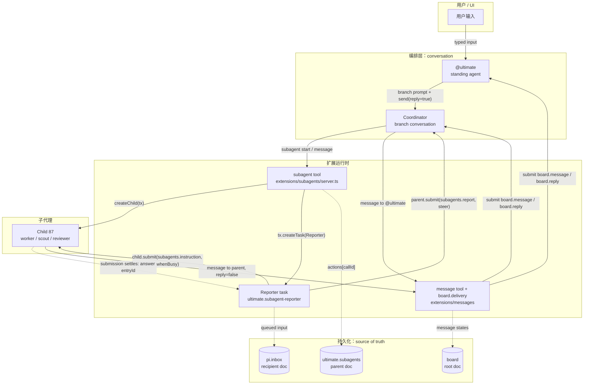
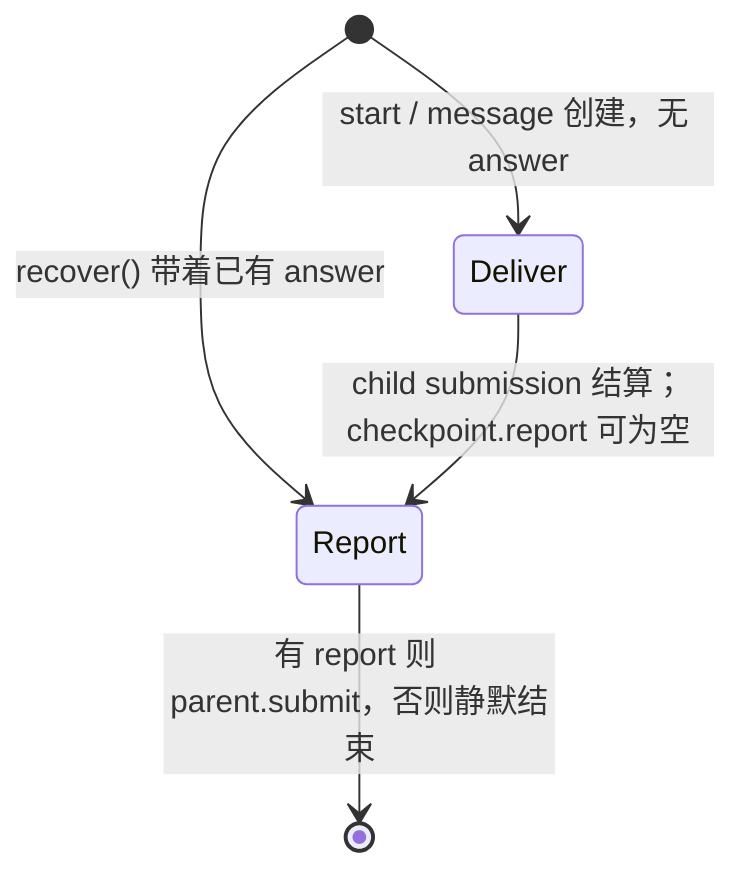
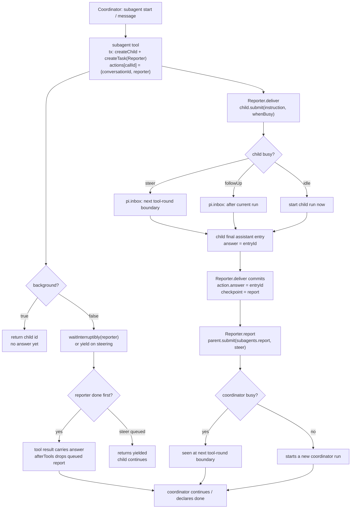
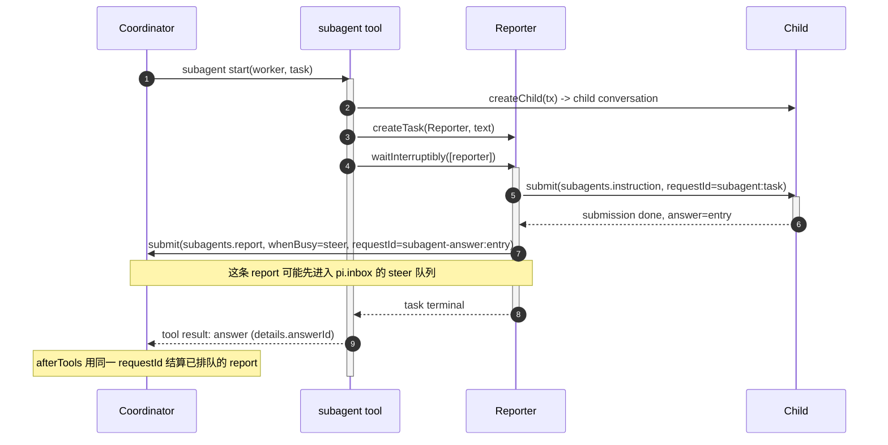

# Ultimate Agent 消息交互：协调者与子代理的往返

> 定义：协调 agent 调用 `subagent`（`start` / `message`）时，指令先被写进一个由父会话持有的 `ultimate.subagent-reporter` 持久任务，由它提交给子会话；子会话的最终 assistant 回答再由同一个 reporter 以 `subagents.report` 输入提交回协调会话，于是协调 agent 空闲时被唤醒、忙碌时在下一个 tool round 看到答案。
>
> 范围：本文只讲 coordinator ↔ 直接 child 的指令 / 答案 / 进展通道，以及 @ultimate ↔ coordinator 的外层消息。不展开 automation、lander、远程 Ultimate、UI 渲染和 plan 账本；更宽的生命周期见 [`docs/task.md`](task.md)。

| 词               | 本文里指什么                                                                            | 不指什么                                           |
| ---------------- | --------------------------------------------------------------------------------------- | -------------------------------------------------- |
| @ultimate        | 项目里的 standing agent，负责启动 / 转动 branch，并把结果转给用户                       | host、server 进程，或某个 branch                   |
| coordinator      | 由 `branch` 创建、按 `agents/coordinator.md` 配置的 branch conversation                 | 独立进程，或 `subagent` 的一种                     |
| child / subagent | 由父会话的 `subagent` 工具创建、记录在父会话 `ultimate.subagents` 文档里的 conversation | 一次 tool call，或操作系统里的子进程               |
| instruction      | 父会话投递给 child 的 `subagents.instruction` 输入                                      | `message` 工具写的 `board.message`                 |
| report           | reporter 把 child 的最终答案投回父会话的 `subagents.report` 输入                        | child 自己写的某条 `message`                       |
| answer           | child 成功结束 turn 时落库的 `pi.assistant` entry（`answered()` 为 true）               | 任意 assistant 文本、tool output，或一条 `message` |
| message          | `message` 工具经 `board` 日志和 `board.delivery` 投递的跨会话消息                       | reporter 的答案通道                                |

## 1. 架构与所有权



| 模块                         | 职责                                           | 暴露 / 依赖                                | 拥有                                                          |
| ---------------------------- | ---------------------------------------------- | ------------------------------------------ | ------------------------------------------------------------- |
| `@ultimate`                  | 判断规模、启动 branch、向用户转达结果          | `branch`、`message`                        | 自己的 standing conversation；唯一可对 `user` 发消息的通道    |
| Coordinator                  | 读代码、计划、验收、决定                       | `subagent`、`message`                      | 自己的 plan；自己的 `ultimate.subagents` 索引（仅直接 child） |
| `subagent` tool              | 创建 child、创建 reporter、把两者登记到 action | `createChild()`、`tx.createTask(Reporter)` | `ultimate.subagents.actions[callId]`                          |
| Reporter task                | 一次 instruction → 一次 answer 的持久往返      | `child.submit()`、`parent.submit()`        | 自己的 phase 和 checkpoint                                    |
| Child conversation           | 按定义执行任务                                 | 工具、模型、worktree                       | 自己的 transcript，尤其是最终 `pi.assistant` entry            |
| `message` + `board.delivery` | conversation 之间的消息与回复                  | `send()`、`resolve()`、`board.delivery`    | `board` 日志和 delivery task                                  |
| `ultimate.subagents`         | child / action / reporter 的父级索引           | parent-scoped document                     | `agents`、`actions`、`reported`                               |
| `pi.inbox`                   | 接收方会话的待处理输入队列                     | harness 的 `submit()`                      | `steer` / `followUp` 排队项                                   |

入口是 `subagent` 工具（`extensions/subagents/server.ts:866`）。真正的 source of truth 不是 `board` 日志：child 的最终答案在它自己的 `pi.assistant` entry；父会话的 `ultimate.subagents` 只记录“哪个 tool call 对应哪个 child / reporter / answer”；`board` 日志负责 `message` 工具的消息状态。三者不要混着看。

边界的存在理由：child 不需要在最终回答里指定 parent，也不需要调用 parent 来交结果；它只回答自己的 turn。父会话通过 reporter 持有返回路径，因此 child 可以独立启动、停止、重试，答案仍然有归属。`ultimate.subagents` 放在父会话，是因为每个 parent 只拥有直接 child；`board` 日志放在 root，是因为任意 conversation 都可能发消息；`pi.inbox` 放在接收方，因为它是运行时的队列，不是业务记录。

host / runtime 的边界同样简单：extension 代码不直接调用另一个 conversation 的模型，只调用 `Conversation.submit()`，由 Pi Durable 决定立即运行、steer 还是 follow-up。`worker`、`scout`、`designer` 只是 definition（prompt / model / tools）；换定义不需要改消息通道。

## 2. Reporter 状态与存储



`Deliver` 只做一件事：把 instruction 提交给 child 并等待 submission。`Report` 只做一件事：把答案（或失败原因）提交给 parent。两个 phase 都有稳定 `requestId`，所以进程重启后可以从 checkpoint 继续，不会重复投递。

`action.status` 是另一个小状态机，记录在父会话的 `ultimate.subagents` 里：

| `action.status` | 含义                                        | 谁设置                     |
| --------------- | ------------------------------------------- | -------------------------- |
| 未设置          | 正在 delivering                             | 创建 action 时             |
| `done`          | child 的 answer 已记录                      | `Reporter.deliver`         |
| `unanswered`    | 父会话 `subagent stop` 取消了 reporter      | reporter 的 abort handler  |
| `interrupted`   | child 在自己的会话里被 Stop                 | `Reporter.deliver`         |
| `failed`        | provider error 由 watchdog 持有，或投递错误 | `Reporter.deliver` / catch |
| `given-up`      | watchdog 已报告 provider error，不再重试    | watchdog                   |

| 状态 / 数据                      | 存在哪里                                                          | 为什么                                                                   |
| -------------------------------- | ----------------------------------------------------------------- | ------------------------------------------------------------------------ |
| Reporter 的 `phase` / checkpoint | Reporter task record，owner 是父 conversation，`background: true` | 崩溃后从 `deliver` 或 `report` 继续；checkpoint 决定是否还要提交         |
| `actions[callId]`                | 父会话的 `ultimate.subagents`                                     | 同一个 tool call 重放时找到同一个 child / reporter                       |
| `agents[childId].reported`       | 同上                                                              | 已投递的 answer entry id；多个 reporter 只投递一次，`wait` 只标记已报告  |
| `subagents.instruction`          | child transcript                                                  | child 模型实际看到的输入；带 sender / agent / body 供卡片展示            |
| `pi.assistant` answer            | child transcript                                                  | 答案的 source of truth；report 只引用它的 entry id                       |
| `subagents.report`               | parent transcript                                                 | coordinator 模型实际看到的输入；data 里有 `entry` 指回 answer            |
| `board.messages`                 | root conversation 的 `board` 文档                                 | `message` 工具的状态和审计；只保留最近 300 条，`board.sent` 事件不带正文 |
| `pi.inbox`                       | 接收方 conversation                                               | steer / followUp 队列；重启后仍在                                        |

## 3. 完整流程



下行链路的实际动作发生在 `Reporter.deliver`，不是 `subagent` 工具本身：工具只负责在同一个事务里创建 child、reporter 和 action 记录；reporter 拿到 instruction 后调用 `child.submit()`。如果 child 空闲，submit 立即启动一次 run；如果 child 正在跑，`whenBusy` 决定这条 instruction 是在下一个 tool-round 边界插入（`steer`），还是等当前 run 结束后再开新 run（`followUp`）。`requestId` 固定为 `subagent:<reporter task id>`，所以重放不会把同一句话投两次。

上行链路也不是 child 主动“发消息”：reporter 等待 child 的 submission 结算，拿到 `settled.answer`（一个 `pi.assistant` entry id），把它写进 action 和 checkpoint；然后 `Reporter.report` 调用 `parent.submit()`，把一条 `subagents.report` 输入放进 coordinator 的会话。coordinator 空闲时这条输入启动一次 run；忙碌时 `whenBusy: 'steer'` 让它在下一个 tool-round 边界被看到。

### 3.1 前台 start 的双路由



前台 `start` / `message` 的 `waitInterruptibly` 等的是 reporter，而不是 child 本身；如果等待期间 coordinator 收到 steering，它会返回 `details.yielded: true`，child 继续跑。真正的答案仍然只会通过 reporter 回来。

### 3.2 外层一圈：@ultimate ↔ coordinator

| 方向                    | 入口                                                      | 传输                                                                                                                         | 回程                                                                                                                                                                                    |
| ----------------------- | --------------------------------------------------------- | ---------------------------------------------------------------------------------------------------------------------------- | --------------------------------------------------------------------------------------------------------------------------------------------------------------------------------------- |
| @ultimate → coordinator | `branch { prompt }`（`extensions/messages/branch.ts:64`） | `send(reply: true)` → `board.delivery` → `board.message` 输入                                                                | coordinator 回答这条 reply-enabled 消息时，`board.delivery` 把 final answer 作为 `board.reply` 唤醒 @ultimate；后续被 subagent 唤醒的 run 由 `board.route` 以单向 note / follow-up 送回 |
| coordinator → @ultimate | `message { to: '@ultimate' }`                             | `board.delivery`；`reply: false` 仍是单向输入（经过 triage，可能 `fyi` 不唤醒），`reply: true` 需要回答（triage 直接 `act`） | @ultimate 的回答作为 `board.reply` steer 回 coordinator                                                                                                                                 |
| coordinator → child     | `subagent { action: 'start' / 'message' }`                | Reporter → `child.submit(subagents.instruction)`                                                                             | Reporter → `parent.submit(subagents.report)`                                                                                                                                            |
| child → coordinator     | 最终答案自动回；或 `message { to: parent }`               | 最终答案走 child 的 `pi.assistant`；`message` 走 `board.delivery`                                                            | reporter report；`message` 的 answer 作为 `board.reply` 回 child                                                                                                                        |

注意 `branch` 不是 `subagent`：branch 是 ownerless 的顶层 conversation，没有 reporter；它的第一条输入是 `board.message`，答案由 `board.delivery` 送回。只有 `subagent` 才有 reporter 这条父子专用通道。

## 4. 关键步骤与代码

### 4.1 为什么 start 要在同一个事务里创建 child 和 Reporter？

- child 是执行上下文，reporter 是返回路径；少一个就会出现“有任务没答案”或“有答案没归属”。如果不在同一个 commit，崩溃可能留下没有 reporter 的 child，或没有 action 的 reporter。
- `state.actions[api.callId] = { conversationId, reporter }` 让 tool replay 通过 call id 找回同一个 child / reporter；`subagent` 工具声明了 `replay: 'safe'`。
- reporter task 的 `background: true` 是“不占用父 conversation 的普通 run”的意思，不是 `subagent start` 的 `background` 参数。

```ts
// 简化 — extensions/subagents/server.ts:1028
const reporter = await tx.createTask(
  Reporter,
  {
    conversationId,
    text,
    steer: args.steer !== false,
    ...(assistant ? { sourceEntry: assistant } : {}),
  },
  { ownership: { kind: 'conversation' }, background: true },
)
state.actions[api.callId] = { conversationId, reporter }
```

### 4.2 协调 agent 的指令如何进入子会话？steer 与 followUp 差在哪？

- `Reporter.deliver` 调用 `child.submit()`，写入的是一条普通 `input`，只是 entry kind 为 `subagents.instruction`。
- `whenBusy: 'steer'` 在 child 当前 tool-round 边界插入；`followUp` 等当前 run 结束再启动下一次 run；child 空闲时两者都立即开始。
- `requestId: subagent:<task.id>` 是这条 instruction 的稳定收据：reporter 重放不会重复写。

```ts
// 简化 — extensions/subagents/server.ts:126
const submission = await child.submit(
  {
    type: 'input',
    content,
    entry: {
      kind: 'subagents.instruction',
      data: { sender: runtime.conversationId, agent, body: content },
    },
    whenBusy: task.input.steer ? 'steer' : 'followUp',
    requestId: `subagent:${task.id}`,
  },
  context,
)
const settled = await submission.wait(context)
```

`settled` 只会是 `done`（带 `answer` entry id）或 `unanswered`（带 `reason`，例如 `aborted`、`model_error`）。reporter 后续的所有判断都基于这个结算结果。

### 4.3 子 agent 的回答如何变成 coordinator 看到的 report？

- child 不调用 parent；它的最终回答就是 child conversation 里的 `pi.assistant` entry。
- `Reporter.deliver` 拿到 `settled.answer` 后记录 `action.answer`、把 answer id 放进 `agents[childId].reported`，并把 `reportText(...)` 写进 checkpoint。
- `Reporter.report` 把这条 report 作为 `subagents.report` 输入提交给 parent；`whenBusy: 'steer'` 保证忙碌的 coordinator 在下一个 tool-round 边界看到它。
- report 的 `requestId` 对成功答案用 `subagent-answer:<answer entry id>`，对无答案失败用 `subagent-report:<reporter task id>`。

```ts
// 简化 — extensions/subagents/server.ts:228
await parent.submit(
  {
    type: 'input',
    content: report,
    entry: {
      kind: 'subagents.report',
      data: { sender: task.input.conversationId, failed, body, entry: answer },
    },
    whenBusy: 'steer',
    requestId: answer === undefined ? `subagent-report:${task.id}` : answerRequest(answer),
  },
  context,
)
```

coordinator 看到的文本类似：

```text
[subagent 87 (worker) answered] Returned model: openai-codex/gpt-6.1-sol
<child 的最终回答正文>
```

`Returned model` 来自 child 实际落库的 assistant message，不是定义里配置的 profile，所以可以用来核对真正运行的模型。

### 4.4 前台 start 已经拿到答案，为什么不会又收到一条 report？

因为 reporter 的 report 和 tool result 是两条路径，必须靠同一个 `requestId` 仲裁：

- reporter 提交 report 时，coordinator 还在 tool call 里，report 会先进入 coordinator 的 `pi.inbox`。
- tool result 带上 `details.answerId`；`afterTools` 在 **outer tool result 已提交** 后运行，按 `answerRequest(answer)` 找到那条 queued submission，把它从 inbox 移除并结算为 `unanswered`，reason 为 `subagent-tool-delivered`。
- 如果 reporter 还没提交，`afterTools` 会创建一个同 `requestId` 的占位 submission；之后 reporter 的提交会被去重，不会再生效。

```ts
// 简化 — extensions/subagents/server.ts:795
const queued = submissions.filter((s) => s.submission?.status === 'queued')
inbox.items = inbox.items.filter((item) => !queued.some((s) => s.submission?.id === item.id))
for (const { answer, submission } of submissions) {
  if (!submission)
    await tx.createSubmission({
      conversationId: api.conversationId,
      requestId: answerRequest(answer),
      type: 'input',
    })
  else if (submission.status === 'queued')
    tx.settleSubmission(submission.id, { status: 'unanswered' })
}
```

这也解释了为什么 `afterTools` 不能用“工具已经返回”来判断：只有 outer tool result 已提交，才说明 coordinator 真的拿到了这个答案。

### 4.5 子 agent 想说“进展 / 卡住了 / 需要决定”，走哪条路？

reporter 只负责“一条 instruction 的最终答案”，不负责中间过程。中间状态走 `message` 工具，它是独立的 `board` 通道：

- `send()` 先检查 child 的 parent：child 只能 `message` 它的直接 parent；发给 sibling 或 `user` 都会被拒绝。
- child → parent 的 `reply: false` 会变成 `note`：`board.delivery` 用 `type: 'write'` 写入 `board.message`，不启动 run，parent 在下一次模型请求时读到。这样中间进展不会消耗父会话的完整 turn。
- child → parent 的 `reply: true` 是普通 input：会唤醒 / 排队 parent，parent 的回答作为 `board.reply` 回到 child。
- 最终答案仍然走 reporter；`message` 不是 `subagents.report` 的替代品。

```ts
// 简化 — extensions/messages/delivery.ts:99
const placing = task.input.note
  ? recipient.submit({ type: 'write', requestId, entry }, ctx)
  : recipient.submit(
      {
        type: 'input',
        requestId,
        whenBusy: task.input.steer ? 'steer' : 'followUp',
        entry,
        content,
      },
      ctx,
    )
```

`note` 的判定在 `send.ts`：`note: note ?? (parent === to && input.reply === false)`。也就是说，只有“子会话给自己 parent 的单向消息”才是 note；coordinator 给 @ultimate 的 `reply: false` 仍是一条会进入 delivery 的单向输入，只是 @ultimate 侧会经过 triage，可能判为 `fyi` 而不启动 run。

## 5. 具体例子与反例

假设 coordinator `#12` 派一个 worker `#87` 修登录页，tool call id 是 `call_7`：

```text
#12  subagent { action: 'start', agent: 'worker', task: '修复登录页', background: true }
      -> 同一事务创建 child #87、reporter #301
      -> actions['call_7'] = { conversationId: 87, reporter: 301 }

#301 child.submit({
       entry: { kind: 'subagents.instruction' },
       whenBusy: 'steer',
       requestId: 'subagent:301'
     })

#87  run ... -> 最终 answer entry #900（stopReason: 'stop'，正文非空）

#301 action.answer = 900
     agents['87'].reported = [900]
     checkpoint = { phase: 'report', answer: 900,
                    report: '[subagent 87 (worker) answered] Returned model: ...' }

#301 parent.submit({
       entry: { kind: 'subagents.report' },
       whenBusy: 'steer',
       requestId: 'subagent-answer:900'
     })

#12  idle -> 新 run 从这条 report 开始
     busy -> 下一个 tool-round 边界看到 report
```

如果 `#12` 正在另一个工具调用里，report 不会打断模型请求，而是在该工具轮结束时插入；如果 `#12` 已经空闲，submit 会直接启动一次新 run。coordinator 可以继续用 `subagent { action: 'wait', id: 87 }` 读最新答案，或者用 `list` 看 child 是否还在跑。

child 也可以中途发进展：

```text
#87 -> message { to: '#12', text: '登录页已定位，正在补测试', reply: false }
     -> board.delivery 写一条 delivery: 'note' 的 board.message
     -> #12 不启动 run；下一次模型请求时读到这条 note
```

**反例（最容易混淆）**：`#87` 只调用 `message { to: '#12', text: 'done, fixed' }`，然后结束 turn，没有再写任何 assistant 文本。这不是 answer：`answered()` 要求 `stopReason` 不是 `aborted` / `error`，且文本非空；reporter 会发 `[subagent 87 failed: ended its turn without an answer]`。coordinator 看到的是失败，而不是“已完成”。`message` 的 note 可能已经到了 `#12`，但它不是结果通道。

另一个反例：`subagent { action: 'start', background: true }` 立即返回 `Started subagent 87.`，这不是答案；它只表示 child 和 reporter 已经创建。真正的结果要么由 reporter 唤醒，要么由后续 `wait` 取回。

## 6. 边界情况与常见误解

- **前台 wait 返回 `details.yielded: true` 不是答案。** 这是 coordinator 收到 steering 后主动让出等待；child 仍在跑，之后用 `message`、`stop` 或再次 `wait` 处理。
- **child 结束但没有文本，不是成功。** `answered()` 会把空文本、`aborted`、`error` 都判为失败；被 Stop 的 Claude Code turn 可能只剩一个空 thinking block。
- **临时 provider error 不由 reporter 反复重试。** `model_error` / `no_model` 时 reporter 静默结束；watchdog 对临时错误 60 秒后重试一次，仍失败（或错误不是临时的）则发 `watchdog.failure` 卡，并把 action 标成 `given-up`。后续 watchdog retry 或用户手动继续产生的答案，`recover()` 会补投一次。
- **父会话 Stop 不会级联到 child。** child 的 owner 是一个 background 的 `ultimate.subagent-anchor`；要停 child 必须显式 `subagent { action: 'stop', id }`，它会取消 reporter、排队输入和当前 run，并列出 child worktree 里未提交的文件。
- **两个 `background` 不是一个东西。** `subagent start { background: true }` 表示工具立即返回 id；reporter task 的 `background: true` 表示它不占用父会话的普通 run。两者独立。
- **`steer` 不是打断模型。** 它只是把输入排到下一个 tool-round 边界；模型当前的请求不会被强制取消。
- **多个 reporter 等同一个 child 时，答案按 entry id 去重。** `agents[childId].reported` 记录已经投递的 answer；后来的 reporter 看到同一个 answer 会跳过，不再重复唤醒。`wait` 仍可显式返回这个答案，只是把它标记为已报告。
- **`subagent { action: 'message' }` 和 `message` 工具不是同一条通道。** 前者创建 reporter，答案回到 `subagents.report`；后者按 `#id` 写 `board` 消息，回答走 `board.reply`，不会更新 `ultimate.subagents` 的 action。委派和取结果用前者；普通对话才用后者。
- **`board` 日志不是完整历史。** 它只保留最近 300 条 message；真正被投递的输入还在各自 transcript 里。

## 7. 代码索引

| 位置                                                                    | 作用                                                                             |
| ----------------------------------------------------------------------- | -------------------------------------------------------------------------------- |
| `extensions/subagents/api.ts:15-45`                                     | `ultimate.subagents` 文档：`agents`、`actions`、`reporter`、`reported`、`status` |
| `extensions/subagents/server.ts:103-269`                                | `ultimate.subagent-reporter` 的 `deliver` / `report` 两阶段                      |
| `extensions/subagents/server.ts:122-147`                                | `Reporter.deliver` 调用 `child.submit()`                                         |
| `extensions/subagents/server.ts:210-251`                                | `Reporter.report` 调用 `parent.submit()`                                         |
| `extensions/subagents/server.ts:663-741`                                | `recover()`：扫描 done submission，补投丢失的答案                                |
| `extensions/subagents/server.ts:773-817`                                | `afterTools`：前台答案与 queued report 的去重                                    |
| `extensions/subagents/server.ts:866-1219`                               | `subagent` 工具的 `start` / `message` / `wait` / `stop` 等 action                |
| `extensions/subagents/server.ts:1028-1039`                              | 创建 Reporter 并登记 `actions[callId]`                                           |
| `extensions/subagents/server.ts:287-347`                                | `waitInterruptibly`：可被 steering 打断的等待                                    |
| `extensions/subagents/children.ts:46-85`                                | `createChild()`：创建并配置 child conversation                                   |
| `extensions/messages/send.ts:84-88`                                     | child 只能 message 直接 parent 的检查                                            |
| `extensions/messages/send.ts:202-216`                                   | 创建 `board.delivery` 任务；`note` 判定                                          |
| `extensions/messages/delivery.ts:99-121`                                | `write`（note / triage 上下文）与 `input`（唤醒 / steer）的分流                  |
| `extensions/messages/delivery.ts:379-410`                               | reply phase：把回答作为 `board.reply` 投回 sender                                |
| `extensions/messages/branch.ts:64-101`                                  | `branch` 创建 branch 并发送 reply-enabled 第一条消息                             |
| `extensions/messages/route.ts:28-107`                                   | `board.route`：branch 后续 final answer 的单向路由                               |
| `extensions/messages/api.ts:14-41`                                      | `Message` 类型与 root `board` 文档                                               |
| `node_modules/@earendil-works/pi-durable/dist/harness/types.d.ts:24-50` | `SubmissionDraft` / `Submission.wait()` 的底层契约                               |

---

**收尾**：这套机制的核心不是“子 agent 给父 agent 发消息”，而是“父 agent 的 reporter 任务持有返回路径”：下行是 `child.submit(subagents.instruction)`，上行是 `parent.submit(subagents.report)`；`message` 是独立的 `board` 通道，只负责进展、提问和外层 @ultimate 通信。最容易混淆的是 `message` 与 `answer`；第 5 节的“只发 message、不写最终回答”反例能把它区分开。下一步建议直接读 `extensions/subagents/server.ts` 的 `createReporter`，再对照 `docs/task.md` 的 5.7 节看一次 `wait` yielded / `recover()` 的真实分支。
