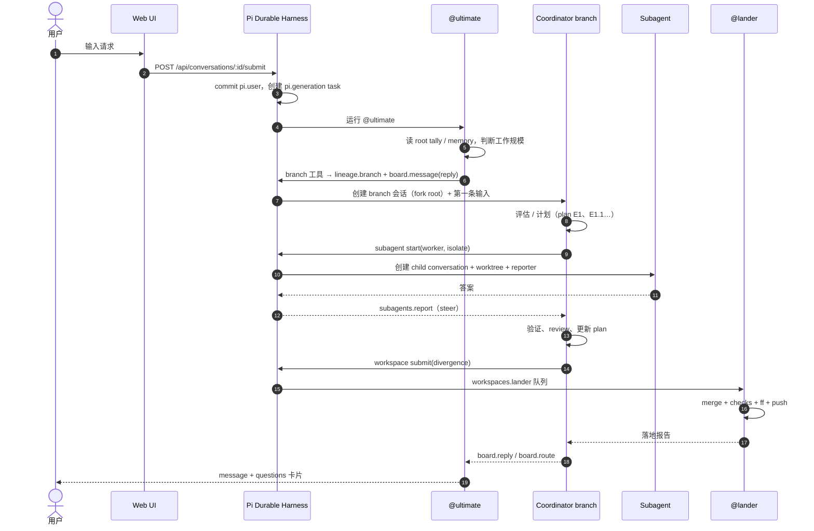

# Ultimate 任务机制分析：从用户聊天到多 Agent 协作

> 分析对象：本仓库（Ultimate）。文中 `path:line` 指向当前源码；行为描述以这些实现和对应 README 为准。
>
> 核心结论：Ultimate 不是“一个主 Agent 调几个子 Agent”的线程模型，而是
> **“会话即 Agent、消息即 RPC、文档即共享状态、Pi Durable Task 即执行引擎”** 的多会话系统。
> 用户在 @ultimate 的会话里说一句话；@ultimate 把工作变成一个 **branch（顶层会话）**；
> branch 里的 **coordinator** 用 `plan` 把工作拆成 **epic/task**；
> 每个 task 通过 `subagent` 变成 **child conversation**（scout / worker / designer / reviewer），
> 在独立 worktree 中执行；结果通过 **reporter → message → reply** 回到父会话；
> 最终通过 **workspace submit → lander** 合并到 main；所有步骤都是可恢复的 Pi Durable task，
> UI 只是这些提交状态的投影。

---

## 1. 三层“任务”模型

初看 Ultimate 的代码，容易把三个不同层级的东西都叫“任务”。先把它们分开：

| 层级           | 载体                                                   | 谁创建                          | 生命周期                                              | 典型例子                                                          |
| -------------- | ------------------------------------------------------ | ------------------------------- | ----------------------------------------------------- | ----------------------------------------------------------------- |
| **工作项**     | 一个 conversation + `lineage.branch` 文档              | @ultimate（通过 `branch` 工具） | 长；可 resume、conclude、landed 后自动 conclude       | “给登录页补错误提示”                                              |
| **计划任务**   | coordinator 会话里的 `ultimate.plan` 文档：epic + task | coordinator（通过 `plan` 工具） | 跟随 coordinator 会话；可回卷、随 branch 生命周期存活 | `E1.1 实现错误提示组件`                                           |
| **运行时任务** | Pi Durable 的 task record                              | 系统、工具、扩展                | 短；到 terminal 即消失                                | `pi.generation`、`pi.tool`、`board.delivery`、`workspaces.lander` |
| **待办**       | root 上的 `todos` 文档                                 | 用户或 @ultimate                | 项目级 open loop                                      | “补部署文档”                                                      |

三者不是一一对应：

- 一个 **branch** 是一个工作项，但 branch 的第一次运行本身是一个 `pi.generation` 运行时任务；
- 一个 **plan task** 可能由 coordinator 自己完成，也可能派给一个 subagent；
- 一个 **subagent** 至少涉及一次 `pi.generation`、若干 `pi.tool`，通常还有一个 `ultimate.subagent-reporter`；
- **todo** 是“开放事项”，不是执行单元；`plan` 才是带验收标准的任务账本。

可以把它们理解成：

```text
工作项（branch）
  └─ 计划任务（plan E1.1）
       └─ 运行时任务（pi.generation / pi.tool / reporter / ...）
```

---

## 2. 角色与职责

| 角色                      | 形态                                                   | 职责                                                                   | 关键约束                                                       |
| ------------------------- | ------------------------------------------------------ | ---------------------------------------------------------------------- | -------------------------------------------------------------- |
| **用户**                  | 人                                                     | 提需求、回答问题卡、决定是否继续/落地                                  | 默认只和 @ultimate 对话；也可以直接打开 coordinator 的会话     |
| **@ultimate**             | `resident: true` 的 standing agent，独立会话           | 项目级编排者：判断规模、启动 branch、转达用户决策、汇总结果            | 不写产品代码（只写配置）；只有它能 `message {to:'user'}`       |
| **coordinator**           | 一个 branch 会话（ownerless）                          | 理解问题、做计划、做判断、验证结果、最终提交                           | 一个 branch 一个 coordinator；不是 subagent，不能被父会话 stop |
| **scout**                 | subagent child                                         | 只读侦察：找调用方、读架构、回答一个具体问题                           | `tools: [read, bash]`，不编辑、不提交                          |
| **worker**                | subagent child，默认 worktree                          | 实现一个有边界的任务、验证、提交到自己的分支                           | 不扩大范围、不 push、不 land 用户 checkout                     |
| **designer**              | subagent child，worktree                               | UI / 设计工作，自己截图评判                                            | 只能改前端范围；预览由 coordinator 启动                        |
| **reviewer / reviewer-*** | subagent child，只读                                   | 审查不可变的 `base..head`，返回一个合并后的 verdict                    | 只读；团队模式由 reviewer 并行启动所有 `reviewer-*`            |
| **@lander**               | source checkout 对应的 lander 会话（通常一个 @lander） | 串行执行落地流水线：merge、checks、fast-forward、push；失败时诊断/修复 | 流水线是代码；模型只在失败或有人问它时运行                     |
| **watcher**               | automation 的 standing agent                           | 维护受监督脚本，失败后修复或升级                                       | 由 automations 创建，不参与普通分支                            |

几个容易混淆的边界：

- **branch 不是 subagent**：branch 没有父会话、没有 owner，不能被 `subagent stop`；它是和 @ultimate、@lander 同级的顶层工作项。
- **standing agent 不是 branch**：@ultimate、@lander 是长期存在的 ownerless conversation，不 fork、不写 `lineage.branch`。
- **foreground 不是所有权**：`subagent start` 的前台/后台只是“调用者是否等待”，子会话始终属于它的 background anchor。

---

## 3. 端到端链路

### 3.1 时序图



### 3.2 阶段 0：用户输入如何变成一次运行

用户输入走的是普通 conversation submit，没有任何“任务系统”的特殊入口：

1. Web SDK 调用 `POST /api/conversations/<id>/submit`（`web/src/sdk/api.ts:91`）。
2. 服务端校验文本/图片、展开 `/skill:`，调用 `conversation.submit({ type: 'input', content, whenBusy })`（`server/api.ts:505-560`）。
3. Pi Durable 在一个事务里写入 `pi.user` 输入，并创建 `pi.generation` 任务；如果会话正忙，输入进入 `pi.inbox`，按 `whenBusy` 作为 steer 或 follow-up。
4. 如果是 @ultimate 的会话，运行的是 `agents/ultimate.md` 里的 standing agent；如果是某个 branch，运行的是该 branch 配置的 coordinator。

**输入不是“消息队列里的一个 job”**，而是 conversation 的一次提交。一个输入对应一个 generation 任务；generation 可能包含多轮 model request + tool calls，每轮工具又是一个独立的 `pi.tool` 任务。Pi Durable 的模型是：

```text
pi.user
  └─ pi.generation → pi.tool × n → pi.tool-result × n
       └─ 下一次 pi.generation → ... → 最终 assistant answer
```

这也是 Tasks 面板看到的树：generation 拥有 tool call，tool call 可能拥有 child conversation（subagent），child 又拥有它自己的 generation/tool。

在输入被放置的同一个 commit 里，各扩展的 `GenerationTask.beforeInput` 会按需插入 per-input note（不修改 system prompt，从而不破坏 prompt cache）：

| note               | 触发                             | 作用                                              |
| ------------------ | -------------------------------- | ------------------------------------------------- |
| `todos.note`       | 开放 to-do 列表自上次 run 后变化 | 把用户/@ultimate 的 open loops 带进这一轮         |
| `goal.note`        | 有 open goal                     | 告知 hands-off 权限、criteria 和提醒              |
| `lineage` catch-up | branch 空闲后 resume             | 生成 “Meanwhile in #R's tree”，补齐分叉后发生的事 |
| `board.open`       | 有等待用户回答的问题             | 列出 open message 的 id、首行和年龄               |
| `watchdog.idle`    | idle branch 集合变化             | 提醒 @ultimate 有 branch 停住了                   |
| `prompt.build`     | build 版本变化                   | 标明这次运行使用的 build                          |
| `setup.note`       | setup 警告集合变化               | 告知项目 setup 状态                               |

这就是“用户只说了一句话，agent 却知道项目当前状态”的来源：状态不是塞进 system prompt，而是作为这一轮输入前的 note 提交。

### 3.3 阶段 1：@ultimate 如何判断与分派

@ultimate 的完整定义在 `agents/ultimate.md`。它的职责不是写代码，而是：

1. **读上下文**：项目 memory、root tally、最近 landing、用户的话。
2. **判断规模**：它在 branch prompt 里必须写明属于哪一种：
   - **Small, clear change**：几行、一个区域、原因明确 → coordinator 自己做，edit/test/submit，不建 epic、不派 worker、不做 review；
   - **Feature / added functionality / question / exploration**：先评估，不构建；coordinator 返回 complexity、code delta、reuse、推荐方案、更简单的替代方案、风险、编号决策；
   - **After the user's go**：按项目正常流程：plan → workers → verify → review → workspace submit。
3. **启动 branch**：调用 `branch { prompt, title?, root?, isolated? }`，把用户原话、目标、约束写进一个**自包含**的 prompt。
4. **转达决策**：把 coordinator 的 assessment 用 `message { to: 'user', questions }` 变成问题卡；用户回答后，再 `message` 给 branch。

```text
用户输入
├─ 简单问题 / 查询        → @ultimate 自己回答（read / codemode / web_search）
├─ 小改动                → branch（small, clear change）→ coordinator 自己做 + submit
├─ 功能 / 探索           → branch（assess first）→ assessment → 用户决定 → 继续 branch
└─ 用户明确要求直接做    → branch（build without assessment）→ plan + workers + review
```

关键点：**branch 的 prompt 是 @ultimate 到 coordinator 的唯一上下文交接**。branch 不会看到 @ultimate 的聊天记录；它只从 root 的 tally/memory 继承项目级上下文，再加这段 prompt。所以 `agents/ultimate.md` 反复强调 prompt 必须 self-contained。

### 3.4 阶段 2：branch 创建（工作项落地）

`branch` 工具在 `extensions/messages/branch.ts:13-113`。它是 `deferred: true` 的工具，默认只有定义里显式列出 `branch` 的 agent（本仓库的 `agents/ultimate.md`）会直接看到它；这是职责分工，不是安全边界（deferred 工具仍可能被 codemode 的 `tool_search` 加载）。它做四件事：

1. **选 root**：显式 `root` → 调用者所在树的 root → 项目唯一 root；找不到就报错并列出可用 root。
2. **解析 coordinator 定义**：从 `agents/`、`~/.ultimate/agents/`、`<project>/.ultimate/agents/` 发现 `coordinator`；取其 model/thinking pin（如果 provider 有登录），否则用默认模型。
3. **调用 `LineageApi.branch`**（`extensions/lineage/server.ts:867` 的 `startBranch` → `forkBranch`，`867-1011`）：
   - 在 root 的最新 entry 处 `forkConversation`，创建 **ownerless** 的 branch 会话（`926`）；
   - 如果 root 有 memory，先写一条 `pi.reset`（`head:'self'`，`data.lineage.brief`），让 branch 的模型上下文从 **memory brief** 开始；否则继承 root 的 tally 上下文；
   - 配置 `cwd = projectRoot`，设置 model/thinking，清掉继承的 `tools`/`modelTools`，让 branch 使用普通工具集；
   - 如果 `isolated`，通过 `WorkspacesApi.create` 创建 `<home>/worktrees/<branch id>` 的 worktree；
   - 写 `lineage.branch { from, at, intent }` 文档，设置 `metadata.title` 为标题/intent；
   - 发 `lineage.branched` 和 `subagents.started { kind: 'branch' }` 事件；
   - 在 root 追加一个 `lineage.branched` 节点，模型看到的文字是 `#<branch> started by <caller> from #<source>/<at>: <intent>`（`985-1002`）；
   - 如果 `deliver !== false`，创建 `lineage.prompt` 任务（`405-427`），把 prompt 作为 branch 的第一条输入（稳定 `requestId: 'lineage:prompt'`）。
4. **发送第一条消息**：`branch` 工具传 `deliver: false`，改由 `send()`（`extensions/messages/send.ts:36`）写 `board` 日志并创建 `board.delivery` 后台任务（`extensions/messages/delivery.ts:29-54`）；delivery 把 prompt 作为 `board.message` 输入递交给 branch，`reply: true`，等待 branch 的回答。branch 的第一次运行因此是一个普通的 generation 任务，只是输入来自消息系统而不是用户。

随后 branch 工具提交三件事：

- `configure(branch, { instructions: coordinator.instructions, modelTools? })`；
- `metadata.label = 'coordinator'`；
- `board.started.by = 发起者`（@ultimate 或 side chat）。

`board.started` 很重要：branch 之后被 subagent、notify、lander 唤醒时，最终答案要通过 `board.route` 回到这个发起者（见 5.1）。

### 3.5 阶段 3：coordinator 的计划

coordinator 的指令在 `agents/coordinator.md`。它的第一步仍然是**判断规模**：

- 小改动：自己改、自己跑检查、自己 `workspace submit`；
- 功能/开放问题：先评估，不构建；把 assessment 作为对 @ultimate 的回复；
- 用户同意后：用 `plan` 建 epic，用 `add` 建 task，然后按依赖派发。

`plan` 工具在 `extensions/plan/server.ts:182-320`，账本存在 coordinator 会话的 `ultimate.plan` 文档（`36-44`）。结构是：

```text
E1 (epic)
  ├─ E1.1 (task, role: worker | reviewer, deps: [...], child?: conversationId)
  ├─ E1.2
  └─ ...
```

- Epic body 包含：Request、Selected approach、Intent、Scope（in/out）、**binary Acceptance criteria**、Implementation、Verification、Risks。
- Task description 包含：Outcome、Scope、Non-goals、Files、Acceptance criteria（带验证命令）、Constraints。
- Task 状态：`backlog | todo | in_progress | in_review | done | blocked | canceled`；epic 状态：`planning | in_progress | done | blocked`。
- `deps` 是 task key 列表；`child` 是子会话 id；`verdict` 记录证据；`note` 追加带时间戳的备注。
- 系统提示只注入**非 done** 的 epic/task 的紧凑行（`extensions/plan/server.ts:164-178`），不注入 body，以节省上下文。

两个重要设计：

1. **plan 是账本，不是调度器**。`deps` 不会自动触发任务；何时 start subagent 由 coordinator 的模型决定。plan 只负责“可见、可回卷、可验收”。
2. **只有一个写者**。`plan` 的 mutation 只能由账本所有者 coordinator 执行；子会话 `show` 会沿 `conversation.owner` 向上找到根 coordinator，mutation 会被拒绝并提示 “Only conversation N edits this plan; report to it instead”（`extensions/plan/server.ts:213-227`）。这避免多个 worker 同时改计划造成竞态。

每次 mutation 还会在同一个事务里重写 root 上的 `ultimate.plan.tasks` 索引（`extensions/plan/server.ts:86-116`），把 `child conversation → { coordinator, epic, key, title, status }` 映射给 Sidebar、Tasks、subagents 等 UI 使用；新建或改名的 task 会同步成子会话标题。

### 3.6 阶段 4：subagent 执行

`subagent` 工具在 `extensions/subagents/server.ts:866-1087`，操作有 `start / message / wait / stop / list / land / discard`。

一次 `start` 的完整动作（`926-1055`）：

1. **解析定义**：从三个目录发现 `agents/*.md`；定义可指定 `model`、`thinking`、`tools`、`denyTools`、`isolate`、`onFailure`、`fast`、`summaries`。定义的工具必须是父工具的子集；默认不把 `subagent` 和 `subagents` extension 传给子会话，避免无限递归。
2. **创建 anchor**：一个 `ultimate.subagent-anchor` background task（`66-102`）。它本身几乎立刻完成，但作为子会话的 owner 边界存在；因此父会话的停止不会级联到子会话。
3. **创建 child conversation**：`createChild`（`extensions/subagents/children.ts`）创建 owner 为 anchor 的会话，按定义配置 model/thinking/tools/instructions，写 `metadata.label = <定义名>`、`title = 任务首行`、`Profile.definition`。
4. **创建 worktree（可选）**：`isolate: 'worktree'` 时调用 `WorkspacesApi.create`，路径 `<home>/worktrees/<child id>`，从父 checkout 的 committed HEAD 切出；子会话的 `cwd` 和指令都指向这里；指令要求只在此 checkout 工作、提交、绝不 push、绝不碰其他 checkout。
5. **创建 reporter**：一个 `ultimate.subagent-reporter` background task（`103-269`），负责把 `task` 文本投递给 child，等待答案，再把答案作为 `subagents.report` 输入投回 parent。
6. **返回**：
   - `background: true`：立即返回 child id；
   - 前台：`waitInterruptibly` 等待 reporter，但可以被 steering 打断，返回状态而不是硬等；工作继续。

reporter 的可靠性设计（5.7 详述）：

- 每个 start/message 恰好一个 reporter；
- 输入用 `requestId: subagent:<taskId>`；
- 答案以 answer entry id 去重，`subagent-answer:<answer>`；
- 报告用 `whenBusy: 'steer'` 投回 parent；
- 重启后 `recover()` 扫描未投递的答案并补投，已投递的不会重复（`extensions/subagents/server.ts:670-760`）。

父子的后续交互：

- `message { id, text, steer? }`：默认 steer，在子会话当前工具轮结束时插入；`steer: false` 排成 follow-up，等当前 run 结束。
- `wait { id }`：等答案，但可被 steering 打断；返回的是状态或答案。
- `stop { id }`：取消当前 work、待处理输入和 reporter，并列出 child worktree 中未提交的文件；不删除代码/分支。
- `land { id }`：把 child 的保存分支 fast-forward 到父 checkout；要求两边干净、child 没有 live run/queued input；不 rebase、不 push。
- `discard { id }`：只删除干净、空闲的 checkout，保留分支。

**注意**：subagent 默认不能 `workspace submit`/`land` 用户 checkout；`workspace` 工具会检查调用者是否为 top-level main（`extensions/workspaces/server.ts:292`）。所以 worker 只能提交到自己的 worktree 分支，由 coordinator `land`，或由 coordinator 最终 `submit` 到 lander。

### 3.7 阶段 5：验证、review、land

coordinator 不会相信“子 agent 说完成了”。`agents/coordinator.md` 要求：

- 读 child 的 diff、检查它的 `path:line` 证据、读它 transcript 里最后一次完整测试运行的记录；“a recorded exit code is evidence, a claim in prose is not”；
- `land` worker 到自己的 checkout 后再跑 `pnpm check` 和受影响测试；
- 独立 review：`reviewer` 接收不可变的 `base..head` 和 acceptance criteria；如果项目有 `reviewer-*`，reviewer 作为 lead 并行启动所有 team member，等全部答案后合并成一个 verdict；reviewer 只读，不跑会修改状态的测试；
- 验证 reviewer 的发现，必要时自己修或重新收紧 brief。

最终提交：

- coordinator 运行 `workspace submit { divergence }`（`extensions/workspaces/server.ts:261-296`；`extensions/workspaces/workspaces.ts:717`）。
- `divergence` 是必填的：说明交付结果与原始请求的差异（新约定、不同方案/库、范围变化），或 `"None"`。
- 提交进入 root `ultimate.workspaces` 文档的 `queue`，按 **source checkout** 排队。branch 的 workspace 以项目根 checkout 为 source，因此所有 branch 的 submit 都进入同一个 main lander 队列，**串行**落地；worker 的嵌套 worktree 只用于 `land` 到 coordinator，不直接 submit。提交的是提交时的 clean tip，branch 可以继续工作；lander 完成后会把结果报告回来。
- 每个 source 有一条 `workspaces.lander` 任务（`extensions/workspaces/lander.ts:491-492`），它在一个专用的 detached checkout 中：
  1. 重置到 target tip；必要时 fetch + merge remote；
  2. merge 提交的 tip；冲突则中止并报告冲突路径；
  3. 跑 `lander.checks`（可按 group 并发；失败重跑一次，第二次通过记为 flaky；超时/无输出由 watchdog 处理）；
  4. `merge --ff-only` 更新 target；target 动了就重来，最多 3 次；
  5. 配置了 `lander.push` 就 push（永不 force；被拒后整合一次再报）；
  6. 记录 `landed`，发出 `workspaces.landed` 事件，并向提交者发报告；
  7. 失败时按 `onFailure: diagnose | fix` 让 lander 模型诊断或修复；修复只能在自己的 checkout 里提交，不能 push。

### 3.8 阶段 6：结果如何回到用户

这里有三条路径，必须区分：

1. **branch 回答的是 @ultimate 的 reply-enabled 消息**：`board.delivery` 的 reply phase 把 branch 的最终答案作为 `board.reply` 投回 @ultimate，唤醒它。@ultimate 再把结果用 `message { to: 'user' }` 发给用户。
2. **通过 `branch` 工具启动、且 `board.started.by` 存在的 branch 被其他东西唤醒**（subagent、notify、lander、steering）：它的最终答案没有人直接接收。`board.route` 任务在 generation `onYield` 时创建（`extensions/messages/server.ts:152-180`），等 generation 结束后把答案作为**单向消息**发给 `board.started.by`；如果答案最后一行是问题/编号选项，则作为 follow-up 唤醒；否则作为 note，不唤醒。它跳过那些已经通过 reply 或显式 `message` 送达的答案，避免重复。
3. **用户直接打开 coordinator 会话说话**：coordinator 的回答就是对该用户输入的回复；如果它还要向 @ultimate 汇报，用 `message @ultimate { reply: false }`。

@ultimate 对用户的最终输出有两种：

- **它自己的 final answer**：如果这一轮是用户直接输入的，final answer 自动显示在它的 transcript 里；
- **主动 `message { to: 'user', text, questions?, reply? }`**：作为气泡出现在 @ultimate 的 transcript 里；带 `questions` 时渲染成答案卡，等待用户选择；答案以 `board.reply` 回到 @ultimate（`extensions/messages/README.md` 的 “Ultimate and branches”）。

---

## 4. 任务创建机制详解

### 4.1 branch：工作项的创建

branch 的本质是“从 root 的上下文分叉出一个独立工作线”，而不是“给某个 agent 发一个任务”。具体语义：

| 方面     | 行为                                                                                         |
| -------- | -------------------------------------------------------------------------------------------- |
| fork 点  | root 的最新 entry（默认）；也可以显式 `at`                                                   |
| owner    | `ownerless`，没有父会话；不是 subagent                                                       |
| 继承     | root 的 tally；如果 root 有 memory，则改为 memory brief（`pi.reset` + `data.lineage.brief`） |
| 首条输入 | `lineage.prompt`（默认）或 `board.delivery`（`branch` 工具走这条）                           |
| 隔离     | @ultimate 启动的 coordinator branch 默认 `isolated: true`，即独立 worktree                   |
| 身份     | `metadata.label = 'coordinator'`，`lineage.branch` 文档记录 `{from, at, intent}`             |
| 回答路由 | `board.started.by` 记录发起者；`board.route` 负责后续 final answer                           |
| 结束     | 通常由 `lineage/conclude-landed` 在落地后自动 conclude；用户也可以手动 conclude/resume       |

隔离需要项目是 Git 仓库，有 checked-out branch 和首个 commit；不满足时 isolated start 会失败，项目也没有 lander（`extensions/workspaces/README.md`）。@ultimate 在 onboarding 里负责 Git setup。

**root 不是 @ultimate**。root 是项目根会话（`ROOT_CONVERSATION_ID = 1`），作为只读的 tally/History 页使用；一旦成为 tally 就拒绝输入、不运行 turn（`extensions/lineage/server.ts:1360-1365`）。@ultimate 是 `subagents.standing('ultimate')` 创建的 standing conversation，id 记录在 root 的 `ultimate.standing-agents` 文档里（`extensions/subagents/server.ts:626-660`）。Branch 从 root fork，而不是从 @ultimate 的会话 fork；这样 branch 继承的是项目级上下文，而不是 @ultimate 的私人对话。

**memory brief** 的内容（`extensions/lineage/memory.ts:244-278`）：

```text
<project_memory root="#R">
slug [kind] — line (updated YYYY-MM-DD)
...
</project_memory>
Recent landings (newest first):
- <sha7> <feature: title> (#conv)
...
The full project context ... read it with codemode ultimate.entries(R) ...
```

这使新 branch 不必带着整个 tally 开头；它从“索引 + 最近 10 次 landing + 指针”开始，需要细节时再用 codemode 读 root。

### 4.2 plan：任务分解账本

`plan` 的写入流程（`extensions/plan/server.ts:213-314`）：

1. 先读 `api.memo('result')`，命中则直接返回（replay 安全）；
2. 生成 receipt UUID，进入 `api.commit`；
3. 沿 `conversation.owner` 向上找到根 coordinator，非所有者 mutation 直接拒绝；
4. 读 task-scoped `Receipt`，按 receipt id 去重；
5. 修改 `ultimate.plan`；`create` 分配 `E<n>`，`add` 分配 `E<n>.<m>`，`update` 按字段白名单写回，`note` 追加备注，`show` 只读；
6. 同一事务里 `reindex` 重写 root 的 `ultimate.plan.tasks`，并在 task 新建/改名时同步子会话标题；
7. 把结果写入 receipt，commit 后 `api.memo` 保存返回值。

几个容易忽略的点：

- **plan 的 `deps` 不执行调度**。它只是给模型和 UI 看的依赖关系；真正的顺序由 coordinator 的决策和 `subagent wait` 控制。
- **plan 的 `child` 不是自动写入的**。coordinator 必须在 `subagent start` 拿到 child id 后，显式 `plan update { key, child: id }`；否则 UI 只能看到任务，不知道它对应哪个会话。
- **branch 的 plan 从空开始**。`plan` 扩展注册了 `GenerationTask.beforeInput`（`extensions/plan/server.ts:152-160`）：如果这是一个 lineage branch 且尚未回答过，就在放置第一条输入的 commit 里把继承的 plan 清空；这样分支不会误以为父分支的计划是自己的。
- **plan 是可回卷的**。`history: 'rewindable'`、`fork: 'asOf'`（`extensions/plan/server.ts:36-44`），与 Pi Durable 的 fork 语义一致；回退对话时计划也能回到对应版本。

### 4.3 subagent：执行单元的创建

subagent 的“定义”是一个 Markdown 文件，frontmatter 描述 profile，body 是指令。发现顺序：

```text
agents/                      (Ultimate 内置)
~/.ultimate/agents/          (用户全局)
<project>/.ultimate/agents/  (项目，最后覆盖)
```

同名定义：后面的文件可以整体替换，也可以用 `addTools` 标记为 overlay——overlay 只能增加工具、追加指令、覆盖设置，不能删除基础定义的工具或改写基础指令。

定义里的关键字段：

| 字段                 | 作用                                     |
| -------------------- | ---------------------------------------- |
| `model` / `thinking` | 固定模型/思考等级；provider 没登录时跳过 |
| `tools`              | 工具子集；必须是父工具的子集             |
| `denyTools`          | 从继承或显式工具列表中移除               |
| `isolate`            | `none` 或 `worktree`                     |
| `resident`           | 是否作为 standing agent                  |
| `onFailure`          | 仅 lander：`diagnose` 或 `fix`           |
| `fast`               | OpenAI/Codex 优先档                      |
| `summaries`          | 是否允许自动摘要                         |

`start` 创建的 child 不是“另一个模型调用”，而是一个完整会话：

- 有独立的 conversation id、独立的 `pi.agent`、独立的 `pi.inbox`、独立的 worktree；
- 父会话结束时它仍然活着（background anchor）；
- 父会话停止时也不会杀它（除非显式 `stop { id }`）；
- 它只能给父会话发消息（`extensions/messages/send.ts` 的 parent 检查），不能直接找用户；
- 它的答案会通过 reporter 作为 `subagents.report` 回到父会话，唤醒父会话。

### 4.4 其他任务入口

| 入口                       | 创建什么                                                                                                            | 关键机制                                                                                                                                    |
| -------------------------- | ------------------------------------------------------------------------------------------------------------------- | ------------------------------------------------------------------------------------------------------------------------------------------- |
| **Automation**             | `ultimate.automation-scheduler` 睡到触发点；fire 时创建 `ultimate.automation-run` 或 `ultimate.automation-delivery` | cron / at / every / event / condition / 受监督脚本；每次 fire 的 run 是一个新会话；subscribers 被 `automations.fired` 输入唤醒              |
| **Goal（hands-off）**      | root 上的 `goal` 文档 + `goal.reminder` automation                                                                  | @ultimate 在用户离开时替用户做决定，每个决定记录 question/picked/reason；`goal.deliver` 写报告卡                                            |
| **Side chat**              | @ultimate 的临时 fork                                                                                               | 用户从 composer 打开；持久动作（branch/message/note/automation）以 @ultimate 身份执行，回复回到 @ultimate；可 Discard 或 Summarize & inject |
| **Onboarding**             | 首次运行的项目 memory + 第一个 branch                                                                               | `onboarding.start` 输入唤醒 @ultimate；写第一组 `remember`，然后按用户说的第一个任务启动 branch                                             |
| **用户直接对 branch 说话** | branch 的新输入                                                                                                     | 用于让 coordinator 做例子、spike、解释；完成后 coordinator 用 `message @ultimate { reply: false }` 汇报                                     |
| **Review comments**        | `review.comments` 输入到某个会话                                                                                    | 从 Review surface 发送行级评论；作为用户输入 steer 到目标会话                                                                               |

---

## 5. 多 Agent 协调机制

### 5.1 消息总线：Agent 之间的 RPC

所有跨会话通信都走 `messages` 扩展的 `board` 文档和 `board.*` durable task，而不是函数调用或共享内存。

`message` 工具（`extensions/messages/send.ts:36`）参数：

```text
message { to, text, reply?: true, steer?, images? }
```

- `to` 可以是 `#id`、`@name`（standing agent）、`@lander`；
- `reply: true` 表示发送者期待回答；回答会作为 `board.reply` 回到发送者；
- `reply: false` 是单向消息：唤醒接收者，但不回答案；
- `steer`：接收者正忙时，`true` 在当前工具轮后插入（steer），`false` 排到当前 run 结束后（follow-up）；默认值对 @ultimate 的消息是 `true`，对其他人是 `false`；
- 只有 @ultimate 能 `to: 'user'`；subagent 只能给父会话发消息；其他 agent 给用户的信息必须经 @ultimate 转达。

发送一条消息会创建一个 `board.delivery` 后台任务（`extensions/messages/delivery.ts:29-54`），它：

1. 把消息作为 `board.message` 输入投递给接收者（稳定 `requestId: board:<id>`）；
2. 等待接收者回答；
3. 把答案作为 `board.reply` 投回发送者（稳定 `requestId: board-reply:<id>`）；
4. 记录状态：`sent → delivered → answered / failed / stopped / dismissed`。

因为 delivery 任务属于 **root conversation**（conversation 1）而不是发送者或接收者（`extensions/messages/send.ts:200-220`），所以它是项目级的通信管道：即使发送者正在重启、被停止或已经结束，消息仍然会被投递和回收答案。

**branch 的答案路由**：

- `branch` 工具用 `send(..., reply: true)` 发送第一条 prompt，所以 branch 的正常最终答案会作为 `board.reply` 回到 @ultimate；
- 通过 `branch` 工具启动的 branch 如果后来被 subagent、notify、lander 唤醒，最终答案没有直接接收者；`board.route` 任务在 generation `onYield` 时创建（`extensions/messages/server.ts:152-180`），把 final answer 作为单向消息路由回 `board.started.by`。路由只从 branch 指向 starter（starter 先存在），且单向消息不会回环。

**triage**：@ultimate 收到的单向消息/回复会先经过 `triage`（`extensions/messages/triage.ts:51`）：如果消息是纯进度/“还在等”，summary model 判为 `fyi`，只写入上下文、不启动 run；如果是决策、问题、落地、失败、阻塞，判为 `act`，提交一个 `board.wake` 输入唤醒 @ultimate。这样状态更新不会消耗一次完整 turn。

### 5.2 所有权与生命周期

| 对象                | owner                                    | 停止语义                                      | 说明                |
| ------------------- | ---------------------------------------- | --------------------------------------------- | ------------------- |
| branch              | 无（ownerless）                          | 不会被父会话停止；只能自己 conclude/resume    | 顶层工作项          |
| standing agent      | 无（ownerless）                          | 不会被普通 stop 影响                          | @ultimate、@lander  |
| subagent child      | `ultimate.subagent-anchor`（background） | 父会话 stop 不影响；显式 `subagent stop` 才停 | anchor 是所有权边界 |
| subagent reporter   | parent conversation（background）        | 父 stop 不杀；显式 stop 会取消                | 答案回传通道        |
| `board.delivery`    | root conversation（background）          | 不随发送者/接收者停止                         | 项目级通信          |
| `workspaces.lander` | lander conversation（非 background）     | 它是 lander 会话的前台工作                    | 串行落地队列        |
| automation run      | 它的 run task                            | abort run task 会级联到 run conversation      | 每次 fire 独立会话  |

几个关键规则：

- **Abort 是自底向上的**：停止一个 task 会先停止它拥有的子任务，再运行它自己的 abort handler，所以每个 task 可以撤销自己的副作用。
- **Background 是边界**：`background: true` 的任务拥有的工作不会让父 task 保持 busy，也不会随父 task 的 abort 被取消。subagent 的 anchor 就是利用这一点让子 agent 在父 run 结束后继续工作。
- **conversation busy**：一个 conversation 在 run 进行中时，新输入进入 `pi.inbox`；steer 在当前工具轮后插入，follow-up 等当前 run 结束。队列中的输入可以被 cancel；Stop 只会 abort 当前 run 的 own tasks，不会撤回已排队的 follow-up（`server/api.ts:578-596`）。
- **conclude / resume**：conclude 只是隐藏会话并释放资源；任何启动 run 的输入（typed、message、reply、subagent report、automation）都会通过 `GenerationTask.beforeInput` 自动 resume 它和它的祖先（`extensions/conversations/README.md`）。

**三条状态机**（不要混用）：

| 对象              | 状态                                                                                      | 谁驱动迁移                                                     |
| ----------------- | ----------------------------------------------------------------------------------------- | -------------------------------------------------------------- |
| plan epic         | `planning → in_progress → done / blocked`                                                 | coordinator 的 `plan update`                                   |
| plan task         | `backlog → todo → in_progress → in_review → done / blocked / canceled`                    | coordinator 的 `plan update`                                   |
| branch（UI 状态） | open → working → awaiting @ultimate → submitted / landing → landed → concluded            | 输入、消息、lander、conclude；不是持久字段，而是从这些状态推导 |
| Pi task           | `pending → running → waiting / sleeping → completing → terminal`；blocked / parked 是例外 | Harness、tool、task 代码                                       |

### 5.3 并发与冲突控制

Ultimate 允许多个 branch、多个 subagent 同时跑，但通过以下边界避免互相踩踏：

| 资源              | 并发策略                                                                     | 实现                                                                  |
| ----------------- | ---------------------------------------------------------------------------- | --------------------------------------------------------------------- |
| plan 账本         | 单写者：只有根 coordinator 能写                                              | `extensions/plan/server.ts:213-227`                                   |
| 同一文件的 worker | 指令要求一次只跑一个（“Workers editing the same files run one at a time”）   | `agents/coordinator.md` 的 Delegation                                 |
| 独立侦察          | 可以并行跑多个 scout                                                         | `agents/coordinator.md`                                               |
| review team       | reviewer lead 并行启动所有 `reviewer-*`，等全部答案再合并                    | `agents/reviewer.md`                                                  |
| 工作目录          | branch/subagent 默认各自一个 worktree（可配置 `none`），互不共享             | `extensions/workspaces/workspaces.ts`                                 |
| 落地              | 每个 source checkout 一个 `workspaces.lander` 队列，串行 merge/check/ff/push | `extensions/workspaces/server.ts:247-248`、`workspaces/lander.ts:491` |
| 用户通道          | 只有 @ultimate 能 `message { to: 'user' }`                                   | `extensions/messages/send.ts:80-90`                                   |
| push              | 策略上只有 top-level agent push；subagent 被指令禁止（不是工具级沙箱）       | `AGENTS.md` 的 Push permission、`extensions/workspaces/README.md`     |

**Worktree 不是安全沙箱**：它只是工作目录隔离；绝对路径仍然可以访问其他 checkout。`tools` 限制也不是安全边界，只是“模型看不到某些工具”。真正的安全边界是进程/主机/登录权限，代码只保护数据丢失、安全、非法状态等硬约束（`AGENTS.md` 的 “Review quality”）。

### 5.4 上下文交接：每个 Agent 只知道自己收到的

Ultimate 的多 Agent 协调是**上下文隔离**的，不是共享上下文：

| 交接               | 传递方式                                  | 约束                                                                                                    |
| ------------------ | ----------------------------------------- | ------------------------------------------------------------------------------------------------------- |
| @ultimate → branch | branch prompt + root tally/memory brief   | prompt 必须自包含；branch 看不到 @ultimate 的聊天                                                       |
| branch → subagent  | `subagent start { task }` + 定义          | 子 agent 从零开始；brief 必须包含目标、范围、输入、验收标准、禁止事项、返回格式                         |
| subagent → branch  | `subagents.report`（最终答案）            | 只有最终答案回来；中间过程在 child transcript 里，coordinator 需要时用 `ultimate.entries(id)` 读        |
| branch → @ultimate | `board.reply` / `board.route` / `message` | 只有最终答案；@ultimate 需要细节时用 codemode 读 branch transcript                                      |
| branch 恢复        | `lineage` catch-up note                   | idle resume 时生成 “Meanwhile in #R's tree”，只带新 abstracts/landings/notes/commit，约 6000 token 预算 |
| 新 branch          | memory brief                              | 只带 memory index + 最近 10 landings + 指针，不复制整个 tally                                           |

`agents/coordinator.md` 对 subagent brief 的要求非常具体（Goal、Scope、Inputs、Acceptance criteria + commands、Do not expand scope、What to return），原因是 worker 没有 coordinator 的上下文，brief 的质量直接决定结果。

**fork** 是另一种上下文交接：`subagent start { fork: true }` 让 child 继承父会话在调用前的可见历史（不含当前 pending tool call），用于需要父上下文的场景；代价是更多 token，但 prompt cache 通常能覆盖共享前缀。

### 5.5 状态与记忆：共享文档

Agent 之间不共享内存，但共享一组 durable 文档。核心文档：

| 文档                       | 位置             | 作用                                                                                                                          |
| -------------------------- | ---------------- | ----------------------------------------------------------------------------------------------------------------------------- |
| `ultimate.standing-agents` | root #1          | resident standing agents（@ultimate、voice 等）的 name → conversationId；@lander 在 `ultimate.workspaces.landerConversations` |
| `board`                    | root #1          | 消息日志（最近 300 条）、`next`、消息状态、问题、答案                                                                         |
| `board.started`            | 每个 branch      | branch 的发起者、已观测的 generation，用于 final answer 路由                                                                  |
| `lineage.roots`            | root #1          | 项目 root 列表                                                                                                                |
| `lineage.branch`           | 每个 branch      | `{ from, at, intent, brief? }`                                                                                                |
| `lineage.tally`            | 每个 root        | abstracts、token 估算、brief token、since                                                                                     |
| `lineage.memory`           | 每个 root        | `{ slug: { kind, line, body, source, updated } }`，最多 150 条                                                                |
| `ultimate.plan`            | 每个 coordinator | epic/task 账本                                                                                                                |
| `ultimate.plan.tasks`      | root #1          | child conversation → plan task 的索引                                                                                         |
| `ultimate.subagents`       | 每个 parent      | child/action/reporter 索引                                                                                                    |
| `ultimate.workspaces`      | root #1          | worktree、lander、queue、results                                                                                              |
| `ultimate.automations`     | session          | 所有 trigger 和最近 50 次 run                                                                                                 |
| `todos`                    | root #1          | 用户/@ultimate 的开放事项                                                                                                     |
| `goal`                     | root #1          | hands-off 目标、criteria、decisions、报告                                                                                     |

这些文档的写入都遵守“一个事务内完成”的原则；很多写操作还带 task-scoped receipt 或稳定 requestId，以保证 replay 不重复。

**lineage 的摘要/落地/记忆**：

- branch 运行过程中，`conversations` 的 summary model 会为它生成 intent title、summary、feature、reply summary 和 **abstract**；abstract 写到 root 的 tally 里，作为“这个 branch 现在是什么状态”的一行。
- 落地时，`workspaces.landed` 事件触发 `lineage/landing-notes`：在 submitter 的 root 写一条 landing note，包含 sha、base、target、commits、paths、divergence 和 `#conversation/entry` 面包屑；如果 submitter 有 open abstract，会在同一条 note 里冻结它（`State at landing`）。
- `lineage/memorize` 再为每次 landing 创建后台 `lineage.memorize` 任务：用 summary model 读 landing note + abstract + 当前 memory，返回 `{"ops":[...]}`，默认不写；只有真正耐久的 decision/fact/lesson 才进入 memory。
- `lineage/conclude-landed` 等 lander 报告被回答、submitter 及其 subagents 都 idle 后自动 conclude branch；如果还有 open reply、running subagent 或 queued input，就不 conclude。
- memory review 是一个专门的 branch：它只读，返回 add/update/delete ops + 证据，不写入；@ultimate 把结果转给用户，用户决定后用一次 `remember` batch 应用。

### 5.6 人类在环

Ultimate 把“需要用户决定”的时刻集中在少数几个通道：

1. **问题卡（questions）**：@ultimate 用 `message { to: 'user', text, questions }` 发一张 reply-expected 消息；`questions` 支持 `choice / multi / confirm / text / scale`，每个选项可带 `detail`、`recommended`、`preview`。用户回答后，`questions.answer` 把答案变成一条 `board.reply`，唤醒 @ultimate。问题会一直留在 To-dos 面板顶部，直到回答或 dismiss。
2. **To-dos**：`todos` 是项目级开放事项，owner 为 `user` 或 `ultimate`；@ultimate 每次 run 的输入前会收到一条 `todos.note`（只有列表变化时），不会污染 system prompt。
3. **Goal（hands-off）**：用户离开时，@ultimate 进入 goal 模式；本来要问用户的 go/decision/preview approval 由它代替用户决定，每个决定用 `goal { action:'decide' }` 记录 question、picked、reason；30 分钟 reminder 防止停摆；结束时写报告卡。
4. **Preview approval**：UI 打磨类工作必须等用户点击预览并明确批准，coordinator 才能 `workspace submit`；checks 通过或 review approved 都不等于用户批准（`AGENTS.md` / `agents/coordinator.md`）。
5. **Push permission**：top-level agent 按策略可以 push 这个仓库，但 subagent 被指令禁止 push；force push/history rewrite 永远需要人。这是 agent 定义与仓库策略，不是工具级阻断。

### 5.7 失败、重试与恢复

Ultimate 的协调可靠性主要靠 Pi Durable 的 checkpoint + 消息系统的 receipt，而不是“让模型重试”。

| 故障                       | 行为                                                                                                 | 代码                                                                     |
| -------------------------- | ---------------------------------------------------------------------------------------------------- | ------------------------------------------------------------------------ |
| provider 临时错误          | watchdog 60 秒后重试一次；仍失败则失败卡                                                             | `extensions/watchdog/README.md`、`extensions/watchdog/server.ts:192-197` |
| provider 永久错误/登录失效 | 立即报告，带 login hint；不再重试                                                                    | `watchdog`                                                               |
| subagent 结束但没有答案    | reporter 发 `[subagent #id failed: ended its turn without an answer]`；父会话可以 `message` 让它继续 | `extensions/subagents/server.ts:91-101`                                  |
| 父会话 Stop                | 只 abort 当前 run 的 own tasks；background 子 agent 继续；已排队 follow-up 保留                      | `server/api.ts:578-596`                                                  |
| 进程崩溃                   | 所有 task 从最后一个 checkpoint 恢复；`replay: 'safe'` 的工具重跑，非 safe 的报 interrupted          | Pi Durable                                                               |
| 消息重复投递               | `board.sent-calls` / `board.requests` receipt、`requestId`、answer id 去重                           | `extensions/messages/send.ts`、`extensions/messages/delivery.ts`         |
| subagent 答案丢失          | `recover()` 在 open/commit 时扫描未投递答案并补投                                                    | `extensions/subagents/server.ts:670-760`                                 |
| lander 崩溃                | memoized merge/checks；恢复后跳过已做步骤；同一 submission 不会重复落地                              | `extensions/workspaces/lander.ts`                                        |
| task 连续崩溃 5 次         | crash-loop guard 将 task 置为 parked；Tasks 面板给用户 Retry                                         | `extensions/tasks/README.md`                                             |
| branch 长时间 idle         | watchdog 30 分钟后在 @ultimate 的输入前加 `watchdog.idle` note（2 小时如果它在等回复）               | `extensions/watchdog/README.md`                                          |

**一个容易忽略的失败模式**：coordinator 在还有子 agent 在跑时结束自己的 run，且没有安排任何会唤醒它的东西，branch 就会停在那里。`agents/coordinator.md` 因此要求“Never end a run with work left unless a child, the lander or a reply will wake you”；watchdog 的 idle note 是最后一道兜底。

### 5.8 可观察性：UI 是 task 状态的投影

| UI                    | 读什么                                                     | 能看到什么                                                                                |
| --------------------- | ---------------------------------------------------------- | ----------------------------------------------------------------------------------------- |
| **Tasks 面板**        | `useTasks()` + `useConversations()`                        | 按 conversation/owner 组织的 live task 树、状态、等待对象、运行时长；parked task 的 Retry |
| **Agents 面板**       | subagent 定义 + `ultimate.subagents`                       | 定义列表、model/thinking、子会话、打开并 steer                                            |
| **Plan 浮层**         | `ultimate.plan` + `ultimate.plan.tasks`                    | epic 进度、task 状态、child 链接、worktree 分支/commits                                   |
| **Sidebar**           | conversations overview、messages 状态、workspaces progress | @ultimate、lander、in-flight branches、subagents、landed、memory                          |
| **System lanes**      | `branchOf` + messages 状态                                 | 会话层级和每个 lane 的状态                                                                |
| **Activity / status** | durable events、watchdog failures                          | 失败、落地、automation 状态                                                               |

UI 不复制状态：它订阅 durable 文档、task graph 和 conversation overview，然后渲染。刷新页面不会改变任何东西，因为真相在 SQLite 里。

---

## 6. 一个完整例子

需求：“给登录页补上错误提示，改完告诉我。”

### 6.1 用户 → @ultimate

```text
用户：给登录页补上错误提示，改完告诉我。
```

@ultimate 在自己的 standing conversation 里收到一个 `pi.generation` 任务。它读 root memory（比如“项目用 pnpm”“前端在 web/”“登录页在 web/src/auth”），判断这是一个 feature，不是一行小改动。

### 6.2 @ultimate → branch

```text
branch {
  prompt: "给 web 登录页补上错误提示。用户原话：... 目标：... 约束：... 这是 feature，先评估，不要直接构建。",
  title: "登录页错误提示"
}
```

`branch` 工具：

- fork root #1 的最新 entry，创建 branch #42（示例 id）；
- 因为 root 有 memory，branch 的上下文从 memory brief 开始；
- 默认创建 worktree `<home>/worktrees/42`；
- 写 `lineage.branch { from: 1, at: ..., intent: ... }`；
- 发 `board.message` 给 #42，创建 `board.delivery` 任务；
- 在 root tally 写 `#42 started by #3 (@ultimate) from #1/123: 登录页错误提示`。

### 6.3 branch → coordinator assessment

#42 的第一次 generation 使用 `agents/coordinator.md`。它读代码、读架构，返回 assessment：

```text
Verdict: medium.
Complexity: ...
Code delta: ...
Reuse: ...
Recommended: ...
Alternative: ...
Risks: ...
Decisions:
1. **错误展示位置:** (a) 表单顶部汇总; (b) 字段内联; (c) 两者都有.
My picks: 1c 2a.
```

这个回答作为 `board.reply` 回到 @ultimate。

### 6.4 @ultimate → 用户 → branch

@ultimate 用 `message { to: 'user', text: <assessment>, questions: [...] }` 发一张问题卡。用户选择后，`questions.answer` 产生 `board.reply` 唤醒 @ultimate；@ultimate 再 `message { to: '#42', text: '用户选择 1c 2a，开始实现。' }`。

### 6.5 coordinator plan

#42 的 coordinator 现在建计划：

```text
plan create { title: "登录页错误提示", body: "Request... Acceptance criteria..." } → E1
plan add { epic: "E1", title: "错误状态与校验逻辑", role: "worker", description: "...", deps: [] } → E1.1
plan add { epic: "E1", title: "错误提示 UI 组件", role: "worker", description: "...", deps: ["E1.1"] } → E1.2
plan add { epic: "E1", title: "错误提示 review", role: "reviewer", description: "...", deps: ["E1.2"] } → E1.3
```

### 6.6 派发与执行

```text
subagent start { agent: "scout", task: "找出登录页现有的表单提交和错误处理路径，给出 path:line。" }
subagent start { agent: "worker", task: "实现 E1.1 ... 验收标准 ... 命令 ... 不要扩大范围。", isolate: "worktree" }
```

- scout 的答案作为 `subagents.report` 回到 #42；
- worker 在 `<home>/worktrees/77` 里工作，提交一个 commit；
- coordinator `plan update { key: "E1.1", status: "done", child: 77, verdict: "..." }`；
- coordinator `subagent land { id: 77 }` 把 worker 分支 fast-forward 到自己的 checkout；
- coordinator 自己跑 `pnpm check` 和受影响测试，读 worker transcript 里的测试输出。

### 6.7 review

```text
subagent start { agent: "reviewer", task: "Review base..head <base>..<head> against E1 acceptance criteria." }
```

如果项目有 `reviewer-*`，reviewer 作为 lead 并行启动它们，等全部答案后返回一个 `APPROVED` 或 `NEEDS CHANGES`。coordinator 验证 reviewer 的发现，必要时修。

### 6.8 submit → lander → landed

```text
workspace submit { divergence: "None" }
```

- 提交进入 root `ultimate.workspaces.queue`；
- `workspaces.lander` 任务在 lander 的 detached checkout 里 merge、跑 checks、fast-forward main、push；
- 成功后发 `workspaces.landed`；
- lineage 在 root 写 landing note，冻结 #42 的 abstract，`lineage.memorize` 生成 memory ops，`lineage/conclude-landed` 在报告被回答且 #42 的 subagents 都 idle 后 conclude #42。

### 6.9 回到用户

#42 的最终答案（或 lander 报告）通过 `board.reply` / `board.route` 回到 @ultimate；@ultimate 用一条 `message { to: 'user', text: '已落地 <sha>，改动 ...，divergence None。' }` 告诉用户。transcript 里同时出现 landing card、branch 状态变化和 plan 的完成状态。

---

## 7. 不变量与设计取舍

### 7.1 不变量

1. **一个 scope 一个写者**：plan 只由根 coordinator 写；main 只由 lander 写；用户通道只由 @ultimate 写。
2. **答案恰好一条路由**：每个 subagent 答案有且只有一个 reporter；branch 的 final answer 要么是 reply，要么由 `board.route` 单向路由；不会既 reply 又 route。
3. **foreground 不是所有权**：父会话的等待风格不改变 child 的生命周期；child 属于 background anchor。
4. **branch 不是 subagent**：branch 是 ownerless 顶层工作项，不能被父会话 stop；subagent 是 owned child。
5. **plan 不是调度器**：plan 记录意图和状态，不自动执行；真正调度的是 coordinator 的模型决策 + Pi 的 task wait。
6. **prompt cache 优先**：动态列表（to-dos、open questions、catch-up、build 变化）都通过 `beforeInput` 的 per-input note 注入，不放进 system prompt。
7. **worktree 不是安全边界**：隔离是工作目录，不是 sandbox；工具限制是模型可见性，不是权限。
8. **代码只保护硬约束**：数据丢失、安全、非法状态；协作行为（brief 质量、何时结束 turn、是否更新 plan）靠 prompt/agent 定义。
9. **durable first**：所有对话、工具调用、文档、task 状态先提交再展示；UI 是提交状态的投影。
10. **没有全局 workflow engine**：没有硬编码的 DAG 调度器；编排是“模型 + 消息 + 文档 + 少量确定性 task”的混合体。

### 7.2 设计取舍

**优点**

- **可恢复**：进程崩溃、重启、模型 provider 故障都不会丢对话或丢子 agent；答案有 receipt 去重。
- **可观察**：每个 agent 都是 conversation，用户可以直接打开、读 transcript、steer；Tasks/Agents/Plan 面板是同一份 durable 状态的投影。
- **上下文经济**：branch 只带 memory brief，subagent 从零开始，plan 只注入开放项；这控制了长任务的 token 成本。
- **职责清晰**：@ultimate 不做实现，coordinator 不做用户沟通，worker 不做判断，lander 不做产品代码；每个角色有明确的工具和禁令。
- **可替换**：agent 定义、skills、extensions 都可以放在 `.ultimate/`，不改核心；模型、工具、worktree 都是配置。

**代价**

- **组件多**：一个请求可能涉及 @ultimate、branch、多个 subagent、lander、lineage、workspaces、messages、watchdog 等十几个扩展；调试需要 Tasks 面板、`debug`、trace。
- **模型依赖强**：coordinator 是否写清楚 brief、是否在结束前安排 waker、是否及时更新 plan，都依赖模型遵守指令；代码只在少数硬约束上兜底。
- **状态可能漂移**：plan 的 status/child 不是自动同步的；如果 coordinator 忘记 `plan update`，UI 会显示旧状态。plan 和 task graph 是两套生命周期。
- **异步延迟**：消息、reporter、lander 都是异步的；用户看到结果的时间取决于最长的那条链。
- **成本**：多个 agent、多个 generation、summary model、memory review 都会消耗 token；subagent 的 fork 模式更贵。
- **安全边界有限**：worktree 不是 sandbox；不要把不可信代码交给 worker 执行，除非你在主机层面隔离。

---

## 8. 观察与建议

1. **把“任务”分成三层来读代码**：先看 conversation/lineage（工作项），再看 plan（分解），最后看 Pi task graph（执行）。否则容易在 `pi.generation`、`plan task`、`subagent` 之间迷失。
2. **branch prompt 和 subagent brief 是系统的“API 契约”**：它们不是普通自然语言，而是上下文交接协议；改进 prompt 模板（Goal/Scope/Inputs/Acceptance/Return）比改调度代码更能提升成功率。
3. **plan 的 `deps` 目前是建议性的**：如果希望更确定的执行顺序，可以在 coordinator 指令里要求“只有 deps 全部 done 才 start”，或在 plan 扩展里增加校验；当前实现不会自动阻塞。
4. **plan status 与 child 状态没有自动对账**：Tasks 面板能看到 child 在跑，但 plan 的 `status` 仍是 coordinator 最后写入的值；可以考虑在 `subagents.report` / `workspaces.landed` 时自动更新，但那会把“判断权”从模型移到代码，需要谨慎。
5. **idle branch 是最大的运维风险**：coordinator 结束 run 但没有 waker，branch 会停 30 分钟才被 watchdog 提醒；可以在 coordinator 指令或 `onYield` 里增加“还有未完成 plan task 时不得结束”的检查。
6. **worktree 数量会增长**：每个 branch、每个 isolate worker 一个 checkout；`workspaces.stats`、`pending`、`release` 和 conclude 时的清理很重要，否则磁盘会膨胀。
7. **消息系统是隐藏的核心**：`board.delivery`、`board.route`、reporter、triage 这几条链路决定了“答案是否丢失”；排查多 agent 问题时，先看 `board` 文档和 reporter/task 状态，再看模型输出。

---

## 9. 代码索引

| 主题                          | 位置                                                                                 |
| ----------------------------- | ------------------------------------------------------------------------------------ |
| 用户输入 HTTP 入口            | `server/api.ts:505-560`                                                              |
| conversation submit / Pi task | `node_modules/@earendil-works/pi-durable/README.md`（Concepts、Task Graph）          |
| @ultimate 定义                | `agents/ultimate.md`                                                                 |
| coordinator 定义              | `agents/coordinator.md`                                                              |
| branch 工具                   | `extensions/messages/branch.ts:13-113`                                               |
| branch 创建 / fork            | `extensions/lineage/server.ts:867-1011`                                              |
| lineage prompt task           | `extensions/lineage/server.ts:405-427`                                               |
| memory brief                  | `extensions/lineage/memory.ts:244-278`                                               |
| catch-up note                 | `extensions/lineage/catchup.ts:383-443`                                              |
| plan 账本                     | `extensions/plan/server.ts:36-70, 182-320`                                           |
| plan prompt section           | `extensions/plan/server.ts:164-178`                                                  |
| plan 分支重置                 | `extensions/plan/server.ts:152-160`                                                  |
| subagent anchor               | `extensions/subagents/server.ts:66-102`                                              |
| subagent reporter             | `extensions/subagents/server.ts:103-269`                                             |
| subagent start                | `extensions/subagents/server.ts:926-1087`                                            |
| child 创建                    | `extensions/subagents/children.ts`                                                   |
| subagent 答案恢复             | `extensions/subagents/server.ts:670-760`                                             |
| messages send                 | `extensions/messages/send.ts:36-230`                                                 |
| board.delivery                | `extensions/messages/delivery.ts:29-380`                                             |
| board.route                   | `extensions/messages/route.ts:38-120`                                                |
| triage                        | `extensions/messages/triage.ts:51-100`                                               |
| workspace submit              | `extensions/workspaces/server.ts:261-296`、`extensions/workspaces/workspaces.ts:717` |
| lander task                   | `extensions/workspaces/lander.ts:491-492`                                            |
| workspaces 扩展注册           | `extensions/workspaces/server.ts:247-248`                                            |
| todos per-input note          | `extensions/todos/server.ts:151-157`                                                 |
| goal per-input note           | `extensions/goal/server.ts:307-333`                                                  |
| watchdog                      | `extensions/watchdog/server.ts:192-197, 416-423`                                     |
| automation scheduler          | `extensions/automations/scheduler.ts:221-268`                                        |
| automation delivery           | `extensions/automations/supervisor.ts:315-316`                                       |
| conversation summary task     | `extensions/conversations/summary.ts:498-516`                                        |
| Tasks 面板                    | `extensions/tasks/README.md`、`extensions/tasks/web.tsx`                             |
| Sidebar 任务可见性            | `extensions/sidebar/README.md`                                                       |
| 子 agent 机制文档             | `extensions/subagents/README.md`、`docs/subagents.md`                                |
| worktree / lander 文档        | `extensions/workspaces/README.md`、`docs/worktrees.md`                               |

---

## 附录 A：一次 branch 任务会创建哪些记录

| 记录                         | 存储位置               | 创建者                      | 用途                                 |
| ---------------------------- | ---------------------- | --------------------------- | ------------------------------------ |
| `pi.generation`              | Pi task graph          | 第一次输入                  | 运行 @ultimate / branch / child      |
| `lineage.branch`             | branch 会话文档        | `branch` 工具               | 记录 from/at/intent/brief            |
| `lineage.branched` entry     | root 会话              | `branch` 工具               | tally 里的 branch 节点               |
| `board.message`              | root `board` 文档      | `send()`                    | branch 的第一条 prompt / 后续消息    |
| `board.delivery`             | root conversation task | `send()`                    | 投递消息并回收答案                   |
| `board.started`              | branch 会话文档        | `branch` 工具               | 记录发起者、route 的 generation 水位 |
| `ultimate.plan`              | coordinator 会话文档   | `plan` 工具                 | epic/task 账本                       |
| `ultimate.plan.tasks`        | root 文档              | `plan` 工具                 | child → task 索引                    |
| `ultimate.subagents`         | parent 会话文档        | `subagent start`            | child/action/reporter 索引           |
| `ultimate.subagent-anchor`   | Pi task graph          | `subagent start`            | 子会话的所有权边界                   |
| `ultimate.subagent-reporter` | Pi task graph          | `subagent start`            | 答案回传                             |
| `ultimate.workspaces`        | root 文档              | isolate / submit            | worktree、queue、lander、results     |
| `workspaces.lander`          | Pi task graph          | submit                      | 串行落地                             |
| `lineage.note`               | root 会话              | `workspaces.landed` reactor | landing note / abstract 冻结         |
| `lineage.memory` ops         | root 文档              | `lineage.memorize`          | 项目记忆更新                         |
| `board.message` to user      | root `board` 文档      | @ultimate                   | 用户可见的气泡/问题卡                |

## 附录 B：读代码时的最短路径

1. 先读 `AGENTS.md` 的 “How work is organised” 和 `agents/ultimate.md`、`agents/coordinator.md`：理解角色和职责。
2. 再读 `extensions/messages/README.md` 和 `extensions/subagents/README.md`：理解消息/答案路由和子 agent 生命周期。
3. 再读 `extensions/lineage/README.md`：理解 root/branch/tally/memory/catch-up。
4. 再读 `extensions/workspaces/README.md`：理解 worktree、submit、lander、landed 事件。
5. 最后读 `extensions/plan/README.md` 和 `extensions/tasks/README.md`：理解计划账本和运行时任务图。
6. 需要看实现时，按第 9 节的索引跳到 `server.ts`；先看 task 定义，再看工具 `execute`，最后看 UI 的投影。
