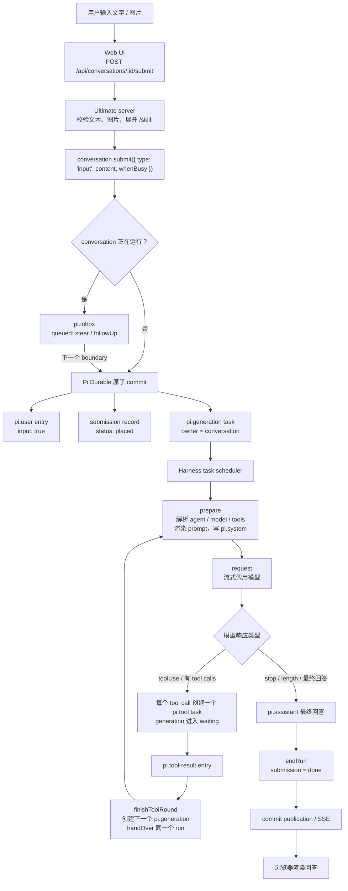
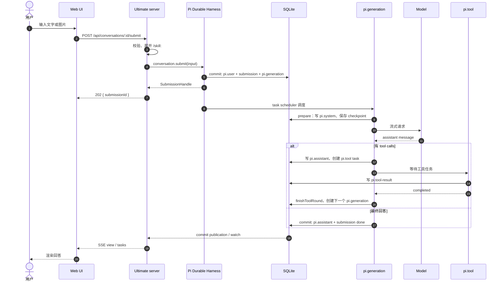

# 从用户输入到 Pi Durable 任务：Ultimate 全链路

> 范围：普通 conversation 的主链路。`branch`、`subagent`、`automation` 等扩展的细节见各自 README；本文只说明它们如何接入同一条主链路。
>
> 术语先分清：
>
> - **Ultimate 宿主**：本地 server、HTTP API、扩展注册表，以及给 Web UI 提供 SSE 的服务端。
> - **@ultimate**：运行在某个 conversation 里的 standing agent，不是宿主本身。
> - **run**：一次用户输入到最终回答的完整过程，可能包含多个 turn。
> - **turn**：一次模型响应及其触发的工具调用。
> - **task**：Pi Durable 的持久状态机记录，例如 `pi.generation`、`pi.tool`。

| 对象         | 在链路中的角色                                                             |
| ------------ | -------------------------------------------------------------------------- |
| Conversation | transcript + 该会话的 agent 配置；所有输入、任务和输出都围绕它             |
| Entry        | 不可变记录：`pi.user`、`pi.assistant`、`pi.tool-result`、`pi.system` 等    |
| Submission   | 一次输入的持久生命周期：`queued → placed → done / unanswered`              |
| Task         | 带 phase 和 checkpoint 的持久状态机：`pi.generation`、`pi.tool` 等         |
| Document     | 会话旁的 typed JSON：`pi.live`、`pi.inbox`、`pi.agent`、`ultimate.plan` 等 |

一句话概括：

> **Ultimate 把用户的文字变成一次 conversation submission；Pi Durable 在同一个原子 commit 中把 submission 变成 `pi.user` entry 和 `pi.generation` task；generation 调用模型，模型要工具就创建 `pi.tool` task，工具结果回来后创建下一个 generation，直到最终回答落库并结算 submission。**

---

## 1. 全链路图



这张图里有两个容易看错的地方：

1. **`pi.user` 和 `pi.generation` 是在同一个 commit 里创建的**，不是先写消息、再异步补任务。
2. **agent loop 不是进程里的一个 `while` 循环**，而是 `pi.generation → pi.tool → 下一个 pi.generation` 的持久任务链。

### 1.1 run 的任务链

同一个 run 的输入记录在 `pi.live.run`，它随任务交接而更新 `taskId`：

```text
pi.live.run = { taskId: G1, inputs: [S1] }
        │
        ├─ G1: pi.generation，第一次模型请求
        │      └─ pi.tool T1 / T2（由 G1 拥有）
        │
        │ finishToolRound：创建 G2，handOver
        ▼
       G2: pi.generation，第二次模型请求
        │      └─ pi.tool T3
        │
        │ finishToolRound：创建 G3，handOver
        ▼
       G3: pi.generation，最终回答
        │
        └─ endRun：S1 结算为 done
```

因此：

- 一个 **turn** 通常对应一个 `pi.generation` 任务；
- 一个 **run** 对应一串 `pi.generation` 任务；
- 一个 `pi.generation` 任务只负责一次模型请求及其工具轮次，不覆盖整个 run 的多次模型往返。

### 1.2 时序视角



---

## 2. 关键步骤解析

### 2.0 启动时：Ultimate 装配 Pi Durable

在用户输入之前，Ultimate 已经把运行时准备好：打开当前 chapter 的 SQLite，把模型、扩展注册表和设置交给 Pi Durable，并恢复上次未完成的任务。

```ts
// server/harness.ts（简化）
const storage = await openNodeSqliteStorage(chapter.database)
const harness = await Harness.open(storage, {
  models: modelRuntime,
  registry,                 // Ultimate 的扩展：tools / sections / hooks / tasks
  settings: createHarnessSettings(...),
  env,
  onReport,
}, context)
const root = await harness.root(context, { agent: { cwd: projectRoot } })
harness.resume()            // 恢复上次进程留下的 pending / sleeping 任务
```

这段装配决定了后面 agent loop 的边界：

- `registry` 让每个 conversation 能解析到 Ultimate 提供的工具、prompt sections 和 hooks；
- `models` 负责实际模型调用；
- `storage` 是所有 entry、document、submission、task 的唯一真相来源；
- `resume()` 让崩溃前没跑完的任务从最后一个 checkpoint 继续。

### 2.1 第 1 步：用户输入进入 Ultimate

Web UI 只负责把输入 POST 给服务端，不在浏览器里创建任务：

```ts
// web/src/sdk/api.ts（简化）
submit: (text, whenBusy, id, images) =>
  post(`/api/conversations/${id ?? shown()}/submit`, {
    text,
    whenBusy,
    images,
  })
```

服务端入口在 `server/api.ts` 的 `/api/conversations/:id/submit`。它做三件事：

1. 校验文本、图片 MIME 类型、base64 和大小；
2. 展开 `/skill:name args`，把 skill 指令附加到本次输入；
3. 把文本和图片组装成 `content`，调用 `conversation.submit()`。

```ts
// server/api.ts（简化）
const content = blocks.length
  ? [...(expanded.trim() ? [{ type: 'text' as const, text: expanded }] : []), ...blocks]
  : expanded

const submission = await conversation.submit(
  { type: 'input', content, whenBusy: data.whenBusy },
  context,
)
```

注意：到这一步为止，还没有任何 `pi.generation` 任务。任务是在 Pi Durable 的接纳事务里创建的。

### 2.2 第 2 步：Pi Durable 的原子接纳

`conversation.submit()` 最终进入 `admitSubmission()`。核心是一个原子 commit：

```ts
// pi-durable/dist/harness/submissions.js（简化）
await session.commitWith(async (tx) => {
  const boundary = await prepareBoundary(...)   // 调用 beforeInput hooks
  const entry = await appendInput(...)          // 写 pi.user，标记 input: true
  const id = (await tx.createSubmission({
    type: 'input',
    status: 'placed',
    entry: entry.id,
  })).id
  await startRun(tx, conversationId, live, [id]) // 写 pi.live.run + 创建 pi.generation
})
```

这个 commit 的结果是：

| 写入                 | 作用                                                          |
| -------------------- | ------------------------------------------------------------- |
| `pi.user` entry      | 保存用户原文，作为模型上下文的一部分                          |
| submission record    | 记录这次输入的生命周期：`queued → placed → done / unanswered` |
| `pi.live.run`        | 记录当前 run 的 `taskId` 和 `inputs`                          |
| `pi.generation` task | 真正执行模型请求的持久任务                                    |

#### `beforeInput`：Ultimate 的 per-input note

在同一个 commit 里，Pi Durable 会调用 `tx.beforeInput()`。Ultimate 的扩展通过 `GenerationTask.beforeInput` 插入本轮需要的上下文，例如：

- `todos.note`：开放 to-do 列表变化；
- `goal.note`：open goal 的权限和验收标准；
- `board.open`：等待用户回答的问题；
- `lineage` catch-up：branch 恢复时的“Meanwhile in …”；
- `prompt.build`：本次运行的 build 版本；
- `setup.note`：项目 setup 警告变化。

这些 note 和用户输入一起提交，所以模型第一次请求就能看到最新状态；它们不写进 system prompt，因此不会破坏 prompt cache。

### 2.3 第 3 步：文字在哪里，任务在哪里

这是最容易误解的地方：

```text
用户文字  →  pi.user entry
一次运行  →  pi.live.run
一个 turn →  pi.generation task
一次工具  →  pi.tool task
```

`pi.generation` 的 `task.input` 是 `{}`，不是用户文字。用户文字保存在 `pi.user` entry 中；`pi.live.run.inputs` 只记录 submission id。generation 每次从 conversation transcript 重新读取消息。

#### 例子：一条输入的完整记录

假设用户对 conversation `#12` 说：“修复登录页的错误提示。”提交后，存储里大致是：

```text
entries
  #101  kind = pi.user
        input = true
        model = [{ role: 'user', content: '修复登录页的错误提示' }]

submissions
  #7    type = input
        status = placed
        entry = 101

pi.live（conversation #12 的 document）
  run = { taskId: 501, inputs: [7] }

tasks
  #501  kind = pi.generation
        input = {}                         ← 不是用户文字
        owner = conversation #12
        state = { phase: 'prepare' }
```

模型第一次返回 tool call 后，generation 为它创建一个 `pi.tool` 任务：

```text
tasks
  #502  kind = pi.tool
        input = { kind: 'model', assistant: 102, callId: 'call_a' }
        owner = task 501

entries
  #102  kind = pi.assistant
        model = [{
          role: 'assistant',
          content: [{ type: 'toolCall', id: 'call_a', name: 'read', arguments: { path: 'Login.tsx' } }]
        }]
```

工具结果写入 `pi.tool-result` 后，`finishToolRound()` 创建下一个 generation：

```text
tasks
  #503  kind = pi.generation
        input = {}                         ← 仍然是空输入
        owner = conversation #12

pi.live.run = { taskId: 503, inputs: [7] }
```

最终回答落库时：

```text
entries
  #104  kind = pi.assistant
        model = [{ role: 'assistant', content: '已修复……' }]

submissions
  #7    status = done
        answer = 104

pi.live.run
  ← 被 endRun() 删除
```

可以看到，用户原文只出现一次，在 `#101` 这个 entry 里。任务 `#501`、`#503` 都只是“执行 conversation #12 的下一轮模型请求”，并不各自保存一份用户文字。

#### 为什么不能把用户文字塞进 `task.input`

反例：假设 `#501` 的 `input` 写成：

```json
{ "text": "修复登录页的错误提示" }
```

会马上遇到几个问题：

1. **一次 run 可能有多个输入。** 用户在 run 进行中发来 `steer` 或 `followUp` 时，`pi.live.run.inputs` 可能是 `[7, 8]`。一个 `task.input.text` 无法表达“这次运行要同时回答两条输入”。
2. **一次 run 会经过多个 generation 任务。** `#501` 调用工具后，下一轮是 `#503`。如果文字放在 task input 里，每次 handOver 都要把文本复制给下一个任务；复制越多，越容易和 transcript 不一致。
3. **fork / rewind / compaction 影响的是 conversation 的 entries，不是 task.input。** 新 branch fork 的是 conversation 的 transcript；如果文字只在 task.input 里，branch 的 generation 还需要额外复制一份文本，恢复和分叉语义会变复杂。
4. **`task.input` 是任务的“原始输入”，不是会话状态。** Pi Durable 的 `TaskRecord.input` 注释就是“Original task input retained while the task is live or terminal”（`types.d.ts:598-599`）。它适合保存任务自己的固定参数，不适合保存会随 conversation 演进的上下文。
5. **模型看到的上下文不是简单的“原文”。** reset、compaction、工具结果、system prompt 变化都会改变模型实际看到的 messages。task.input 里的一份原文很容易和真实上下文脱节。

#### `task.input` 到底放什么

不同 task 的 `input` 是它自己的执行参数，不是“用户的原始任务描述”：

| task             | `input` 的内容                         | 说明                                                          |
| ---------------- | -------------------------------------- | ------------------------------------------------------------- |
| `pi.generation`  | `{}`                                   | 执行当前 conversation 的下一轮模型请求；上下文从 entries 读取 |
| `pi.tool`        | `{ kind: 'model', assistant, callId }` | 执行哪个 assistant entry 的哪个 tool call                     |
| `lineage.prompt` | `{ id, prompt, images }`               | 向哪个 branch 投递哪条 prompt                                 |
| automation run   | `{ automation, firedAt, text }`        | 这次触发的 automation 参数                                    |

所以，分离不是“多存一份”，而是把不同性质的数据放在正确的位置：

```text
transcript（entries）  = 模型和用户看到的事实
pi.live.run            = 这次 run 关联哪些 submission
task.input             = 这个任务自己的固定执行参数
task.state.checkpoint  = 这个任务执行到哪一步
```

这样做的好处是：

- fork、rewind、compaction 后，文本和任务不会各存一份而失去同步；
- 任务记录只负责状态机，不复制会话内容；
- 同一个 run 可以在多个 generation 任务之间交接，而输入和上下文始终只有一份。

### 2.4 第 4 步：generation 的 prepare 与 request

`pi.generation` 是一个 `defineTask` 状态机，核心 phase 大致如下：

```ts
// pi-durable/dist/harness/generation.js（简化）
export const GenerationTask = defineTask({
  name: 'pi.generation',
  initial: () => ({ phase: 'prepare', attempt: 1 }),
  phases: {
    prepare, // 解析 agent/model/tools，渲染 prompt，写 pi.system
    request, // 调用模型流
    retry, // 可重试错误：sleep 后重试
    poll, // deferred 响应：sleep 后轮询
    tools, // 等待并收尾本轮工具任务
  },
})
```

`prepare` 做的主要事情：

1. 从 `pi.agent` 解析当前 conversation 的 model、thinkingLevel、扩展和工具；
2. 渲染 system prompt sections；
3. 只有当 prompt 或工具集变化时，才追加 `pi.system` entry；
4. 计算 cutoff，保存 `{ phase: 'request', model, cutoff, ... }` checkpoint。

`request` 做的主要事情：

1. 从 conversation 读取上下文；
2. 调用模型流；
3. 把 partial 输出定期提交到 `pi.live.generation`，默认最多每 100ms 一次；
4. 根据 `stopReason` 分流：`toolUse` 进入工具轮，`stop` / `length` 进入最终回答，错误按 retry / compaction / fail 处理。

如果上下文超限，generation 会创建 `pi.compaction` 子任务，等待摘要完成后重试请求；压缩本身也是 durable task。

这里的关键设计是：**流式输出也是 durable 的**。UI 看到的增量不是只存在于内存，崩溃最多丢失一个 partial commit 窗口。

### 2.5 第 5 步：agent loop = generation 与 tool 的任务链

当模型返回 `toolUse` 且有 tool calls 时，generation 不会在进程里直接调用工具，而是为每个调用创建一个 `pi.tool` 任务：

```ts
// generation.js（简化）
const taskId = await createToolTask(tx, runtime, assistant, call.id)
// ownership: { kind: 'task', taskId: generationTaskId }

return {
  status: 'waiting',
  checkpoint: { phase: 'tools', tools },
  on: tools,
  policy: 'allSettled',
}
```

工具任务执行完后（正常回合）：

1. 工具结果写入 `pi.tool-result` entry；
2. 同一个 generation 在 `tools` phase 收尾；
3. `finishToolRound()` 创建一个新的 `pi.generation`，并把 `pi.live.run.taskId` 交接给新任务；
4. 新 generation 从 `prepare` 开始，带着新增的工具结果再次请求模型。

```ts
// generation.js（简化）
handOver(live, runtime.taskId, await createGeneration(tx, conversationId))
```

这就是 Pi Durable 的 agent loop：

```text
pi.generation（模型请求）
   ↓ 有 tool calls
pi.tool × n（独立持久任务）
   ↓ 结果回到 transcript
pi.generation（下一次模型请求）
   ↓ ...
pi.generation（最终回答）
```

每一步都是独立任务、独立 checkpoint，因此可以在任意一步崩溃后恢复。

### 2.6 第 6 步：最终回答与 submission 结算

最终回答不会只写一条消息就结束，它还要结算本次输入：

```ts
// generation.js（简化）
await runtime.commit(async (tx) => {
  const entry = await appendAssistant(tx, conversationId, message)
  endRun(tx, live, runtime.taskId, {
    status: 'done',
    answer: entry.id,
  })
  if (users.length > 0) await startRun(tx, conversationId, live, users)
})
```

`endRun()` 会：

- 把 `pi.live.run.inputs` 里的每个 submission 结算为 `done`；
- 写入 `answer` entry id；
- 清除 `pi.live` 中本轮 generation / tool 的展示状态；
- 如果 final boundary 选中了排队的 follow-up，则立即用它们开启下一个 run。

失败时则结算为 `unanswered`，并带 reason，例如 `model_error`、`no_model`、`aborted`、`reset`。

### 2.7 第 7 步：UI 如何看到结果

UI 不轮询任务，也不复制状态。服务端通过两个 watch 把已提交状态投影给浏览器：

- `conversation.watch()`：transcript、documents、`pi.live`（partial、工具状态）；
- `harness.taskGraph()`：当前所有 live task 的树。

`server/api.ts` 把它们转换成 SSE 的 `view`、`tasks`、`doc` 事件。浏览器收到后渲染：

- 消息流来自 `pi.user` / `pi.assistant` / `pi.tool-result` entries；
- 工具卡片来自 `pi.tool` task 和 `pi.live`；
- Tasks 面板来自 `taskGraph`；
- 流式文字来自 `pi.live.generation.message` 的 partial 提交。

因为所有内容都先 commit 再 publish，所以刷新页面不会改变事实，UI 只是 durable state 的投影。

---

## 3. 会话忙时：steer 与 followUp

如果提交时 conversation 正在运行，输入不会立刻创建 generation，而是先进入 `pi.inbox`：

| 情况                       | 写入                                | 何时真正执行                             |
| -------------------------- | ----------------------------------- | ---------------------------------------- |
| 空闲                       | `placed` + 立即创建 `pi.generation` | 当前提交的 commit 后                     |
| 忙，`whenBusy: 'steer'`    | `queued`，inbox mode = `steer`      | 当前 tool round 结束后插入当前 run       |
| 忙，`whenBusy: 'followUp'` | `queued`，inbox mode = `followUp`   | 当前 run 最终回答后，作为下一个 run 开始 |
| 忙，`whenBusy: 'reject'`   | 不接纳，抛 `ConversationBusy`       | 不会执行                                 |

Ultimate 只使用 `steer` 和 `followUp`，并把 `followUpMode` 设为 `"all"`：下一个 run 会一起取走所有排队的 follow-up，而不是一次只取一个。

```text
idle:
  submit → placed → pi.generation → ... → done

busy + steer:
  submit → queued(pi.inbox) → 当前 tool round 后 → placed → 加入当前 run

busy + followUp:
  submit → queued(pi.inbox) → 当前 run 最终回答后 → 下一个 run
```

`pi.inbox` 是 document，不是内存队列，所以进程重启后排队输入仍然存在；`submission.abort()` 可以撤回尚未 placed 的输入。

---

## 4. 崩溃恢复与 durable 语义

| 场景                  | Pi Durable 的行为                                                      |
| --------------------- | ---------------------------------------------------------------------- |
| 模型流中途崩溃        | generation 从最后一个 checkpoint 继续；已提交的 partial 和工具结果保留 |
| 工具执行中断          | `replay: 'safe'` 的工具重跑；否则结果为 `interrupted`，模型看到失败    |
| 进程在 commit 后崩溃  | 提交已持久化，UI 重连后从快照恢复                                      |
| 排队输入              | 存在 `pi.inbox`，重启后仍在                                            |
| 连续崩溃 5 次         | task 被 crash-loop guard 标记为 parked，需要用户在 Tasks 面板点 Retry  |
| 相同 `requestId` 重试 | 复用已有 submission，不会重复写入                                      |

`server/harness.ts` 在打开 SQLite 后调用 `harness.resume()`，恢复所有未完成任务。所有任务状态都在 `state.sqlite` 中，进程重启不会从头开始。

---

## 5. 当调用者是 @ultimate：再套一层

上面讲的是“任意 conversation”的主链路。用户通常和 **@ultimate** 对话，它是运行在某个 conversation 里的 standing agent，输入路径完全一样；区别在于它的 generation 可能调用 `branch` 等工具，把工作分派出去。

```text
用户 → @ultimate conversation
          └─ pi.generation（@ultimate）
               └─ pi.tool: branch
                    ├─ fork 出 branch conversation
                    ├─ 写 lineage.branch document
                    └─ board.delivery / lineage.prompt task
                         └─ 向 branch 提交第一条输入
                              └─ branch 自己的 pi.generation → ...
```

几个关键点：

- `branch` 工具本身是 @ultimate generation 的一个 `pi.tool` 任务；
- branch 是新的 top-level conversation，有自己的 `pi.live.run` 和 generation 链；
- branch 的第一条输入通过 `board.delivery` 或 `lineage.prompt` 任务投递，所以崩溃不会留下“有 branch 但没有第一条输入”的状态；
- coordinator 的 `plan` 工具写的是 `ultimate.plan` **document**，不是 Pi Durable task；只有某个 plan task 真正被执行时，才产生 `pi.generation` / `pi.tool`；
- `subagent` 会创建 child conversation 和 `ultimate.subagent-anchor` / reporter task；child 的 `task` 文本作为它的第一条输入，再走一遍同样的 generation 链。

所以，“用户的文字描述任务”在 Ultimate 里通常经历两次映射：

1. **运行时映射**：文字 → submission → `pi.user` + `pi.generation`；
2. **语义映射**：@ultimate 的模型根据文字决定是否 `branch` / `plan` / `subagent`，把工作拆成 conversation、document 和更多 runtime task。

---

## 6. 职责边界

| 层                | 负责                                                                                                    |
| ----------------- | ------------------------------------------------------------------------------------------------------- |
| **Ultimate 宿主** | HTTP API、输入校验、扩展注册表、prompt sections、tools、hooks、SSE、Web UI 数据投影                     |
| **Pi Durable**    | Storage / commit、entries、documents、submissions、tasks、scheduler、model stream、task graph、崩溃恢复 |
| **@ultimate**     | 通过工具做编排决策：branch、plan、subagent、message；不实现运行时                                       |
| **扩展**          | 通过 `GenerationTask.beforeInput` 等 hook 往输入前插入 note；通过 tools 提供能力                        |

一句话：**Ultimate 决定“这个 agent 能做什么、看到什么”，Pi Durable 决定“这次运行如何持久地执行、恢复和展示”。**

---

## 7. 核心代码索引

下表的 Pi Durable 路径省去了 `node_modules/@earendil-works/` 前缀。

| 位置                                             | 作用                                                                                     |
| ------------------------------------------------ | ---------------------------------------------------------------------------------------- |
| `web/src/sdk/api.ts:91`                          | Web SDK 的 `submit()`，发送 POST                                                         |
| `server/api.ts:495-576`                          | `/api/conversations/:id/submit` 路由、校验、`/skill:` 展开、调用 `conversation.submit()` |
| `server/harness.ts:234-281`                      | `Harness.open()`、SQLite、扩展 registry、`resume()`                                      |
| `pi-durable/dist/harness/submissions.js:36-56`   | `Submissions.submit()`：提交入口和 telemetry                                             |
| `pi-durable/dist/harness/submissions.js:147-225` | `admitSubmission()`：原子接纳、idle/busy 分流、创建 entry/submission/task                |
| `pi-durable/dist/harness/inbox.js:17-23`         | `prepareBoundary()`：调用 `beforeInput` hooks                                            |
| `pi-durable/dist/harness/inbox.js:81-87`         | `appendInput()`：写入 `pi.user`，`input: true`                                           |
| `pi-durable/dist/harness/generation.js:22-220`   | `GenerationTask` 的 prepare / request / retry / poll / tools phases                      |
| `pi-durable/dist/harness/generation.js:229-230`  | `createToolTask()`：为每个 tool call 创建 `pi.tool` 子任务                               |
| `pi-durable/dist/harness/generation.js:373-457`  | `classify()`：按 `stopReason` 分流到工具轮或最终回答                                     |
| `pi-durable/dist/harness/generation.js:459-490`  | `answer()`：写最终 assistant entry、`endRun()`、启动下一个 run                           |
| `pi-durable/dist/harness/generation.js:492-580`  | `startToolRound()` / `finishToolRound()`：工具轮与 generation 交接                       |
| `pi-durable/dist/harness/generation.js:595-600`  | `startRun()` / `createGeneration()`：写 `pi.live.run` 并创建 generation task             |
| `pi-durable/dist/harness/live.js:27-38`          | `endRun()`：结算 submission、清理 live 状态                                              |
| `server/api.ts:147-346`                          | `taskGraph()`、`conversation.watch()`、SSE `view` / `tasks` 投影                         |
| `docs/task.md:102-130`                           | 从用户输入到运行的既有说明                                                               |
| `docs/durability.md`                             | 持久化、replay、恢复的细节                                                               |

---

## 8. 常见误解

- **“用户输入就是一个 task”**：不准确。输入先成为 submission 和 `pi.user` entry；任务是由 `startRun()` 创建的 `pi.generation`。
- **“一个输入只对应一个 generation task”**：不准确。一次 run 可能包含多个 turn，每个 turn 是一个 `pi.generation`，通过 `handOver` 串起来。
- **“agent loop 是 server 里的 while 循环”**：不是。它是 durable task 链，每一步都可以独立 checkpoint 和恢复。
- **“plan 里的 task 就是 Pi Durable task”**：不是。`ultimate.plan` 里的 epic/task 是 document；只有实际执行时才产生 `pi.generation` / `pi.tool`。
- **“流式输出只存在内存”**：不是。partial 会定期提交到 `pi.live.generation`，默认间隔 100ms。
- **“UI 先显示，后落库”**：相反。所有 entry、document、task 都先 commit，再通过 watch/SSE 投影到 UI。
